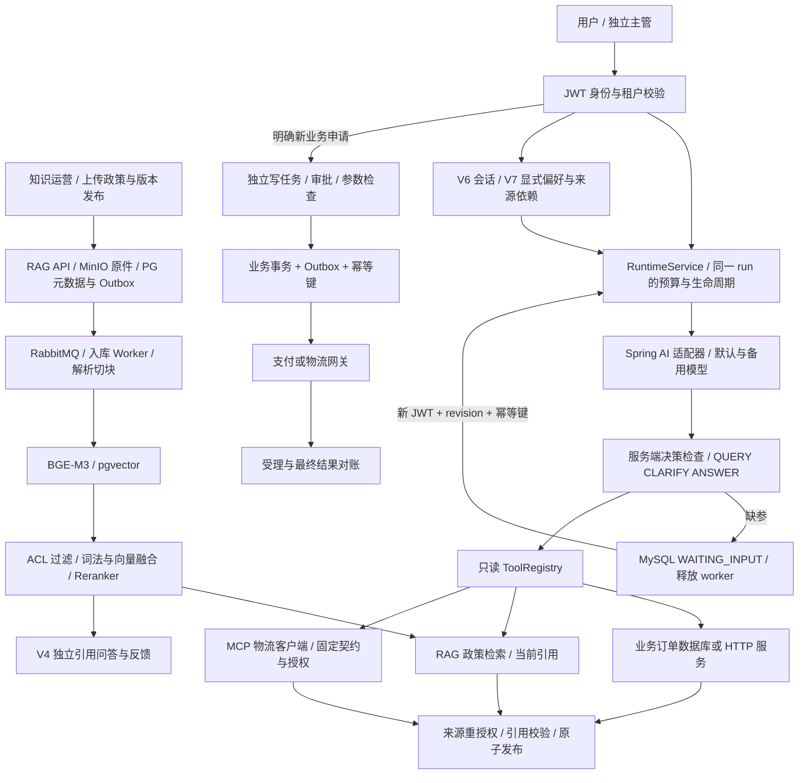

# Java AI Agent 面试讲解包

状态基线：2026-11-05，生产代码已编译，9 项本地定向用例最终通过；真实模型/企业集成/生产部署结论以 [验证记录](verification-v11-2026-11-05.md) 为准。以下讲解应由项目作者结合实际理解改写，不冒充真实线上业务经历。

完整演示入口：[V1–V11 公司售后全流程计划](company-demo-plan.md)。包含 Docker 服务、启动顺序、身份/授权、政策上传与版本发布、RAG 问答、Java Agent、记忆、MCP、审批退款和收尾；本次只编写计划，执行交给后续模型。原 [V10 演示](demo-v10.md) 是其中 Agent 环节的补充，不能代替完整业务流程。

## 90 秒项目介绍

> 我围绕售后场景实现了一个 Java Agent，既能查询订单、物流和政策，也能在用户明确申请后进入独立审批的退款流程。
>
> 政策来自运营上传的真实文件：通过对象存储、消息队列和 worker 异步解析切块，用 BGE-M3、pgvector、词法融合和重排检索；文档支持版本发布与回滚，回答引用当前有权访问的内容。
>
> Spring AI 负责模型协议和工具调用建议，Java 执行器负责权限、预算、状态和最终结果校验。RAG 提供政策证据，MySQL 保存任务、审批、记忆和执行账本；MCP 物流工具有固定契约和独立授权。
>
> 我重点处理了三个问题：缺少订单号时持久化暂停，回复后沿用原预算并重新查证；知识无结果时只允许有限重规划，权限和预算问题直接停止；写操作通过审批、幂等和 Outbox，区分受理与最终成功。
>
> 最近在真实 Spring 容器和隔离 MySQL 上完成了 9 项小样本验证，修复了长期记忆创建的 Spring 代理字段访问问题。模型和支付使用本地替身，因此这些证据说明工程链路能工作，不代表真实供应商质量或生产 SLA。

## 一张架构图

图中模型输出属于待校验数据；用户身份、工具执行和数据库提交由服务端控制。V10 澄清入口没有自动导入 V6/V7 会话/偏好，也不会自动把查询转为退款申请。演示时要明确各入口。

## 五分钟讲解顺序

| 时间 | 展示与说明 | 证据位置 |
| --- | --- | --- |
| 0–1 分钟 | 从运营上传文件开始，展示入库 job、检索引用和版本发布 | 公司流程 A–C；已有 RAG 验证记录 |
| 1–2 分钟 | 引用问答及 Java 使用同一政策、订单和 MCP 物流 | 公司流程 D–F；按实际调用轨迹说明覆盖 |
| 2–3 分钟 | 缺参暂停、同 run 恢复、预算累计，区分会话与长期记忆 | clarification_resume、公司流程 G |
| 3–4 分钟 | 独立申请退款、审批、Outbox 确认与幂等 | sandbox_refund、公司流程 H |
| 4–5 分钟 | 当前来源撤权、审计、已修复的代理问题和验证边界 | 公司流程 I、V11 已有报告 |

## 高频追问

**政策从哪里来？不是把几段文字写在 prompt 里吗？**

运营上传文件后，原件进入对象存储，数据库 Outbox 与 MQ 驱动 worker 解析、切块和向量化；搜索在授权范围内做词法/向量融合与重排。回答引用具体文档版本和 chunk。演示要保留上传 job 到引用版本的对应关系，不能只展示一段无法追溯来源的答案。

**政策改版后，为什么不会同时检索两套冲突政策？**

同一 document 的新版本先完成入库，再通过当前 content_revision 发布并切换 active version。未发布的 READY 版本不是默认检索最新版；历史版本可用于追溯/回滚。发布权限、审批流程和当前引用重授权需要分别解释，现有系统没有强制文档双人审批。

**为什么业务库和向量库分开？**

MySQL 保存实时订单、审批、幂等和执行账本；PG/pgvector 保存知识内容与检索索引。订单事实查询业务系统，政策依据检索知识库。长期记忆以 MySQL 的 owner、revision、状态和来源为权威，向量索引只负责候选召回，不授予访问权。

**为什么没有直接用一个自治 Agent 跑完整退款？**

模型建议和业务授权是两回事。退款具有副作用，我把金额、订单、审批主体、幂等键和外部确认放在显式工作流中。自然语言、检索命中或历史偏好都不能批准写操作。

**Tool Calling 与 Workflow 在这里分别做什么？**

Tool Calling 决定下一项候选只读查询，执行器校验后调用。Workflow 管理跨请求、审批、暂停、异常和外部结果状态。Spring AI 不替我保证权限、幂等或持久化恢复。

**为什么用 MySQL 保持澄清状态？**

项目已经使用 MySQL 保存审计和预算，同库事务可以原子提交任务等待态、run 等待态和待补字段。等待时释放 worker；恢复不依赖原线程和原 JWT。代价是状态和事务边界要自己设计，且单库可用性需要部署保障。

**怎么避免用户每次回复重新获得预算？**

整链复用同一 run，模型次数、工具次数、token/费用和备用模型额度持续累计。暂停时扣除已用执行时间；用户等待时间单独受 TTL 和整链生命周期限制。恢复只有当前 owner/tenant 和正确 revision 才能进入。

**什么情况会重规划？**

服务端白名单决定。授权知识检索无结果可以有限改写；本地业务编号无结果要求用户核对。权限拒绝、MCP 隐藏式 NOT_FOUND、来源变更、预算和取消都不能交给模型换路绕过。最多两次自动修订，重复动作拒绝。

**记忆和 RAG 有什么不同？**

RAG 回答“当前政策有什么证据”；记忆辅助个性化和理解历史。个人偏好需要确认，业务事实仍要重新查询。向量索引只帮助召回，MySQL 是授权与版本的依据；遗忘或来源变化会使相关历史不可再使用。V11 验证了显式偏好和遗忘依赖，没有验证向量链路质量。

**引用能保证模型完全正确吗？**

不能。现有门禁验证来源存在、当前可读和引文确实出自本阶段证据，不能证明每条自然语言结论都被原文语义蕴含。语义质量需要独立样本评测，不能用通过 JSON 格式校验来代替。

**取消是否保证供应商不计费？**

不能。取消会阻止后续工具和最终答案提交，尽力取消本地等待；请求可能已被供应商接收。没有可信 usage 时保守计入预留额度。真实 provider usage 与估算价格、供应商账单必须分开说。

**如何避免重复退款？是否 exactly-once？**

申请幂等、审批状态门禁、业务幂等键和 Outbox 租约共同限制重复。外部系统仍必须支持幂等或可对账；不确定结果进入查询/人工路径，不能盲重放。不能把本地事务说成跨网络的绝对 exactly-once。

**最有价值的一次问题修复是什么？**

真实 Spring 集成测试发现创建记忆 500。代码直接读 Repository 代理的 jdbc 字段，拿到 null；手动构造对象时可能正常。修复为通过仓储方法访问私有 JdbcTemplate，保留事务和异常转换，复验了偏好创建、使用以及遗忘撤销历史的完整路径。这也解释了为什么少量真实集成测试比堆同构 mock 更有用。

**为什么没有加多 Agent 或换图框架？**

当前主要问题是授权、状态与副作用边界，多 Agent 会增加调用成本和调试面。已有状态机足以表达当前流程；只有出现明确的并行任务、复杂图结构或协作需求，再通过小规模比较决定是否迁移。

## 简历可用表述

- 基于 Java / Spring AI 构建售后 Agent，将只读工具调用与审批写流程分离，实现引用门禁、持久澄清、有限重规划和任务回放。
- 基于 MySQL 事务实现同链预算累计、幂等恢复与取消提交互斥，并为退款流程保留审批、Outbox 和外部结果确认。
- 完成 9 项本地定向集成验证，覆盖澄清恢复、来源撤权、并发取消及 sandbox 退款幂等；定位并修复 Spring Repository 代理字段访问故障。

不要添加“生产日均处理量”“准确率提升 X%”“成本降低 X%”“已上线企业 OIDC/MCP 全链路”等没有证据的表述。介绍 AI 辅助开发时如实说明分工，确保能独立解释关键代码、失败用例和取舍。

## 开始面试前的自查

脱离文档画出上面的边界；用自己的话解释同 run 恢复为什么不增加预算；指出最后答案校验和退款审批分别在哪里；能演示一次失败而不仅是成功路径。先练清楚这些，再决定是否继续开发新功能。
