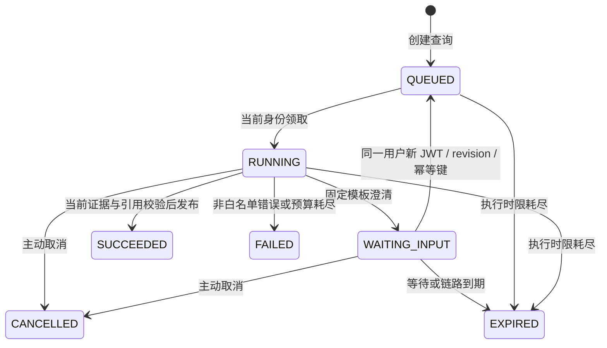

# V10：缺参澄清、受控重规划与计划回放

交付日期：2026-11-05。生产目标代码和测试设计已编写；**未编译、未实现/执行测试、未运行迁移、未调用真实模型、未做部署验收**。验证交给后续模型，见 [测试交接](testing-v10-handoff.md)。

## 交付范围

新增 `/dialogue.html` 与 `/api/v1/agent/dialogues`，复用 V9 同一条 run、同一任务、Spring AI 工具循环、只读工具注册表、来源校验和预算账本。旧单轮聊天、V6 会话入口保持原来的问答语义，不将所有历史会话自动变成澄清任务。

V10 的计划是**逐步确定下一项只读动作的滚动计划**：明确 QUERY / CLARIFY / ANSWER、失败原因、父版本和修订版本；不生成一个未经检查的长工具脚本，也不持久化模型的隐式思维过程。代码包括：

- `DialogueScope`：受控决策、字段白名单、业务编号检查、重复动作门禁和可恢复错误分类。
- `RuntimeLedger`：持久等待、输入幂等/CAS、累计执行时限、计划事件和恢复准入。
- `RuntimeService`：释放 worker、使用恢复请求的新 JWT 执行、恢复前来源校验。
- `ChatAuditService` / `TaskStatus`：任务 `WAITING_INPUT` 与 run 等待状态一起提交，步骤序号跨阶段连续。
- 页面：恢复已有查询、补充指定字段、计划回放、累计估算费用、主动停止、提交失败时使用原幂等键重试。

## 状态与并发边界

`agent_runs` 新增 V10 限制快照、待补字段、输入 revision、计划版本、重规划次数、等待/链路到期时间、剩余执行毫秒数；`agent_dialogue_inputs` 保存有序用户输入及幂等键。迁移是 [V12](../../src/main/resources/db/migration/V12__agent_dialogue.sql)，不等于应用版本编号。

暂停在 run 行锁内完成任务状态、剩余额度、待补字段及审计事件的原子提交；事务内没有模型或来源校验网络请求。任务提交失败则一起回滚。随后 worker 和 ThreadLocal 被释放，不保存 JWT，不持有模型连接，不定时自动调用模型。SSE 观察者遇到等待快照即结束；新页面等待时也不轮询。

恢复仅接收等待中的同一 tenant/owner，必须匹配 `dialogue_revision` 和 `clarification_field`。同 key 同输入只返回状态，同 key 不同输入冲突；不同 key 竞争同 revision 只有一个进入队列。输入提交与排队之间崩溃时，不猜测重放付费调用：到期后收尾。已提交的等待状态在重启后可凭新身份恢复。

暂停提交后，用户可能极快地发回补充输入；旧 worker 通过专用暂停结果直接退出，不读取新阶段状态，也不错误结束新阶段。取消和恢复通过同一个 run 行锁竞争；等待态取消直接终止，任务审计由既有收尾任务关闭。绑定 runtime 的任务须使用 run 取消入口，旧 task-only 取消入口返回冲突，避免绕过取消/答案发布的同一把锁。

## 预算与时间

整条澄清链保留 V9 `attempt_count`、`tool_count`、实际/未知 usage 记账、预留、费用、token、一次备用模型机会以及原始 UTC 日钱包。回复不会产生新 run，也不会获得新预算。

默认：60 秒**累计执行时间**（含各阶段排队及工具/校验等待），6 次模型尝试、8 次业务工具调用，自动重规划最多 2 次、补充输入最多 3 次；费用/token 由 V9 配置决定。等待输入不消耗执行时间；单次等待最多 900 秒，整链最多 1800 秒。活动阶段 deadline 是剩余执行时间、链路到期和当前 JWT 到期三者的最小值。

`execution_remaining_ms` 是最近暂停边界保存的余额，不是持续刷新的实时剩余时长；执行中的有效 deadline 看 `deadline_at`。`deadline_at` 在等待时表示待回复期限，状态必须一起解释。等待中的 run 计入用户活动查询数量，防止无限创建悬挂任务。输入最多 2000 字符，至多原问题加 3 条补充，不积累模型工具消息。

原钱包日固定意味着跨 UTC 日恢复仍计入创建日；这沿用 V9 的执行链记账约定。价格版本按每次尝试记录；部署币种改变后旧链禁止恢复或继续模型调用。费用依旧是配置价格估算，未知 usage 保守结算预留；不是供应商账单的硬封顶。

## 澄清和重规划规则

模型获得额外的 `agent_clarify` 控制决策，只能提交 `field=orderId|ticketId|details`；问题文本由服务端模板生成，不接收模型自由编写的提示或业务断言。每轮最多一个工具决策；并行批次、未知字段或非法形状直接停止，避免半批次执行和未配对工具消息。澄清不执行注册表工具，不产生写操作；生成澄清决策的模型调用正常计费。

实际调用业务工具前还检查缺参：缺少字段转澄清，订单/工单编号必须能在用户原问题或补充资料中按完整 token 找到，不能由模型猜测；已结构化补充的编号优先，模型使用旧编号会被拒绝。用户补充的编号格式为 1–80 位字母、数字、下划线或连字符；实际 MCP 等工具还保留自己的更严格校验。

| 观察 | 执行器策略 |
| --- | --- |
| `knowledge.search` 抛出 `NO_EVIDENCE` | 记录新计划版本，消费一次自动重规划额度，把无结果观察反馈给模型；只允许继续有限只读决策或澄清 |
| 本地 order/payment/shipment/ticket 查询抛出 `NOT_FOUND` | 记录修订并要求用户核对订单/工单号，不猜新编号 |
| `MCP_NOT_FOUND`、授权拒绝、来源撤销/变更 | 立即停止；MCP 不存在可能隐藏无权限，不换本地查询绕过 |
| 模型限流/暂时失败/超时 | 仅沿用 V9 的一次允许列表内备用切换；不增加工具重试，不重置预算 |
| 工具超时、取消、预算上限、无效引用或其他错误 | 停止；保留明确原因，不让模型自由改写失败含义 |
| 同阶段重复相同工具和参数 | 归一化空格/大小写后拒绝；语义相同但不同文本由总次数上限继续约束 |

失败的知识检索不加入证据。发生知识缺口后，即使经过暂停恢复，也必须获得本阶段的新知识证据才能最终回答；不能只查订单绕过缺失政策。初始自然语言需求的语义完整性仍依赖模型与既有引用门禁，引用包含性不等于已证明语义蕴含。

恢复只重建原问题和有界用户补充资料，不复用旧工具正文/引用。继续执行前校验旧任务的 RAG/MCP/记忆来源图；权限失效则停止。新的 ToolContext 使用恢复请求的当前角色；新事实必须重新查工具。最终回答继续走 `GroundedAnswer`，读取结果也重新授权。禁止通过重规划执行退款、改地址等写操作；退款由独立任务/审批/Outbox 路径处理。

## API

所有 API 使用原 JWT 验证与租户边界；公开 HTML/JS 不包含任何业务数据。

| 请求 | 契约 |
| --- | --- |
| `POST /api/v1/agent/dialogues` | `Idempotency-Key` 必填；`{"message":"帮我看看能不能退款"}`；202 返回 run 元数据 |
| `POST /api/v1/agent/dialogues/{id}/inputs` | 新幂等键；`{"revision":0,"field":"orderId","value":"ORD-1001"}`；必须使用当前待补字段/版本；202 |
| `GET /api/v1/agent/dialogues/{id}/plans` | owner-only 结构化计划/修订/终止事件，最多 200 项；不含输入原文、工具参数或模型思维过程 |
| `GET /api/v1/agent/runs/{id}` | 等待态包含固定模板 question、待补字段、版本和累计费用；状态读取不触发模型 |
| `GET /api/v1/agent/runs/{id}/events` | 沿用 V9 认证 SSE 和 Last-Event-ID；等待即关闭观察，不取消业务 |
| `GET /api/v1/agent/runs/{id}/usage`、`/result` | 原尝试账本、重新授权后的最终答案；等待时不可读最终答案 |
| `POST /api/v1/agent/runs/{id}/cancel` | owner 主动取消，等待态无需启动 worker |

新页面运行时每秒刷新状态/安全计划摘要，单次观察上限 130 秒；补信息、刷新、断网重试均不偷偷新建任务。刷新页面后从“我的查询”选择已有 run。前端不存储 JWT，身份变化清空视图，答案以 `textContent` 渲染。普通 HTTP 暂时失败不会由服务端自动重放模型。

## 部署与回退设计

1. 后续验证者先在隔离 MySQL 应用 V12，执行有限编译与 [交接用例](testing-v10-handoff.md)；本轮未做这些操作。
2. 合并 [runtime 配置](../../deploy/runtime.env.example) 与 [dialogue 配置](../../deploy/dialogue.env.example)。必须启用 JDBC、V9、Spring AI 和明确的租户/价格/预算；V10 默认关闭。身份、TLS、MCP 授权、RAG 来源门禁沿用此前生产要求。
3. 部署时先关闭新流量或排空运行，再统一升级；不要让不了解 WAITING_INPUT 的旧进程与新进程共享活动链路。V12 是追加迁移，但新增任务状态不保证旧二进制兼容。
4. 回退前停止入口，等待/取消 V10 run 并完成审计收尾，再降级代码；不要删除账本或回滚已结算用量。仅关闭 V10 可停止新澄清/恢复，V9 仍可取消与收尾旧 run。
5. 用户输入表按现有任务审计的授权、备份及保留制度管理；TTL 限制可继续执行的时间，不等于删除审计数据。当前没有新增自动删库任务。

## 取舍与面试交付

复用同一 run 避免跨多个子 run 聚合预算的竞争；暂停时释放资源，同时保留精确的恢复条件。滚动只读计划能展示观察驱动决策，但每种可恢复错误仍由服务端授权。选择固定澄清模板减少无依据业务话术，代价是缺参类型只有三种、复杂表单需后续扩展。

V10 入口目前不自动导入 V6 会话和 V7 偏好，也不把写申请自动衔接为聊天副作用；这些能力通过已有入口在 [演示手册](demo-v10.md) 中串联。这样用户确认退款、独立主管审批和外部结果确认都有明确的业务边界。此轮补齐代码和演示/验证设计，不代表已取得部署或面试演示通过证据。
