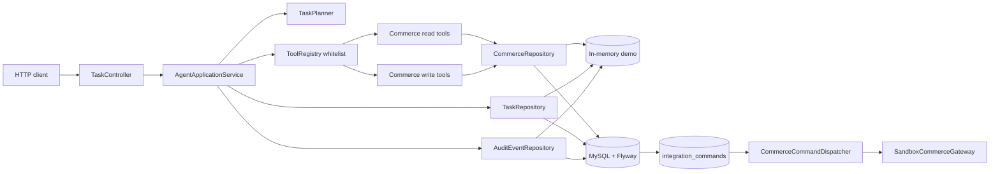
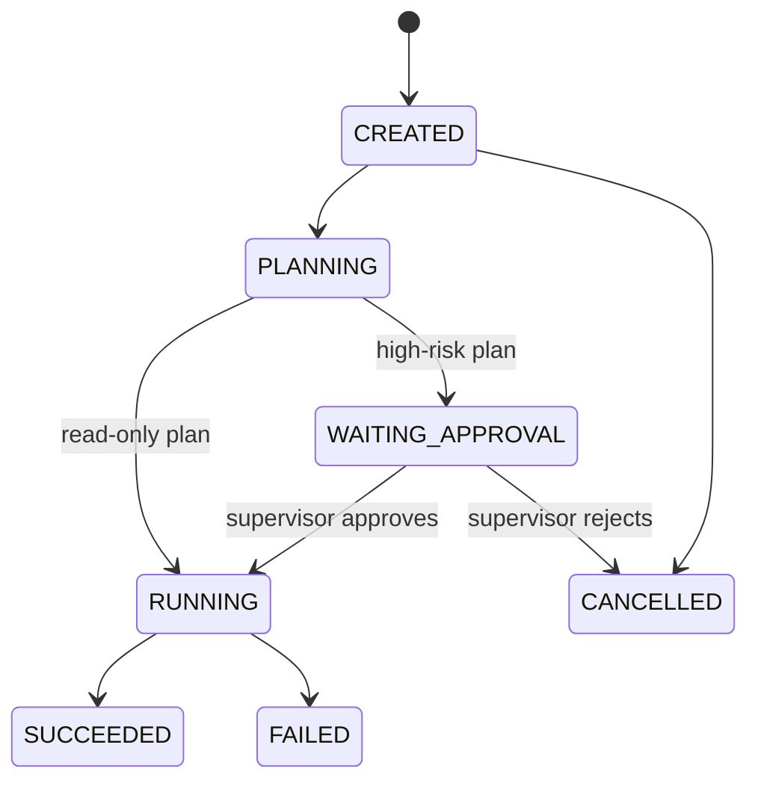

# Architecture

The service owns the state transition and execution loop. The deterministic planner is the offline default; the optional DeepSeek adapter implements `TaskPlanner` and receives no direct access to tool implementations. `ToolRegistry` is the execution boundary for role checks and tool-name allowlisting. Set `AGENT_PERSISTENCE=jdbc` to use MySQL for tasks, audit events, and commerce data; memory remains the default for local tests. Write tools commit business rows and `integration_commands` in one transaction, and the dispatcher settles them through a replaceable gateway adapter.

## State machine

