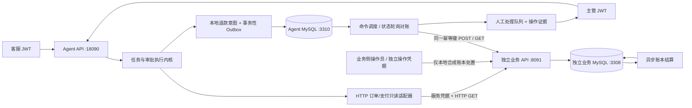
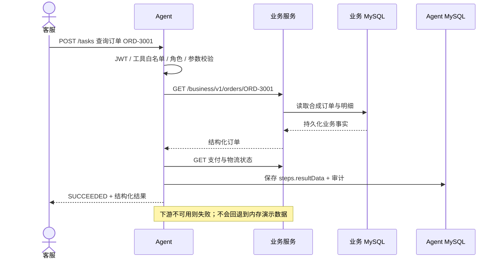
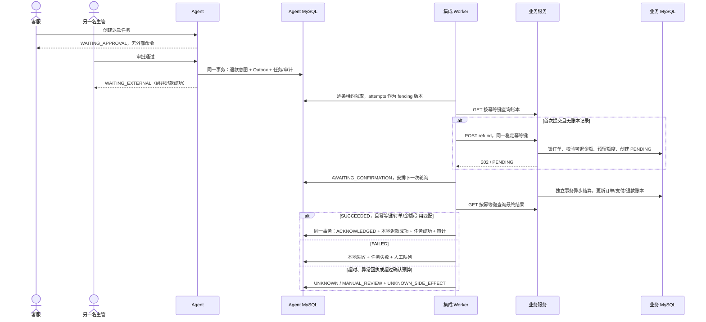
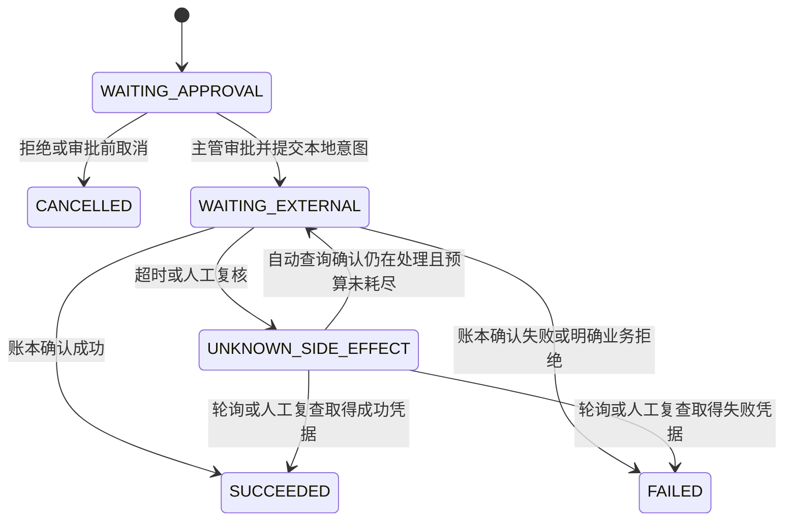
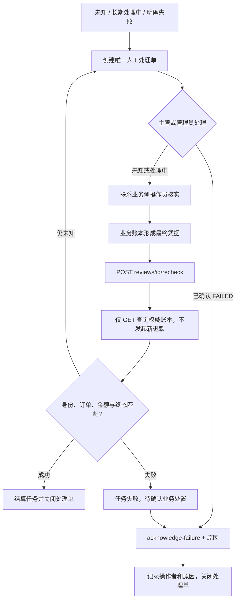

# 独立业务系统接入、退款闭环与流程图

## 1. 范围和边界

本轮按用户要求，使用本地 Docker 建设一个独立订单/支付业务服务。**业务服务、HTTP 请求、MySQL 事务和账本变更是真实执行的；客户、地址、商品和资金均为合成数据，不产生真实支付。** 这不是银行/支付公司/承运商生产接口的认证或联调完成证明。

已接入：订单与支付只读查询；一种写操作 `refund.create`；退款幂等、状态查询、定时轮询对账、有限确认预算、人工队列和操作审计。本轮采用轮询，不依赖回调。

尚未接入：真实承运商、银行/支付平台、外部工单、租户/组织数据范围、完整任务 Worker/心跳、生产审计 Sink、告警与灾备。HTTP 模式的改地址/发货写入明确拒绝，不降级到沙箱。合成订单都未发货，物流查询为空；不能据此声称完成了物流平台集成。

## 2. 架构图



Agent 只持有业务 API 凭据，不持有业务数据库凭据或业务侧操作员凭据。两个数据库使用不同容器、schema、账号和卷。旧 `compose.yaml` 的演示库与新环境完全独立。

## 3. 只读接入流程



`steps[].resultData` 新增到任务响应并写入 `task_steps.result_json`，重启后仍可查询。HTTP 模式 `source=http-business`，原演示模式行为保留。

## 4. 退款与轮询对账流程



业务 HTTP 不在 Agent 数据库事务内执行。业务端对幂等键建立唯一约束，同键不同订单/金额返回 409；订单行锁保护可退金额和待处理退款预留，结算只从 PENDING 进入一个终态。Agent 校验回执中的幂等键、订单、金额、业务引用和状态后才结算。

**重试规则：**每次调度先查询。对于此前已受理或未知的命令，查不到账本时进入人工调查，不自动重发；进程崩溃遗留的 PROCESSING 可先查询，再按下游原子幂等契约使用同键提交。无状态查询契约的旧沙箱网关，过期 PROCESSING 不自动重放。

**租约规则：**逐条领取再执行，避免串行批次里后面的命令提前过期；结果落库同时匹配 `locked_by`、`attempts` 和 PROCESSING，过期执行者不能覆盖新执行者。当前没有无限续租；接真实平台仍必须满足下游幂等契约并合理设置超时和租约。

## 5. 状态与人工处理图





已受理的外部操作禁止用 `/cancel` 伪装撤销。人工接口也不能把 UNKNOWN 任意改成成功/失败。只有已确认 FAILED 才允许确认处理完毕。处理原因必填，事件记录操作者；客服不能访问人工队列或触发人工操作。

## 6. Docker 启动与数据

Windows PowerShell，在项目根目录运行：

```powershell
$env:JAVA_HOME = 'F:\ayd\jdk-17'
.\mvnw.cmd -B -ntp package
.\mvnw.cmd -B -ntp -f business-system/pom.xml package
docker compose -p workflow-business -f compose.business.yaml up -d --build
python scripts/business_integration_acceptance.py --fault-drill
```

Linux/macOS 把 `.\mvnw.cmd` 换成 `./mvnw`。需 Docker 和 Java 17+。构建产物必须先生成，Dockerfile 复制 Maven jar。`compose.business.yaml` 只用于本地，所有端口绑定 127.0.0.1，默认凭据明确为开发用途；生产需要 OIDC、外部凭据管理、TLS 和独立安全评审。

若 Docker Hub 无法下载 Java 镜像，可使用本机 Java 17 运行服务，两个数据库仍在 Docker 中：

```powershell
python scripts/local_business_stack.py start
python scripts/business_integration_acceptance.py --host-jvm --fault-drill
python scripts/local_business_stack.py status
# 需要停止这两个本机 Java 服务时：
python scripts/local_business_stack.py stop
```

启动器隐藏后台窗口，在 `target/business-integration/runtime` 保存日志和进程信息；停止前验证 PID 对应本项目的预期 Java jar，不停止其他 Java 服务，不删除数据库。此回退方式与容器方式使用同一份 jar、schema、HTTP 契约和验收脚本。

| 服务 | 地址/账号 | 用途 |
| --- | --- | --- |
| Agent | `http://localhost:18090` | 任务、审批、状态与人工接口 |
| 业务服务 | `http://localhost:8091` | 独立订单/支付/退款 HTTP API |
| Agent MySQL | `localhost:3310/workflow_integration`；workflow / integration_agent_local_only | 任务、退款意图、Outbox、审计 |
| 业务 MySQL | `localhost:3308/local_business`；business / business_local_only | 权威合成账本 |

种子数据为 **50 个订单 ORD-3001..3050、50 个商品明细、49 个支付记录**。重启只补不存在的数据，不覆盖已发生的退款。

| 订单 | 场景 |
| --- | --- |
| ORD-3001 | 正常异步退款 |
| ORD-3002 | 业务已受理并提交事务，但响应延迟超过客户端超时；自动查账恢复 |
| ORD-3003 | 下游最终拒绝 |
| ORD-3004 | 长期 PENDING，预算耗尽转人工；需业务侧操作员处理后再复查 |
| ORD-3005 | 未支付订单，明确拒绝退款 |
| ORD-3006..3050 | 常规合成订单，可用于额外演示 |

查看业务库：

```powershell
docker compose -p workflow-business -f compose.business.yaml exec business-db mysql -ubusiness -pbusiness_local_only -D local_business -e "select id,status,paid_amount,refunded_amount,refund_behavior from orders order by id"
docker compose -p workflow-business -f compose.business.yaml exec agent-db mysql -uworkflow -pintegration_agent_local_only -D workflow_integration -e "select id,task_id,status,attempts,external_ref,last_error from integration_commands order by created_at desc"
```

停止可运行 `docker compose -p workflow-business -f compose.business.yaml stop`；数据卷保留。本轮不执行删除卷、清空旧库或重建旧演示库。

## 7. 接口与人工操作示例

所有 Agent 接口使用 Bearer JWT；本地临时签发：

```powershell
$base = 'http://localhost:18090'
$alice = (Invoke-RestMethod "$base/api/v1/auth/dev-token" -Method Post -ContentType 'application/json' -Body '{"subject":"alice","role":"CUSTOMER_SERVICE"}').data.token
$manager = (Invoke-RestMethod "$base/api/v1/auth/dev-token" -Method Post -ContentType 'application/json' -Body '{"subject":"manager","role":"SUPERVISOR"}').data.token
$customerHeaders = @{ Authorization = "Bearer $alice"; 'Idempotency-Key' = [guid]::NewGuid().ToString() }
$managerHeaders = @{ Authorization = "Bearer $manager" }
$task = (Invoke-RestMethod "$base/api/v1/tasks" -Method Post -Headers $customerHeaders -ContentType 'application/json' -Body '{"request":"为订单 ORD-3004 退款 3 元"}').data
Invoke-RestMethod "$base/api/v1/tasks/$($task.id)/approve" -Method Post -Headers $managerHeaders -ContentType 'application/json' -Body '{"reason":"确认合成订单退款"}'
Invoke-RestMethod "$base/api/v1/tasks/$($task.id)" -Headers $customerHeaders
$commands = (Invoke-RestMethod "$base/api/v1/integrations/commands?taskId=$($task.id)" -Headers $managerHeaders).data
$reviews = (Invoke-RestMethod "$base/api/v1/integrations/reviews?status=OPEN" -Headers $managerHeaders).data
```

等待 ORD-3004 进入人工队列后，在**独立业务侧**模拟人工核实并结算（操作凭据不配置给 Agent）：

```powershell
$command = $commands[0]
$key = [uri]::EscapeDataString($command.idempotency_key)
$providerOps = @{ 'X-Operations-Key' = 'local-business-operations-key-separate-from-agent' }
Invoke-RestMethod "http://localhost:8091/business/v1/operations/refunds/$key/settle" -Method Post -Headers $providerOps -ContentType 'application/json' -Body '{"status":"SUCCEEDED","reason":"合成业务侧操作员核实并完成退款"}'
$review = $reviews | Where-Object command_id -eq $command.id | Select-Object -First 1
Invoke-RestMethod "$base/api/v1/integrations/reviews/$($review.id)/recheck" -Method Post -Headers $managerHeaders -ContentType 'application/json' -Body '{"reason":"业务侧已确认，请重新读取账本凭据"}'
```

| 接口 | 权限与语义 |
| --- | --- |
| GET `/api/v1/integrations/commands?taskId=...` | 任务所有者或主管/管理员；本地命令状态及对账键 |
| GET `/api/v1/integrations/commands/{id}` | 同上；状态、尝试次数、业务引用、事件和处理单 |
| GET `/api/v1/integrations/reviews?status=OPEN` | 主管/管理员；最多最近 200 条 |
| POST `/api/v1/integrations/reviews/{id}/recheck` | 主管/管理员，必填 reason；仅查账 |
| POST `/api/v1/integrations/reviews/{id}/acknowledge-failure` | 主管/管理员，必填 reason；仅确认已失败操作的业务处置 |
| GET `/business/v1/orders/{id}` | 业务 API key；独立业务库订单 |
| GET `/business/v1/orders/{id}/payment` | 业务 API key；支付事实 |
| POST `/business/v1/refunds` | 业务 API key；幂等受理，202 不等于成功 |
| GET `/business/v1/refunds/{idempotencyKey}` | 业务 API key；查账依据 |
| POST `/business/v1/operations/refunds/{key}/settle` | 独立操作凭据，仅用于本地合成账本人工场景 |

## 8. 验收与兼容性

自动化证据：`target/business-integration/acceptance-report.json`。脚本不记录 JWT 或服务密钥，不清空数据库；每次使用独立运行 ID，重复运行会新增小额合成退款。订单余额耗尽时需换用其他合成订单或单独建设新的测试环境，不要清除已有账本。

本轮实际结果和环境限制见 [业务接入验收记录](business-integration-verification.md)。对账范围是按幂等键逐笔核对订单、金额、业务引用和最终结果，不含银行或渠道日账单全量对账。

覆盖：独立数据库数据、真实 HTTP 只读、结果重启持久化、审批前零命令、角色门禁、等待外部确认、成功/拒绝/超时/长期处理中、并发幂等和金额冲突、命令可见性、人工处置审计、未知结果禁止取消或直接判失败、应用重启；`--fault-drill` 还验证业务服务停机时 readiness 失败和查询不降级。

兼容变化：JDBC 写任务审批响应可能为 WAITING_EXTERNAL；客户端应查询任务到终态，不能把 200 当作退款成功。内存模式仍立即结算用于离线测试。老的双实例验收脚本已按等待外部确认的语义更新。

发布限制：本轮没有解决整个评估清单，不能据此宣称全面生产就绪；真正接支付平台时需要替换 HTTP 适配器契约、平台认证/签名、回执校验和对账规则，并在目标环境验证。
