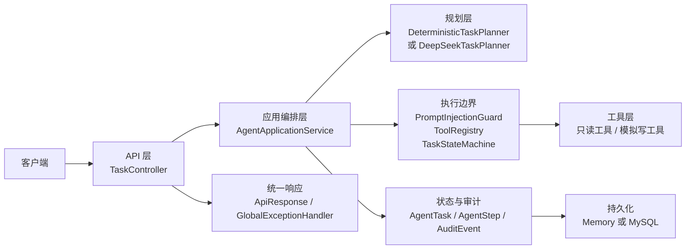
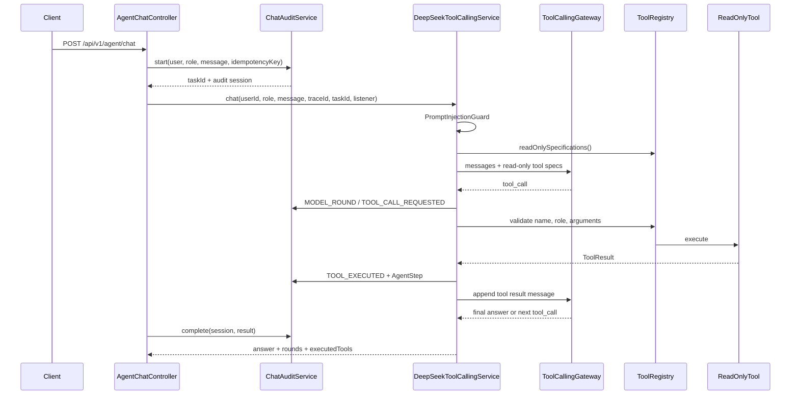
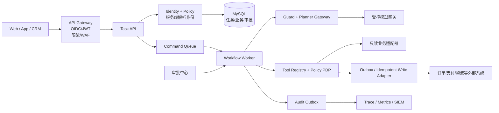

# Enterprise Workflow Agent 完整调用链路

这份文档把外部工作流文档里的每日任务，串成一次真实请求可以走完的调用链。阅读时先看“当前代码链路”，再看“生产目标链路”；前者解释仓库现在怎么运行，后者说明接入真实身份、真实业务系统和生产基础设施时需要补什么。

当前仓库是一个可测试的垂直切片：默认使用确定性规划器和内存仓库（内置同一套脱敏演示数据）。设置 `AGENT_PERSISTENCE=jdbc` 可以切换到 MySQL 适配器，业务工具读写同一数据库；设置 `DEEPSEEK_ENABLED=true` 才会调用 DeepSeek。

## 1 先建立整体地图

一次任务请求经过六层：



每层的职责只有一个核心问题：

| 层 | 要回答的问题 | 当前代码 |
| --- | --- | --- |
| API | 谁在请求、请求什么、如何返回 | `TaskController`、`AgentChatController` |
| 应用编排 | 任务现在应该走哪一步 | `AgentApplicationService` |
| 规划 | 自然语言如何变成结构化步骤 | `DeterministicTaskPlanner`、`DeepSeekTaskPlanner` |
| 执行边界 | 这个计划能不能执行 | `PromptInjectionGuard`、`ToolRegistry`、`TaskStateMachine` |
| 工具 | 如何查询或执行一个业务动作 | `tools` 包下的 `AgentTool` 实现 |
| 状态与持久化 | 发生了什么、重启后能否追溯 | `AgentTask`、`AgentStep`、`AuditEvent`、Repository |

模型只负责提出计划或工具调用建议。状态迁移、权限、参数、审批、工具执行和最终成功判断都在服务端。

## 2 一次 HTTP 请求携带什么

以创建任务为例：

```http
POST /api/v1/tasks
Content-Type: application/json
Authorization: Bearer <JWT>
Idempotency-Key: demo-read-1
X-Trace-Id: demo-trace-read

{"request":"查询订单 ORD-1001 的物流"}
```

`TaskController.create` 做三件事：

1. 使用 `@Valid` 检查请求体，`request` 不能为空且最多 2000 个字符。
2. 通过 Spring Security 的 `@AuthenticationPrincipal Jwt` 读取签名令牌，`JwtUserResolver` 从 `sub` 得到用户 ID、从配置的角色 claim 得到有效角色；同时读取 `Idempotency-Key`、`X-Trace-Id`。
3. 调用 `AgentApplicationService.create`，最后包装成 `ApiResponse`。

`X-User-Id` 和 `X-Role` 已被移除，客户端提交这两个头不会影响身份。生产环境由 OIDC/JWT 验证签名、issuer、audience 和过期时间；`local` 模式只用于离线演示和测试。审批接口在过滤器链和业务层都要求 `SUPERVISOR`/`ADMIN`，并且申请人不能审批自己的任务。

## 3 完整链路一：只读订单或物流查询

这是最适合第一次阅读代码的链路。用请求 `查询订单 ORD-1001 的物流`，沿着下面顺序看。

### 3.1 入口和幂等

调用：`TaskController.create` → `AgentApplicationService.create`

`create` 首先检查：

- `userId` 是否为空。
- 当前用户和 `Idempotency-Key` 是否已经对应一个任务。重复提交直接返回原任务，不重新规划、不重新调用工具。
- 创建 `AgentTask`，初始状态是 `CREATED`，保存到 `TaskRepository`。
- 写入 `TASK_CREATED` 审计事件。
- 通过 `TaskStateMachine` 将状态推进到 `PLANNING`，同时写入 `STATE_CHANGED`。

内存模式下，任务放在 `InMemoryTaskRepository`；JDBC 模式下，`JdbcTaskRepository.save` 把任务写入 `tasks` 表。`audit` 方法会保存任务并追加事件，因此状态变化和事件都会被记录。

### 3.2 输入安全检查

调用：`PromptInjectionGuard.check(request)`

它检查用户输入是否包含诸如“忽略之前的指令”“泄露密钥”“绕过审批”等已阻断模式。命中后：

1. 任务写入 `PLAN_REJECTED`。
2. 任务转为 `FAILED`。
3. 抛出 `PROMPT_INJECTION_BLOCKED`。
4. 工具还没有被调用，因此没有业务副作用。

这对应外部文档的 Day 30 威胁模型和 Day 48 安全测试。

### 3.3 规划

调用：`TaskPlanner.plan(request)`

默认实现是 `DeterministicTaskPlanner`。它根据关键词和 ID 生成一个 `TaskPlan`，例如：

```json
{
  "steps": [
    {
      "sequence": 1,
      "toolName": "shipment.query",
      "arguments": {"orderId": "ORD-1001"},
      "requiresApproval": false
    }
  ]
}
```

启用 DeepSeek 时，调用链变成：

```text
AgentApplicationService
  -> DeepSeekTaskPlanner.plan
  -> RestClient POST /chat/completions
  -> 解析 choices[0].message.content
  -> 解析 steps JSON
  -> TaskPlan
```

`DeepSeekTaskPlanner` 有固定系统提示、JSON 输出、超时、有限重试和工具名提示，但这些都不是最终安全边界。模型返回的计划仍然要经过下一步的服务端校验。

### 3.4 计划规范化和白名单校验

调用：`AgentApplicationService.normalizeAndValidatePlan`

这里是模型与执行器之间的第一道硬边界：

- 计划不能为空。
- 步骤数不能超过 `agent.workflow.max-steps`，默认 8。
- 每个工具名必须存在于 `ToolRegistry`。
- `requiresApproval` 不信任模型；服务端根据注册工具的 `readOnly()` 重新计算。
- 未注册工具直接失败，不会进入工具实现。

通过后写入任务计划和 `PLAN_ACCEPTED` 事件。因为 `shipment.query` 是只读工具，任务继续进入执行循环。

### 3.5 受控执行循环

调用：`AgentApplicationService.executePlan`

执行循环对每个 `PlanStep` 做以下事情：

1. 将 `PLANNING` 转为 `RUNNING`。
2. 建立总 deadline，默认 30 秒。
3. 再次检查计划步数和当前时间。
4. 创建 `ToolContext(userId, role, taskId, traceId)`。
5. 调用 `ToolRegistry.execute(toolName, arguments, context)`。
6. 由注册表检查工具名和角色，再调用具体 `AgentTool`。
7. 工具内部拒绝未知参数、空参数、超长参数和非法值。
8. `ResultEvaluator.verify` 检查结果是否可信。
9. 保存 `AgentStep`，写入 `TOOL_EXECUTED` 审计事件。
10. 保存 checkpoint 摘要，写入 `CHECKPOINT_SAVED` 事件。

对于本例，最终实际调用的是：

```text
ToolRegistry.execute("shipment.query", {orderId: "ORD-1001"}, ToolContext)
  -> ShipmentQueryTool.execute
  -> ToolResult.ok(...)
```

所有步骤成功后：

```text
RUNNING -> SUCCEEDED
resultMessage = "Workflow completed"
写入 TASK_SUCCEEDED
```

### 3.6 返回响应和查询审计

`TaskController` 返回任务视图，其中包含：

- `taskId`
- `status=SUCCEEDED`
- `plan`
- `steps`
- `resultMessage`
- `sideEffectCount=0`
- `traceId`

之后可以调用：

```http
GET /api/v1/tasks/{taskId}
GET /api/v1/tasks/{taskId}/events
```

事件列表会按时间排序，用于重建任务从创建、规划、执行到完成的过程。

## 4 完整链路二：退款或修改地址审批

请求 `退款 ORD-1001 金额 20` 的前半段和只读查询相同，从 `TaskController` 进入 `AgentApplicationService.create`，区别从计划规范化之后开始。

### 4.1 创建阶段只申请，不执行

规划得到：

```json
{
  "steps": [
    {
      "sequence": 1,
      "toolName": "refund.create",
      "arguments": {"orderId": "ORD-1001", "amount": 20},
      "requiresApproval": true
    }
  ]
}
```

服务端会再次根据 `RefundTool.readOnly() == false` 设置审批要求，然后：

```text
PLANNING -> WAITING_APPROVAL
创建 ApprovalRequest(status=PENDING)
写入 APPROVAL_REQUESTED
返回 sideEffectCount=0
```

此时 `refund.create` 没有被调用。客服可以发起请求，但不能自己审批。

### 4.2 客服审批会被拒绝

调用：`TaskController.approve` → `AgentApplicationService.approve`

`approve` 首先检查：

- 角色必须是 `SUPERVISOR` 或 `ADMIN`。
- 任务必须是 `WAITING_APPROVAL`。
- 已成功任务重复审批时直接返回原结果。

客服调用会得到 `FORBIDDEN`，任务状态不变，副作用仍为 0。

### 4.3 主管审批和一次性执行

主管审批通过后，`approve` 在 JDBC 模式下运行于 `workflowTransactionManager` 事务中：

```text
WAITING_APPROVAL
  -> approval.status = APPROVED
  -> 写入 APPROVAL_GRANTED
  -> RUNNING
  -> ToolRegistry.execute("refund.create", ...)
  -> RefundTool.execute
  -> ResultEvaluator 检查 verified=true/simulation=true
  -> sideEffectCount = 1
  -> SUCCEEDED
```

`RefundTool` 只返回模拟退款结果，不调用支付系统。重复点击审批时，任务已经是 `SUCCEEDED`，直接返回终态，不会再次执行工具。

### 4.4 拒绝和取消

- `POST /tasks/{id}/reject`：主管或管理员把等待审批任务转为 `CANCELLED`，不执行写工具。
- `POST /tasks/{id}/cancel`：任务所有者可以取消未完成任务，管理员可以取消任意任务。

这条链路对应 Day 40 权限、Day 41 审批、Day 42 幂等并发、Day 45 结果验证和 Day 49 审计。

## 5 完整链路三：多轮只读 Tool Calling

`POST /api/v1/agent/chat` 是另一条入口，它用于让模型多轮选择只读工具。现在它也会创建 `AgentTask`，因此聊天可以使用同一套任务查询和审计时间线。



关键行为和限制：

- 只向模型暴露 `readOnlyTools()`。
- 外部工具名用下划线，服务端再映射回点号名称。
- 每次调用都经过 `ToolRegistry`。
- 最多 4 轮，避免模型无限循环。
- 退款和改地址不会从这个入口执行，必须走任务审批链路。

当前实现已经为聊天创建任务并记录 `CHAT_STARTED`、`MODEL_ROUND`、`TOOL_CALL_REQUESTED`、`TOOL_EXECUTED`、`CHAT_COMPLETED`、`CHAT_FAILED` 等事件；响应中的 `taskId` 可以继续调用 `/tasks/{taskId}` 和 `/events`。生产版本仍需要补充会话历史、PII 脱敏、成本上限、人工接管和更细粒度的模型请求摘要。网关现在已经有连接/读取超时和一次有限重试；真实业务写工具不能直接复用这条模型重试策略。

## 6 完整链路四：失败、超时和重启恢复

### 6.1 规划失败

模型不可用、返回非法 JSON、计划为空或触发提示注入时：

```text
create
  -> TASK_CREATED
  -> PLANNING
  -> PLAN_REJECTED
  -> FAILED
  -> 统一错误响应
```

不会执行任何工具。

### 6.2 工具拒绝或业务失败

工具名未知、角色不允许、参数非法或工具返回业务错误时：

```text
ToolRegistry / Tool.execute
  -> AgentStep(status=REJECTED 或 FAILED)
  -> TOOL_REJECTED 或 RESULT_REJECTED
  -> FAILED
```

权限错误、参数错误和业务拒绝不会被当成可重试的网络错误。`RetryPolicy` 只允许有限的临时错误和限流错误重试。

### 6.3 deadline 和步骤上限

`AgentApplicationService.executePlan` 在每步执行前检查 deadline，计划步数不能超过 `maxSteps`。超限时：

```text
RUNNING -> FAILED
写入 DEADLINE_EXCEEDED 或计划超长结果
```

### 6.4 进程重启

应用启动时，`RecoveryService.inspectInterruptedTasks` 查找仍为 `RUNNING` 的任务：

```text
RUNNING -> RECOVERY_REQUIRED
写入 RECOVERY_REQUIRED
不自动重放未知副作用
```

主管或管理员调用 `/resume` 后，服务端检查 checkpoint 后面的步骤：

- 剩余步骤全部只读：允许受控恢复。
- 仍有写工具：返回 `RECOVERY_UNSAFE`，要求人工核对外部系统。

## 7 状态、数据库和事件是怎么串起来的

一次任务不是只返回一个字符串，而是同时维护三种状态：

| 状态对象 | 保存什么 | 当前存储 |
| --- | --- | --- |
| `AgentTask` | 用户、角色、请求、状态、计划、审批、结果、副作用计数 | `tasks` 表或内存 Map |
| `AgentStep` | 每一步工具、参数、状态、结果码、开始/结束时间 | `task_steps` 表或任务内列表 |
| `AuditEvent` | 状态变化、审批、工具执行、拒绝、恢复、traceId | `audit_events` 表或事件 Map |

JDBC 模式的迁移文件是：

- `V1__init.sql`：`tasks`、`task_steps`、`audit_events`。
- `V2__task_plan_and_approval.sql`：计划和审批 JSON。
- `V3__audit_outbox.sql`：待发布审计事件和 pending 索引。
- `V4__audit_outbox_delivery.sql`：发布尝试次数、下一次尝试时间和领取租约。

### 7.1 审计事件分类

| 分类 | 事件 | 说明 |
| --- | --- | --- |
| 生命周期 | `TASK_CREATED`、`STATE_CHANGED`、`TASK_SUCCEEDED` | 任务何时创建、如何迁移、何时进入终态 |
| 规划 | `PLANNING_STARTED`、`PLANNING_COMPLETED`、`PLAN_ACCEPTED`、`PLAN_REJECTED` | 规划器类型、步骤数、耗时和拒绝原因 |
| 执行 | `TOOL_CALL_REQUESTED`、`TOOL_EXECUTED`、`TOOL_REJECTED`、`RESULT_REJECTED` | 工具名、结果码、步骤和拒绝原因；不把模型权限当作事实 |
| 审批 | `APPROVAL_REQUESTED`、`APPROVAL_GRANTED`、`APPROVAL_REJECTED` | 谁申请、谁审批、审批结果和任务状态 |
| 聊天 | `CHAT_STARTED`、`MODEL_ROUND`、`CHAT_COMPLETED`、`CHAT_FAILED` | 聊天任务的模型回合、只读工具调用和最终答复 |
| 恢复 | `CHECKPOINT_SAVED`、`RECOVERY_REQUIRED`、`RECOVERY_STARTED` | checkpoint、重启发现和受控恢复 |
| 约束 | `DEADLINE_EXCEEDED`、`TASK_CANCELLED` | 时间预算、取消和人工处理入口 |

当前每次任务快照、对应事件和待发布 outbox 记录通过 `TaskAuditWriter` 在同一资源事务中写入；`AuditOutboxPublisher` 已提供租约领取、失败退避和幂等发布标记。生产环境仍需要真实事件总线、死信处理、监控和审计归档。

## 8 和外部工作流文档 Day 30–56 的对应关系

| 文档 Day | 在调用链中的位置 | 代码或材料 |
| --- | --- | --- |
| Day 30 | 业务边界、角色、威胁模型 | `docs/day-30-business-scope-threat-model.md` |
| Day 31 | API、应用、领域、工具、持久化分层 | `src/main/java/com/yu/agent/workflow` |
| Day 32 | 只读业务工具 | `OrderQueryTool`、`ShipmentQueryTool`、`TicketQueryTool`、`KnowledgeSearchTool` |
| Day 33 | 固定名称和白名单 | `AgentTool`、`ToolRegistry` |
| Day 34 | 工具参数边界 | `AbstractTool` 和各工具 `execute` |
| Day 35 | 规划器和多轮只读 Tool Calling | `DeepSeekTaskPlanner`、`DeepSeekToolCallingService` |
| Day 36 | 决策→校验→执行→记录→完成 | `AgentApplicationService.executePlan` |
| Day 37 | 合法状态迁移 | `TaskStatus`、`TaskStateMachine` |
| Day 38 | 任务、步骤、事件持久化 | `TaskRepository`、`EventRepository`、JDBC 实现 |
| Day 39 | checkpoint 和恢复 | `Checkpoint`、`RecoveryService`、`/resume` |
| Day 40 | 角色和工具权限 | `UserRole`、`ToolRegistry` |
| Day 41 | 高风险审批 | `ApprovalRequest`、`/approve`、`/reject` |
| Day 42 | 幂等和并发 | `Idempotency-Key`、数据库唯一约束、任务锁 |
| Day 43 | deadline、重试和错误分类 | `RetryPolicy`、`executePlan` |
| Day 44 | 结构化计划 | `TaskPlan`、`PlanStep`、`DeepSeekTaskPlanner` |
| Day 45 | 业务结果验证 | `ResultEvaluator` |
| Day 46 | 知识检索和 ACL | `KnowledgeBase`、`KnowledgeSearchTool` |
| Day 47 | 上下文预算和任务隔离 | `ContextBuilder` |
| Day 48 | Prompt Injection 和越权测试 | `PromptInjectionGuard`、安全测试 |
| Day 49 | traceId 和事件时间线 | `AuditEvent`、`/events` |
| Day 50–51 | 评估集和自动化测试 | `EvaluationBatchTests`、`src/test` |
| Day 52 | 故障矩阵和恢复演练 | `docs/fault-matrix.md`、`docs/fault-drill-report.md` |
| Day 53 | 对外 API 和演示 | `docs/openapi.yaml`、`docs/demo.md` |
| Day 54 | Compose、Flyway、JDBC 部署 | `compose.yaml`、`Dockerfile`、`docs/deployment-rehearsal.md` |
| Day 55–56 | 选型、验收和发布 | `docs/adr-002-workflow-framework.md`、`docs/release-notes.md` |

## 9 生产目标调用链

下面是把当前垂直切片接入真实环境时建议采用的链路。它保留现有 `TaskPlanner`、`ToolRegistry` 和 `AgentApplicationService` 的核心边界，但把演示替身换成生产组件。



生产化时建议遵循这些不变原则：

1. API 层只接收命令和查询，不直接调用外部写系统。
2. 模型网关只返回结构化计划，不能拿到业务系统凭据。
3. 所有工具调用统一经过 `ToolRegistry` 和策略决策点。
4. 写操作必须带业务幂等键，并通过 Outbox/事务边界可靠投递。
5. 长任务通过队列和 Worker 执行，HTTP 返回 `202 Accepted + taskId`，客户端轮询或订阅事件。
6. 审批、任务状态、工具结果和审计事件使用同一 traceId 串联。
7. 所有日志、模型上下文和事件都做 PII 脱敏；密钥来自 Secret Manager/KMS。

## 10 当前代码到生产环境的差距

| 方面 | 当前仓库 | 生产需要 |
| --- | --- | --- |
| 身份认证 | JWT 资源服务器 + 角色 claim + 职责分离；本地 HS256 演示 | 企业 IdP 联调、令牌轮换/吊销、租户与审批范围 |
| 业务数据 | 本地 MySQL + 脱敏种子数据，下游沙箱网关 | 带超时、重试、幂等和审计的外部适配器 |
| 任务执行 | HTTP 请求内同步执行 | 队列、Worker、超时、取消和死信队列 |
| 持久化 | 内存默认或 MySQL JDBC | 备份、保留策略；多实例事务/锁已由双实例验收覆盖 |
| 审计 | 应用层事件追加 | Outbox/事件总线、不可篡改存储、脱敏和保留策略 |
| Tool Calling | 只读聊天已创建任务并记录基础事件 | 会话历史、成本控制、模型网关和生产级审计检索 |
| 观测性 | `traceId` 字段 | OpenTelemetry、指标、告警、SLO、审计检索 |
| 安全 | 规则型注入防护 | WAF、输入分类、模型评测、红队、密钥轮换 |
| 部署 | Compose 运行手册 | Kubernetes/容器编排、滚动发布、探针、回滚演练 |

因此，当前代码可以作为生产架构的“安全执行内核”和本地演示基线，但不能直接宣称已经完成生产验收。尤其是身份认证、真实外部写接口、JDBC 重启演练、聊天会话治理和压测仍需在目标环境补齐。

## 11 建议的实际阅读和演示顺序

### 第一次：只读链路

1. 阅读本文件第 3 节。
2. 打开 `TaskController.create`。
3. 依次阅读 `AgentApplicationService.create`、`normalizeAndValidatePlan`、`executePlan`。
4. 阅读 `ToolRegistry` 和 `ShipmentQueryTool`。
5. 运行 `docs/demo.md` 的物流查询示例。
6. 用 `/tasks/{taskId}/events` 对照 `TASK_CREATED → PLANNING → RUNNING → TOOL_EXECUTED → SUCCEEDED`。

### 第二次：审批链路

1. 阅读本文件第 4 节。
2. 阅读 `RefundTool`、`ApprovalRequest` 和 `AgentApplicationService.approve`。
3. 先用客服身份创建退款，再用客服身份审批，最后用主管身份审批。
4. 对照 `WAITING_APPROVAL`、`APPROVAL_GRANTED`、`sideEffectCount` 和终态幂等。

### 第三次：故障链路

1. 阅读 `TaskStateMachine`、`RetryPolicy`、`RecoveryService`。
2. 阅读 `CheckpointRecoveryTests` 和 `ReliabilityControlTests`。
3. 重点理解为什么“结果未知的写操作不能自动重放”。

### 第四次：模型链路

1. 先读 `DeepSeekTaskPlanner`，它负责结构化计划。
2. 再读 `DeepSeekToolCallingService`，它负责多轮只读工具调用。
3. 最后回到 `ToolRegistry`，确认模型两条路径都不能绕过服务端权限和工具白名单。

