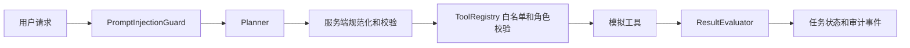
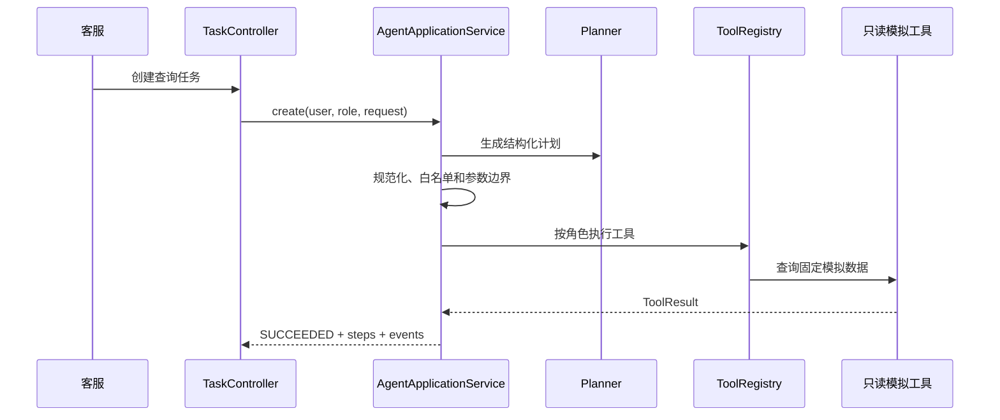
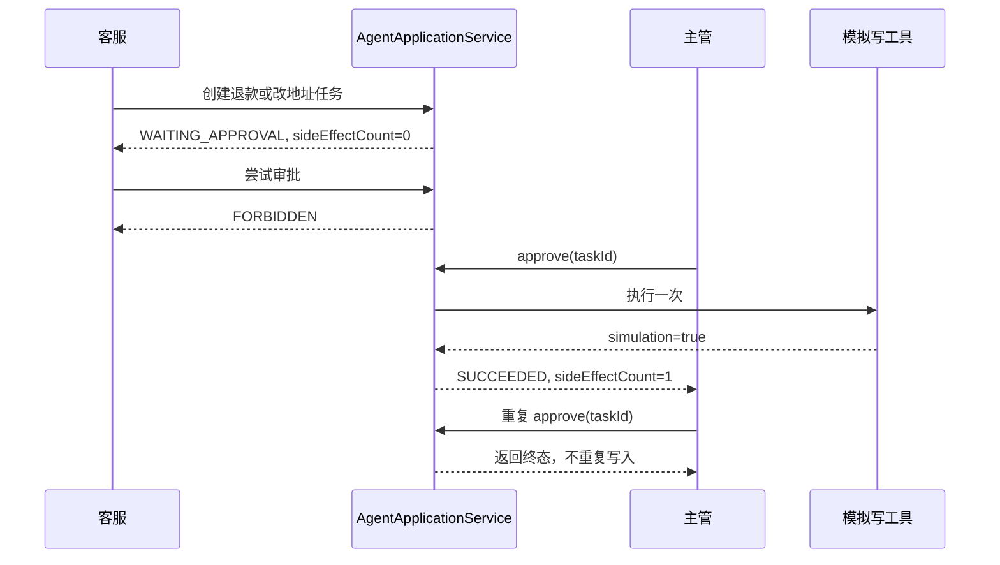
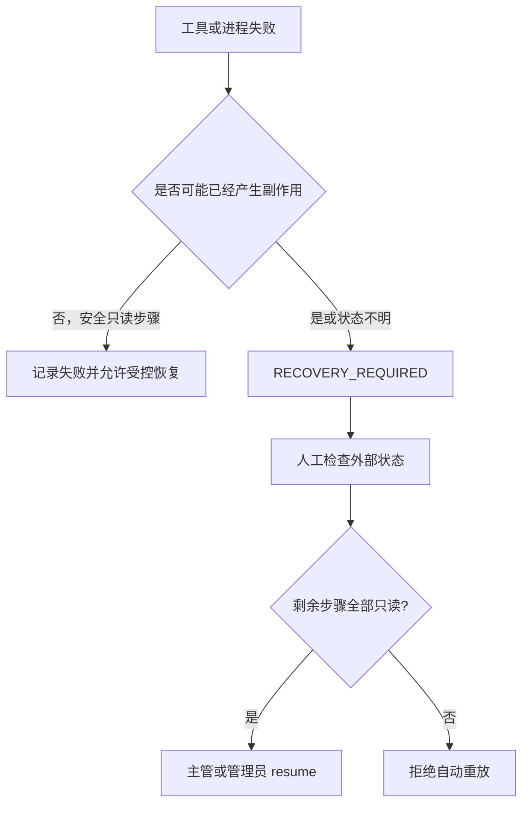

# Day 30 业务范围与威胁模型

这份文档是供应流程 Agent 的边界说明和代码验收入口。它对应外部工作流文档的 Day 30：先回答系统允许做什么，再说明谁可以做，最后把每类风险对应到代码控制和测试证据。

当前结论：Day 30 的运行时控制已经存在；本次补充把原本分散在代码和 README 中的业务需求、权限矩阵、流程和威胁模型整理成一份可核对的材料。所有业务数据和写操作仍然是脱敏模拟数据。

## 1 业务范围

### 1.1 允许的业务场景

| 场景 | 工具 | 类型 | 结果 |
| --- | --- | --- | --- |
| 查询订单状态和金额 | `order.query` | 只读 | 返回固定模拟订单 |
| 查询订单物流 | `shipment.query` | 只读 | 返回固定模拟物流 |
| 查询售后工单 | `ticket.query` | 只读 | 返回固定模拟工单 |
| 查询售后政策 | `knowledge.search` | 只读 | 返回带引用的授权知识片段 |
| 创建退款 | `refund.create` | 高风险写操作 | 只返回 `simulation=true` 的模拟结果 |
| 修改订单地址 | `order.address.update` | 高风险写操作 | 只返回 `simulation=true` 的模拟结果 |

### 1.2 明确不在范围内

- 不连接真实订单、支付、物流、工单或知识库系统。
- 不保存或处理真实客户个人信息。
- 模型不能直接调用 Java 类、任意 HTTP 接口或写工具。
- 模型不能决定角色、审批状态、工具白名单或任务最终状态。
- 未审批的退款和地址修改不能产生副作用；重启后不能盲目重放状态不明的写操作。

### 1.3 一次请求的业务边界

入口是 `TaskController`，服务端编排在 `AgentApplicationService`。规划器只产生数据，真正的执行权在服务端；`ToolRegistry` 和 `AgentApplicationService` 是不能绕过的执行边界。

## 2 角色与权限矩阵

角色定义在 `src/main/java/com/yu/agent/workflow/domain/UserRole.java`，工具权限定义在各个 `AgentTool` 实现和 `ToolRegistry` 中。

| 角色 | 创建任务 | 读取自己的任务 | 读取他人任务 | 调用只读工具 | 发起高风险请求 | 审批/拒绝 | 恢复任务 | 说明 |
| --- | --- | --- | --- | --- | --- | --- | --- | --- |
| `CUSTOMER_SERVICE` | 可以 | 可以 | 不可以 | 可以 | 可以 | 不可以 | 不可以 | 可以提出退款或改地址，但只能等待主管处理 |
| `SUPERVISOR` | 可以 | 可以 | 可以 | 可以 | 可以 | 可以 | 可以 | 审批高风险动作，也可以恢复安全的只读步骤 |
| `ADMIN` | 可以 | 可以 | 可以 | 可以 | 可以 | 可以 | 可以 | 演示环境的最高权限，仍不能绕过服务端审批和结果校验 |
| `AGENT` | 不作为业务身份 | 不作为业务身份 | 不可以 | 当前不开放 | 不可以 | 不可以 | 不可以 | 保留为内部模型角色；不能把模型身份当作业务权限 |

有两个容易混淆的区别：

1. “发起高风险请求”不等于“执行高风险工具”。客服可以创建退款任务，但任务会进入 `WAITING_APPROVAL`，审批前 `sideEffectCount=0`。
2. “模型建议调用工具”不等于“工具已经执行”。模型返回的工具名、参数和 `requiresApproval` 字段都会被服务端重新检查。

## 3 工具边界矩阵

| 工具 | 只读 | 允许角色 | 是否需要审批 | 主要校验 | 实现 |
| --- | --- | --- | --- | --- | --- |
| `order.query` | 是 | 客服、主管、管理员 | 否 | 仅允许 `orderId`，固定订单集合 | `tools/OrderQueryTool.java` |
| `shipment.query` | 是 | 客服、主管、管理员 | 否 | 仅允许 `orderId`，固定订单集合 | `tools/ShipmentQueryTool.java` |
| `ticket.query` | 是 | 客服、主管、管理员 | 否 | 仅允许 `ticketId`，固定工单集合 | `tools/TicketQueryTool.java` |
| `knowledge.search` | 是 | 客服、主管、管理员 | 否 | 仅允许 `query`，按角色过滤知识 | `tools/KnowledgeSearchTool.java` |
| `refund.create` | 否 | 主管、管理员 | 是 | `orderId`、金额范围、未知字段拒绝 | `tools/RefundTool.java` |
| `order.address.update` | 否 | 主管、管理员 | 是 | `orderId`、地址长度、未知字段拒绝 | `tools/AddressUpdateTool.java` |

计划中的审批属性由注册表决定，而不是由模型决定：`AgentApplicationService.normalizeAndValidatePlan` 会根据 `tool.readOnly()` 重写 `requiresApproval`。执行时再次经过 `ToolRegistry.execute` 的角色检查。

## 4 三条关键流程

### 4.1 只读查询

### 4.2 高风险审批

### 4.3 失败与恢复

## 5 威胁模型与控制措施

| 威胁 | 入口/触发 | 服务端控制 | 证据 | 残余风险 |
| --- | --- | --- | --- | --- |
| 模型调用未注册工具 | 计划或 Tool Calling 返回未知名称 | `ToolRegistry.require` 和计划规范化拒绝；任务记录 `PLAN_REJECTED` 或工具拒绝事件 | `ToolRegistry.java`、`AgentApplicationService.java` | 仍需线上监控拒绝率 |
| 模型关闭审批标记 | 计划返回 `requiresApproval=false` | 服务端按注册工具的 `readOnly` 属性重写审批属性 | `AgentApplicationService.normalizeAndValidatePlan` | 新增写工具时必须正确标记 `readOnly=false` |
| 客服绕过审批执行写操作 | 直接调用审批接口或工具 | 审批接口只接受主管/管理员；写工具也只允许主管/管理员；审批前不执行工具 | `AgentApplicationService.approve`、`ToolRegistry.execute`、`AgentWorkflow1ApplicationTests` | 本地身份头是演示替身，不是生产认证 |
| 参数注入或危险额外字段 | 工具参数缺失、越界或多字段 | `AbstractTool` 统一拒绝未知字段、空值、超长值；金额范围单独校验 | `AbstractTool.java`、`RefundTool.java`、工具测试 | 复杂业务规则仍需真实系统契约 |
| Prompt Injection | 用户输入或模型消息包含覆盖指令 | `PromptInjectionGuard` 在任务入口和聊天入口阻断 | `PromptInjectionGuard.java`、`ReliabilityControlTests` | 规则列表不是完整语义安全方案 |
| 重复任务或重复审批 | 网络重试、重复点击 | `Idempotency-Key` 返回原任务；终态审批直接返回；任务锁保护审批路径 | `AgentApplicationService`、`AgentWorkflow1ApplicationTests` | JDBC 并发验收仍需真实 PostgreSQL 环境 |
| 无限执行或模型循环 | 超长计划、连续 Tool Calling | `maxSteps`、deadline、Tool Calling 最大回合数 | `AgentApplicationService`、`DeepSeekToolCallingService`、`RetryPolicy` | 指标和生产限流仍需补充 |
| 工具返回“成功”但业务未完成 | 不可信写结果 | 写工具结果必须包含 `simulation=true`，否则 `ResultEvaluator` 拒绝 | `ResultEvaluator.java`、`ReliabilityControlTests` | 真实业务接入时要换成业务状态查询 |
| 进程重启后重复写入 | 任务停在 `RUNNING` | `RecoveryService` 标记 `RECOVERY_REQUIRED`；恢复只允许剩余只读步骤 | `RecoveryService.java`、`CheckpointRecoveryTests` | Docker/PostgreSQL 重启演练受本机环境限制 |
| 知识越权或编造政策 | 跨角色检索、无证据检索 | `KnowledgeBase` 按角色过滤；无命中返回 `NO_EVIDENCE`；只返回片段和引用 | `KnowledgeBase.java`、`KnowledgeSearchTool.java` | 外部向量库 ACL 尚未接入 |
| 审计泄漏敏感信息 | 事件、响应或日志 | 当前只使用模拟数据，事件记录工具名、结果码和摘要；生产认证和脱敏仍需替换 | `AuditEvent.java`、`docs/security.md` | 生产日志策略需要单独审查 |

## 6 Day 30 验收与代码证据

| 文档要求 | 本仓库交付物 | 验收方式 |
| --- | --- | --- |
| 售后场景需求，只使用模拟数据 | 本文第 1 节、`README.md`、`tools` 包 | 检查工具固定数据和 `simulation=true` |
| 角色及权限矩阵 | 本文第 2 节、`UserRole`、`AgentTool`、`ToolRegistry` | 运行工具权限和审批测试 |
| 只读与高风险动作区分 | 本文第 3 节、`readOnly()`、`normalizeAndValidatePlan` | 只读任务直接完成；写任务进入 `WAITING_APPROVAL` |
| 正常、审批、失败恢复流程 | 本文第 4 节、`docs/diagrams.md`、`docs/demo.md` | 按演示脚本查看状态和事件 |
| 威胁清单及控制措施 | 本文第 5 节、`docs/security.md` | 检查每项威胁是否有代码控制和测试证据 |

Day 30 的完成判断是“边界明确、没有真实写接口、每类风险有控制措施”。它不是说系统已经达到生产验收；真实认证、外部系统幂等、PostgreSQL 重启和压力指标仍属于后续工作。

