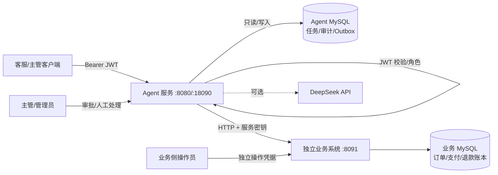
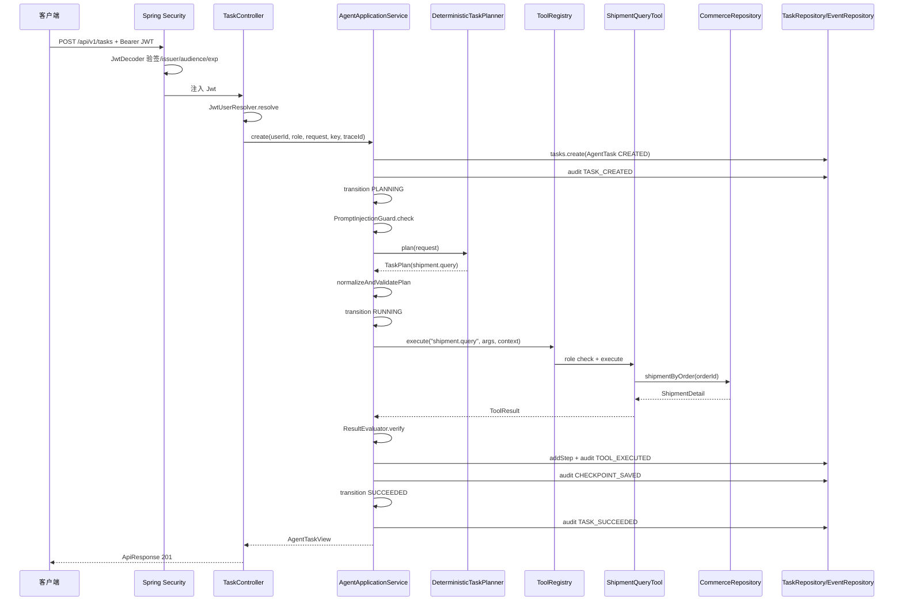

# 企业售后工作流 Agent 系统分析

> 分析日期：2026-10-28  
> 分析对象：`F:\myproject\agent-workflow-1\agent-workflow-1` 当前工作区  
> 分析方式：通读 `src/main/java`（94 个类、约 5406 行）、`business-system`（5 个类）、Flyway 迁移、配置、测试与主要文档；按“先全局后局部、先业务后代码、完整调用链”的顺序展开。  
> 验证说明：本次使用 JDK 17 重新执行 `./mvnw -B -ntp test`，68 个测试全部通过（Failures 0、Errors 0、Skipped 0）。双实例 73/73、独立业务 39/39 来自仓库文档记录，本次未重跑。

---

## 0. 结论摘要

这是一个**以“服务端掌握执行权”为核心的售后工作流 Agent 垂直切片**，不是简单的“大模型 + 工具”演示。它已经具备以下完整骨架：

1. JWT 身份认证、角色映射、工具白名单、参数校验、审批门禁与职责分离。
2. 确定性规划器与可选 DeepSeek 规划器，模型只能产出结构化计划，不能直接执行写操作。
3. 任务状态机、步骤快照、审计时间线、幂等创建、重复审批保护。
4. MySQL/Flyway 持久化、事务性 Outbox、下游命令租约、外部状态轮询对账、人工处理队列。
5. 独立业务系统（订单/支付/退款账本）与本地合成数据，HTTP 模式下完成真实跨服务调用。
6. 启动恢复、只读 checkpoint 恢复、prod fail-closed 配置门禁。

从代码质量看，边界意识很强：**模型输出被视为数据而不是权限**；写操作必须先过审批；未知外部结果不允许盲目重放；审计与业务状态尽量同事务提交。这些是本系统最有价值的部分。

但当前仍属于“**具备受控试点条件的工程原型**”，不能直接承载真实资金或真实客户业务。主要缺口集中在：数据范围/租户隔离、真实支付与物流适配器、模型与日志的 PII/成本治理、异步任务 Worker 与持续恢复、审批运营闭环、生产观测与审计落点。详细问题见第 8 节。

---

## 1. 分析范围与方法

### 1.1 范围

- 主服务：`src/main/java/com/yu/agent/workflow`，包含 API、应用编排、领域、工具、业务数据、持久化、安全、配置。
- 独立业务系统：`business-system`，提供订单/支付查询、退款受理与合成账本结算。
- 数据层：`src/main/resources/db/migration/V1..V6`、`db/seed/commerce-demo-data.sql`、`business-system/.../V1__business_ledger.sql`。
- 运行与验收：`compose.yaml`、`compose.business.yaml`、`scripts/*.py`、`src/test/java`。
- 设计文档：`README.md`、`docs/*.md`、`production-launch-criteria.md`、`ds-todolist.md`。

### 1.2 方法

按以下顺序阅读，避免一上来陷入单个类：

1. 先读 README、架构图、完整调用链、生产评估，建立“系统要解决什么、边界在哪”的认识。
2. 再读领域模型、状态机、任务服务、工具注册表，理解执行内核。
3. 然后按业务链路读工具、业务仓储、Outbox、调度器、独立业务系统。
4. 最后读测试与验收脚本，确认哪些行为被验证、哪些只是文档承诺。
5. 对关键判断回到代码逐行核对，本文中的行号均以当前工作区为准。

### 1.3 重要说明

- 本文把“当前实现”和“生产目标”分开描述，避免把演示能力误认为生产能力。
- 文中的“问题”既包括代码缺陷，也包括产品/运营闭环缺口；会标注是“已文档化的限制”还是“代码层可改进点”。

---

## 2. 全局认识

### 2.1 业务定位：这个系统解决什么问题

电商/售后客服场景中，客服需要围绕订单、支付、物流、工单和售后政策做大量查询与少量高风险操作。直接让大模型调用业务系统会带来四类风险：

1. **越权**：模型或用户可能要求执行退款、改地址、发货等高风险动作。
2. **幻觉与越界**：模型可能编造订单号、金额、工具名或权限。
3. **不可追溯**：出了问题无法还原“谁在什么时候基于什么依据做了什么”。
4. **外部不确定性**：支付/物流调用可能超时，不能简单重试，否则可能重复退款或重复发货。

本系统的业务答案是：

- 用自然语言接收售后请求；
- 服务端把请求规划为**固定工具白名单**中的结构化步骤；
- 只读步骤可直接执行，写步骤必须经过**主管/管理员审批**；
- 写操作先落本地业务记录与事务性 Outbox，再由调度器调用下游；
- 下游结果区分成功、失败、处理中、未知，未知进入人工对账；
- 全链路记录任务、步骤、审计事件和 traceId。

### 2.2 系统边界与部署拓扑



边界要点：

- Agent **不持有**业务数据库凭据，HTTP 模式下只持有业务 API 服务密钥。
- 业务侧操作凭据（`X-Operations-Key`）与 Agent 的 `X-Api-Key` 分离，Agent 不能直接结算业务账本。
- 默认 `sandbox` 模式不访问任何真实支付/承运商；HTTP 模式也只访问本地合成业务系统。
- 没有前端工作台，当前通过 REST API、Postman、脚本演示。

### 2.3 运行模式矩阵

| 维度 | 取值 | 行为 | 关键条件 |
| --- | --- | --- | --- |
| 持久化 | `memory`（默认） | 任务、审计、业务数据都在内存；写操作立即生效 | 离线测试/演示 |
| 持久化 | `jdbc` | MySQL + Flyway；Hikari 连接失败即启动失败 | `AGENT_PERSISTENCE=jdbc` |
| 业务网关 | `sandbox`（默认） | `SandboxCommerceGateway` 生成确定性单号，不访问真实系统 | 可与 memory/jdbc 组合 |
| 业务网关 | `http` | 真实 HTTP 读写独立业务系统 | 需要 `jdbc`（依赖 JdbcTemplate）与服务密钥 |
| 规划器 | 确定性（默认） | 关键词 + 正则生成单步计划 | `DEEPSEEK_ENABLED=false` |
| 规划器 | DeepSeek | JSON Output 生成计划；服务端仍重新校验 | `DEEPSEEK_ENABLED=true` + API Key |
| 聊天工具调用 | 离线网关 | 返回固定提示，不调用模型 | DeepSeek 关闭 |
| 聊天工具调用 | DeepSeek | 多轮只读 Function Calling | DeepSeek 开启 |
| 认证 | `local` | HS256 本地密钥；可临时开启 dev-token | 仅本地 |
| 认证 | `oidc` | OIDC discovery 或 JWK Set 校验 | 生产必须 |
| 调度器 | 开启（默认） | 领取 `integration_commands` 并调用网关 | 仅 `jdbc` 且 dispatcher 开启 |
| 审计发布器 | 关闭（默认） | 审计只落库，不投递外部 Sink | `AUDIT_OUTBOX_PUBLISHER_ENABLED=true` 才启动 |

### 2.4 分层架构与代码地图

| 层 | 业务职责 | 包/关键类 |
| --- | --- | --- |
| API 层 | 接收 HTTP、认证主体、统一响应、错误映射 | `api/TaskController`、`AgentChatController`、`CommerceController`、`IntegrationOperationsController`、`HealthController`、`GlobalExceptionHandler`、`ApiResponse` |
| 安全层 | JWT 解码、角色 claim 解析、开发令牌 | `security/SecurityConfiguration`、`JwtUserResolver`、`DevTokenController` |
| 应用编排层 | 任务生命周期、规划、执行循环、审批、恢复 | `application/AgentApplicationService`、`ChatAuditService`、`RecoveryService` |
| 规划层 | 自然语言 → 结构化计划 | `DeterministicTaskPlanner`、`DeepSeekTaskPlanner` |
| 执行边界 | 工具白名单、角色检查、参数校验、结果验证 | `tools/ToolRegistry`、`AbstractTool`、`application/ResultEvaluator`、`PromptInjectionGuard` |
| 工具层 | 具体业务查询/写入 | `tools/*Tool`（8 个工具） |
| 领域层 | 任务、步骤、计划、审批、状态机 | `domain/AgentTask`、`AgentStep`、`TaskPlan`、`ApprovalRequest`、`TaskStateMachine` |
| 业务数据层 | 订单/支付/退款/物流/工单 | `commerce/CommerceRepository` 及 Memory/JDBC/HTTP 实现 |
| 外部写闭环 | Outbox、调度、网关、人工复核 | `commerce/CommerceCommandDispatcher`、`JdbcCommerceOutbox`、`CommerceGateway`、`IntegrationOperationsService` |
| 持久化层 | 任务/审计/Outbox 仓储 | `persistence/*` |
| 配置与门禁 | 生产配置校验、事务管理器 | `config/ProductionConfigurationGuard`、`JdbcPersistenceConfiguration`、`InMemoryTransactionConfiguration` |

### 2.5 六条核心设计原则

阅读代码后可以归纳出六条贯穿全局的原则：

1. **模型只产出数据，不拥有执行权**  
   `TaskPlanner.plan` 只返回 `TaskPlan`；`DeepSeekTaskPlanner` 不持有任何工具引用；`normalizeAndValidatePlan` 重新计算审批要求（`AgentApplicationService.java:300`）。

2. **工具名是白名单，参数是边界**  
   `ToolRegistry` 在启动时注册所有 `AgentTool`，未知工具直接拒绝；每个工具在 `AbstractTool` 中拒绝未知参数、空值、超长值。

3. **高风险动作必须审批，且职责分离**  
   `WAITING_APPROVAL` 状态 + `ApprovalRequest`；审批接口在过滤器链和业务层双重校验；申请人不能审批自己的任务（`AgentApplicationService.java:122`）。

4. **写操作先落本地意图，再异步投递**  
   退款/改地址/发货在同一个数据库事务中写业务记录和 `integration_commands`；调度器带租约领取，网关在事务外调用；结果回来再与任务状态、审计同事务提交。

5. **未知外部结果不盲目重放**  
   `GatewayTimeoutException` 进入 `UNKNOWN` / `MANUAL_REVIEW`，人工只能查询权威账本，不能任意改成功/失败。

6. **所有关键动作留痕**  
   `AuditEvent` 记录任务创建、状态变化、规划、工具执行、审批、恢复、外部结果；`TaskAuditWriter` 把任务快照、事件、Outbox 放在同一事务。

### 2.6 数据模型

#### 2.6.1 Agent 库（`workflow_agent` / `workflow_integration`）

| 表 | 作用 | 关键约束 |
| --- | --- | --- |
| `tasks` | 任务主表：请求、状态、计划 JSON、审批 JSON、结果、副作用计数 | `unique(user_id, idempotency_key)` |
| `task_steps` | 每个计划步骤的工具、参数、状态、结果 JSON | 外键 `task_id` |
| `audit_events` | 任务审计时间线 | 外键 `task_id`，按 `occurred_at` 查询 |
| `audit_outbox` | 待投递外部审计事件 | `event_id` 唯一，租约字段 |
| `customers` / `orders` / `order_items` | 订单与客户主数据 | 订单金额 CHECK 约束 |
| `payments` | 支付记录 | 每订单一条，金额 CHECK |
| `refunds` | 本地退款记录 | `idempotency_key` 唯一 |
| `shipments` / `shipment_events` | 物流单与轨迹 | `order_id` 唯一、幂等键唯一 |
| `address_change_log` | 地址变更审计 | 幂等键唯一 |
| `tickets` | 工单 | 外键客户 |
| `integration_commands` | 支付/物流命令 Outbox | 幂等键唯一，`status/attempts/locked_*` |
| `external_refund_requests` | HTTP 模式下 Agent 侧退款意图 | `idempotency_key` 唯一，关联任务 |
| `integration_reviews` | 人工处理单 | `command_id` 唯一 |
| `integration_events` | 命令级操作事件 | 关联命令 |

#### 2.6.2 业务库（`local_business`）

| 表 | 作用 |
| --- | --- |
| `orders` | 合成订单，含 `refund_behavior`（NORMAL/TIMEOUT_AFTER_ACCEPT/DECLINE/HOLD） |
| `order_items` | 订单明细 |
| `payments` | 合成支付 |
| `refunds` | 业务侧退款账本，`idempotency_key` 唯一 |
| `operation_audit` | 业务侧结算操作审计 |

关键关系：`tasks 1—N task_steps`、`tasks 1—N audit_events`、`tasks 1—N integration_commands`（V6 增加 `task_id`）、`integration_commands 1—0..1 integration_reviews`、`external_refund_requests 1—1 integration_commands`（通过 `aggregate_id` 关联，`channel=BUSINESS_HTTP`）。

### 2.7 任务状态机

当前 `TaskStateMachine`（`domain/TaskStateMachine.java:10`）定义：

| 当前状态 | 允许迁移到 |
| --- | --- |
| `CREATED` | `PLANNING`、`CANCELLED` |
| `PLANNING` | `RUNNING`、`WAITING_APPROVAL`、`FAILED`、`CANCELLED` |
| `WAITING_APPROVAL` | `RUNNING`、`CANCELLED` |
| `RUNNING` | `SUCCEEDED`、`FAILED`、`CANCELLED`、`RECOVERY_REQUIRED`、`WAITING_EXTERNAL` |
| `WAITING_EXTERNAL` | `SUCCEEDED`、`FAILED`、`UNKNOWN_SIDE_EFFECT` |
| `UNKNOWN_SIDE_EFFECT` | `SUCCEEDED`、`FAILED`、`WAITING_EXTERNAL` |
| `RECOVERY_REQUIRED` | `RUNNING`、`CANCELLED` |
| `SUCCEEDED` / `FAILED` / `CANCELLED` | 无（终态） |

`TaskStatus.terminal()` 只把 `SUCCEEDED/FAILED/CANCELLED` 视为终态；`WAITING_EXTERNAL` 和 `UNKNOWN_SIDE_EFFECT` 不是终态，因此不能直接取消，必须等外部结果或人工对账。

> 注意：`docs/architecture.md` 的状态图只画了部分状态，缺少 `WAITING_EXTERNAL`、`UNKNOWN_SIDE_EFFECT`、`RECOVERY_REQUIRED`，文档与代码存在漂移。

---

## 3. 业务能力与代码实现（先业务，后代码）

### 3.1 身份认证与授权

**业务问题**：客服、主管、管理员、内部 Agent 的权限不同；客户端不能通过请求头伪造身份；审批必须由另一名主管完成。

**实现链路**：

1. 所有业务接口要求 `Authorization: Bearer <JWT>`；`SecurityConfiguration.apiSecurityFilterChain` 配置无状态资源服务器（`SecurityConfiguration.java:53`）。
2. `JwtDecoder` 支持两种模式（`SecurityConfiguration.java:97`）：
   - `oidc`：OIDC discovery 或 JWK Set；可配置 issuer/audience 严格校验。
   - `local`：HS256 本地密钥，密钥少于 32 字节直接拒绝启动。
3. `JwtAuthenticationConverter` 把 `JwtUserResolver.roles(jwt)` 转成 `ROLE_*` 权限（`SecurityConfiguration.java:84`）。
4. `JwtUserResolver.resolve` 从 `sub` 取用户 ID，从可配置 claim（支持 `realm_access.roles` 点路径）取角色，并按 `ADMIN > SUPERVISOR > CUSTOMER_SERVICE > AGENT` 取最高角色（`JwtUserResolver.java:21`）。
5. 过滤器链额外限制审批/拒绝/恢复只能 `SUPERVISOR/ADMIN`（`SecurityConfiguration.java:68`）；业务层再检查一次。
6. `DevTokenController` 仅在 `local` 且 `dev-token-enabled=true` 时注册（`DevTokenController.java:32`），TTL 被限制在 60–3600 秒。

**角色与工具矩阵**：

| 工具 | 读/写 | CUSTOMER_SERVICE | SUPERVISOR | ADMIN | AGENT |
| --- | --- | --- | --- | --- | --- |
| `order.query` | 读 | 允许 | 允许 | 允许 | 拒绝 |
| `payment.query` | 读 | 允许 | 允许 | 允许 | 拒绝 |
| `shipment.query` | 读 | 允许 | 允许 | 允许 | 拒绝 |
| `ticket.query` | 读 | 允许 | 允许 | 允许 | 拒绝 |
| `knowledge.search` | 读 | 允许 | 允许 | 允许 | 拒绝 |
| `refund.create` | 写 | 拒绝 | 允许 | 允许 | 拒绝 |
| `order.address.update` | 写 | 拒绝 | 允许 | 允许 | 拒绝 |
| `shipment.create` | 写 | 拒绝 | 允许 | 允许 | 拒绝 |

`ToolRegistry.execute` 对 `ADMIN` 直接放行（`ToolRegistry.java:34`），其他角色按 `allowedRoles()` 判断。

**已知限制**：

- 没有组织/租户/客户归属的数据范围；客服只要知道订单号就能查询任意订单。
- 审批人只有角色约束，没有“审批范围”（例如只能审批自己团队）。
- 本地 HS256 只适合演示，生产必须 OIDC。

### 3.2 任务受理与规划

**业务问题**：把自然语言请求变成可执行、可审计、可拒绝的结构化计划，且模型不能越权。

**实现链路**：

1. `POST /api/v1/tasks` 进入 `TaskController.create`（`api/TaskController.java:30`），请求体 `request` 非空且不超过 2000 字符，读取 `Idempotency-Key` 和 `X-Trace-Id`。
2. `AgentApplicationService.create`（`AgentApplicationService.java:68`）：
   - 校验 userId；
   - 生成 `AgentTask`，状态 `CREATED`；
   - `TaskRepository.create` 原子插入；
   - 如果命中幂等键，返回已有任务，不重新规划；
   - 写 `TASK_CREATED`，迁移到 `PLANNING`；
   - `PromptInjectionGuard.check` 检查提示注入模式；
   - `TaskPlanner.plan` 生成计划；
   - `normalizeAndValidatePlan` 校验并重算审批要求；
   - 根据 `plan.requiresApproval()` 决定进入 `WAITING_APPROVAL` 还是直接执行。
3. 两种规划器：
   - `DeterministicTaskPlanner`：按关键词/正则识别订单、工单、金额、地址、物流、支付、知识查询，生成单步计划（`DeterministicTaskPlanner.java:24`）。
   - `DeepSeekTaskPlanner`：调用 OpenAI 兼容 `/chat/completions`，要求 `{"steps":[...]}` JSON；解析后仍交给服务端校验（`DeepSeekTaskPlanner.java:74`）。
4. `normalizeAndValidatePlan`（`AgentApplicationService.java:300`）：
   - 计划不能为空；
   - 步骤数不超过 `agent.workflow.max-steps`（默认 8）；
   - 工具名必须在 `ToolRegistry` 中；
   - **不信任模型返回的 `requiresApproval`**，而是根据工具 `readOnly()` 重新设置。

**业务决策点**：

- “退款/改地址/发货”即使模型声称 `requiresApproval=false`，也会被强制要求审批。
- 未知工具、空计划、超过步数上限都在执行前失败，不产生副作用。
- 确定性规划器只生成单步计划；复杂多步计划主要依赖 DeepSeek，但执行循环本身支持多步。

### 3.3 受控执行内核

**业务问题**：在有限时间、有限步骤、有限权限内执行计划，任何一步失败都要留下可解释的结果，且不能让模型无限循环。

**实现链路**：`AgentApplicationService.executePlan`（`AgentApplicationService.java:229`）：

1. 若当前不是 `RUNNING`，迁移到 `RUNNING`；
2. 检查计划非空、步骤数不超过 `maxSteps`；
3. 建立 `deadline = now + deadlineSeconds`（默认 30 秒）；
4. 按 `sequence` 遍历：
   - 每步前检查 deadline；
   - `ToolRegistry.execute(toolName, arguments, ToolContext)`；
   - 捕获 `BusinessException`：记录 `REJECTED` 步骤、`TOOL_REJECTED` 事件、任务 `FAILED`；
   - `ResultEvaluator.verify` 校验写工具结果是否可验证；
   - 记录 `AgentStep` 与 `TOOL_EXECUTED`；
   - 写工具增加 `sideEffectCount`；
   - 根据工具结果判断是否需要等待外部确认；
   - 生成 `Checkpoint` 并写 `CHECKPOINT_SAVED` 事件；
5. 全部成功：根据是否等待外部确认进入 `WAITING_EXTERNAL` 或 `SUCCEEDED`。

**关键细节**：

- `ResultEvaluator`（`application/ResultEvaluator.java:10`）：写工具结果必须带 `verified=true` 或 `simulation=true`，否则 `RESULT_NOT_VERIFIED`。
- `Checkpoint` 对象本身没有独立表，恢复时通过 `task_steps` 中已成功的步骤推导下一步；`CHECKPOINT_SAVED` 只记录在审计事件里。
- deadline 只在步骤之间检查，不限制单个工具调用；HTTP 业务调用有 2 秒超时，DeepSeek 有 30 秒超时，但多轮聊天可能累计超过 30 秒。

### 3.4 工具层

**业务问题**：把订单、支付、物流、工单、知识、退款、改地址、发货封装成固定、可审计、参数受控的能力。

**实现**：8 个 `AgentTool`：

| 工具 | 类 | 核心逻辑 | 数据来源 |
| --- | --- | --- | --- |
| `order.query` | `OrderQueryTool` | 订单、明细、支付/物流状态聚合 | `CommerceRepository.order` |
| `payment.query` | `PaymentQueryTool` | 支付详情 + 退款历史 | `paymentByOrder`、`refunds` |
| `shipment.query` | `ShipmentQueryTool` | 物流单与轨迹 | `shipmentByOrder` |
| `ticket.query` | `TicketQueryTool` | 工单详情 | `ticket` |
| `knowledge.search` | `KnowledgeSearchTool` | 本地 RAG + ACL | `KnowledgeBase.search` |
| `refund.create` | `RefundTool` | 金额/订单校验后调用 `createRefund` | Memory/JDBC/HTTP |
| `order.address.update` | `AddressUpdateTool` | 发货前改地址 | `updateAddress` |
| `shipment.create` | `ShipmentCreateTool` | 创建物流单 | `createShipment` |

公共参数边界在 `AbstractTool`（`tools/AbstractTool.java:7`）：

- `requiredText`/`optionalText` 拒绝非字符串、空串、超过 200 字符；
- `rejectUnknown` 拒绝未声明参数；
- `idempotencyKey` 用**服务端 taskId + 工具名 + 业务参数**生成，不采用模型输出（`AbstractTool.java:35`）。

### 3.5 高风险审批

**业务问题**：退款、改地址、发货不能由客服直接执行，必须由主管/管理员批准，且申请人不能自批。

**实现链路**：

1. 计划包含写工具 → `plan.requiresApproval()` 为 true → `WAITING_APPROVAL`；
2. 创建 `ApprovalRequest`，状态 `PENDING`，记录申请人、申请时间（`AgentApplicationService.java:99`）；
3. `POST /tasks/{id}/approve`：
   - 过滤器链要求 `SUPERVISOR/ADMIN`；
   - `AgentApplicationService.approve` 在 `workflowTransactionManager` 事务中执行；
   - `tasks.require` 在 JDBC 下 `select ... for update` 锁任务行；
   - `synchronized(task)` 做 JVM 内串行化；
   - 角色检查、申请人自批检查；
   - 已是 `SUCCEEDED/WAITING_EXTERNAL/UNKNOWN_SIDE_EFFECT` 直接返回；
   - 必须是 `WAITING_APPROVAL`；
   - 记录 `APPROVED` 审批结果，写 `APPROVAL_GRANTED`；
   - 调用 `executePlan`，执行写工具。
4. `POST /tasks/{id}/reject`：主管/管理员把任务置为 `CANCELLED`，不执行写工具。
5. `POST /tasks/{id}/cancel`：任务所有者或管理员取消未完成任务；`WAITING_EXTERNAL/UNKNOWN_SIDE_EFFECT` 不允许取消。

**幂等与并发**：

- 重复审批：状态已离开 `WAITING_APPROVAL`，直接返回任务视图。
- 并发审批：JDBC 行锁 + 状态检查；内存模式靠 `synchronized`（单实例）。
- 双实例：数据库唯一约束、`for update` 行锁、Outbox 幂等键共同兜底；仓库文档记录双实例验收 73/73。

**注意点**：

- `reject` 没有申请人自批检查（`approve` 有）。拒绝没有副作用，风险较低，但与职责分离原则不完全一致。
- 审批执行写工具时，`ToolContext.userId` 使用的是**审批人**，因此业务记录的 `requested_by` 也是审批人；申请人身份保存在 `tasks.user_id` 和审计事件中。这是语义选择，需要在业务上明确“谁算发起人”。

### 3.6 商业数据访问：Memory / JDBC / HTTP 三种实现

**业务问题**：同一套工具需要支持离线测试、本地 MySQL 演示、独立业务系统接入，且不能因下游故障悄悄回退到演示数据。

**实现**：

| 实现 | 条件 | 读 | 写 | 特点 |
| --- | --- | --- | --- | --- |
| `InMemoryCommerceRepository` | `persistence=memory`（默认） | 内置 10 个订单 | 立即改内存状态 | 测试稳定，无外部依赖 |
| `JdbcCommerceRepository` | `persistence=jdbc` | 查 `orders/payments/shipments/tickets` | 写本地业务表 + Outbox | 支持行锁、幂等键、待退款预留 |
| `HttpCommerceRepository` | `gateway=http` + `@Primary` | 调独立业务系统 HTTP | 只支持退款意图 | 不访问本地订单表；不支持改地址/发货/工单 |

**JDBC 写操作的关键业务规则**：

- 退款可退金额 = `paid_amount - refunded_amount - pending/unknown refunds`，防止并发超额退款（`JdbcCommerceRepository.java:158`）。
- 订单状态必须属于 `PAID/ALLOCATED/SHIPPED/DELIVERED/PARTIALLY_REFUNDED`。
- 支付状态必须属于 `SUCCEEDED/PARTIALLY_REFUNDED`。
- 改地址只允许 `CREATED/PAID/ALLOCATED`（发货前）。
- 创建物流单只允许 `PAID/ALLOCATED`，且每单只能有一张物流单。
- 所有写操作都有幂等键；重复请求返回已有记录并标记 `replayed=true`。

**HTTP 模式的业务规则**：

- `HttpCommerceRepository.createRefund` 只写本地 `external_refund_requests` + `integration_commands`，不直接调用业务系统；实际提交由调度器完成。
- `writesEnabled=false` 时直接拒绝退款（`FORBIDDEN`）。
- 改地址/发货/工单在 HTTP 模式明确抛 `UNSUPPORTED_OPERATION`，不降级到本地演示表。

### 3.7 外部写闭环：Outbox + Dispatcher + 人工处理

**业务问题**：跨系统写操作不能放在本地数据库事务里直接调用 HTTP；下游超时/失败/未知必须有明确状态和人工兜底。

**实现链路**：

1. 写工具在本地事务中写业务记录和 `integration_commands`（`PENDING`），命令带稳定幂等键。
2. `CommerceCommandDispatcher.scheduledDispatch` 按固定间隔触发（默认 3 秒），`dispatchOnce` 逐条领取（`CommerceCommandDispatcher.java:55`）。
3. `JdbcCommerceOutbox.claim` 用 `select ... for update skip locked` 领取命令，设置 `PROCESSING`、`attempts`、`locked_by`、`locked_until`（`JdbcCommerceOutbox.java:32`）。
4. 调度器在数据库事务外调用 `CommerceGateway`：
   - `sandbox`：生成确定性外部引用，直接成功；
   - `http`：先按幂等键查询账本，再决定提交或等待。
5. 结果回写：
   - `completeRefund` / `completeShipment` / `completeAddressChange`：在事务中更新命令、业务记录、任务状态、审计；
   - `markFailed` / `markUnknown` / `markManualReview`：记录失败/未知，创建人工处理单；
   - `awaitConfirmation`：设置 `AWAITING_CONFIRMATION`，安排下一次轮询。
6. `IntegrationTaskTracker.refresh` 根据同一任务下所有命令状态，把任务从 `WAITING_EXTERNAL` 推进到 `SUCCEEDED/FAILED/UNKNOWN_SIDE_EFFECT`（`IntegrationTaskTracker.java:24`）。
7. 人工处理：
   - `GET /api/v1/integrations/reviews?status=OPEN`：主管/管理员查看处理单；
   - `POST /reviews/{id}/recheck`：只查询权威账本，不发起新写；
   - `POST /reviews/{id}/acknowledge-failure`：只允许确认已 `FAILED` 的命令。

**失败分类**：

| 场景 | 处理 |
| --- | --- |
| 下游明确拒绝（HTTP 400/409） | `FAILED`，任务失败，创建处理单 |
| 下游超时/连接失败 | `UNKNOWN`（预算内）或 `MANUAL_REVIEW`（预算耗尽/人工查询） |
| 下游返回 PENDING | `AWAITING_CONFIRMATION`，按预算轮询 |
| 查询不到账本且此前已受理/未知 | 人工处理，不自动重发 |
| 查询不到账本且是首次提交 | 使用同一幂等键提交 |
| 进程崩溃留下 `PROCESSING` | 过期后先查询；有状态查询契约才允许按幂等键重提 |
| 无状态查询契约的旧网关 | 过期 `PROCESSING` 不盲目重放，转人工 |

### 3.8 多轮只读聊天

**业务问题**：客服希望用自然语言连续追问，模型可以自动选择只读工具，但绝不能通过聊天入口执行写操作。

**实现链路**：

1. `POST /api/v1/agent/chat`（`AgentChatController.java:30`）。
2. `ChatAuditService.start` 创建任务并进入 `PLANNING`，写 `CHAT_STARTED`（`ChatAuditService.java:45`）；如果幂等键命中且原任务 `SUCCEEDED`，直接 `replay`。
3. `DeepSeekToolCallingService.chat`（`DeepSeekToolCallingService.java:37`）：
   - `PromptInjectionGuard` 检查；
   - 只向模型暴露 `registry.readOnlyTools()` 的规格；
   - 最多 4 轮；
   - 模型返回工具调用后，检查工具存在且 `readOnly()`，再经 `ToolRegistry.execute` 做角色检查；
   - 结果作为 `tool` 消息回填，继续下一轮；
   - 没有工具调用时返回最终回答。
4. `ChatAuditService` 的 `Listener` 把模型轮次、工具请求、执行结果写成任务步骤和审计事件（`ChatAuditService.java:124`）。
5. 成功：`CHAT_COMPLETED` + `TASK_SUCCEEDED`；异常：`CHAT_FAILED` + 任务 `FAILED`。

**限制**：

- 离线模式 `OfflineToolCallingGateway` 只返回固定提示，不会真正多轮调用。
- 聊天入口只读，退款/改地址/发货必须走任务审批链路。
- 没有会话历史、成本上限、PII 脱敏、人工接管。

### 3.9 审计

**业务问题**：任何一次任务都要能回答“谁、何时、基于什么请求、执行了哪个工具、结果如何、谁审批的”。

**实现**：

- `AuditEvent` 包含 `eventId/taskId/traceId/type/actor/toolName/status/message/metadata/occurredAt`。
- `TaskAuditWriter.write` 在同一事务中写任务快照、`audit_events`、`audit_outbox`（`TaskAuditWriter.java:35`）。
- `AuditOutboxPublisher` 可选启用，带租约、重试、幂等标记；默认关闭，默认 Sink 只写日志。
- 查询：`GET /api/v1/tasks/{taskId}/events`，按 `occurred_at` 排序。

**事件目录**（代码中实际出现）：

| 类别 | 事件 |
| --- | --- |
| 生命周期 | `TASK_CREATED`、`STATE_CHANGED`、`TASK_SUCCEEDED`、`TASK_CANCELLED` |
| 规划 | `PLANNING_STARTED`、`PLANNING_COMPLETED`、`PLAN_ACCEPTED`、`PLAN_REJECTED` |
| 执行 | `TOOL_EXECUTED`、`TOOL_REJECTED`、`RESULT_REJECTED`、`CHECKPOINT_SAVED`、`DEADLINE_EXCEEDED` |
| 审批 | `APPROVAL_REQUESTED`、`APPROVAL_GRANTED`、`APPROVAL_REJECTED` |
| 外部 | `EXTERNAL_CONFIRMATION_PENDING`、`EXTERNAL_OUTCOME_UPDATED` |
| 聊天 | `CHAT_STARTED`、`MODEL_ROUND`、`TOOL_CALL_REQUESTED`、`CHAT_COMPLETED`、`CHAT_FAILED`、`TOOL_CALL_REJECTED` |
| 恢复 | `RECOVERY_REQUIRED`、`RECOVERY_STARTED` |

### 3.10 重启恢复

**业务问题**：进程崩溃后，未完成任务不能盲目重放，尤其是可能已经产生外部副作用的写操作。

**实现**：

- `RecoveryService.inspectInterruptedTasks` 在 `ApplicationReadyEvent` 时扫描 `CREATED/PLANNING/RUNNING` 中超过 `stale-seconds`（默认 120 秒）未更新的任务，标记 `RECOVERY_REQUIRED` 并写审计（`RecoveryService.java:53`）。
- `POST /tasks/{id}/resume` 仅主管/管理员可用：
  - 任务必须是 `RECOVERY_REQUIRED`；
  - 必须有 checkpointed plan；
  - 计算第一个未成功步骤；
  - 检查剩余步骤全部只读，否则 `RECOVERY_UNSAFE`；
  - 迁移到 `RUNNING` 并从该步骤继续。
- 写操作永不自动重放；只恢复安全的只读后缀。

### 3.11 知识库与 RAG

**业务问题**：客服需要依据售后政策回答，且不同角色能看到的知识不同。

**实现**：

- `KnowledgeBase` 内置 3 份文档，每份带 `allowedRoles` 引用（`KnowledgeBase.java:20`）。
- `search` 先按角色过滤，再做词法打分，返回 snippet、citation、score（`KnowledgeBase.java:28`）。
- `KnowledgeSearchTool` 无命中时抛 `NO_EVIDENCE`，任务失败。

**限制**：词法匹配、字符级打分、无向量检索、无文档版本治理；仅适合演示。

### 3.12 独立业务系统

**业务问题**：验证 Agent 能通过真实 HTTP 与独立订单/支付系统交互，而不是只读写自己的演示表。

**实现**：

- 独立 Spring Boot 服务 + 独立 MySQL（`business-system`）。
- `BusinessApiKeyFilter` 对所有非 `/health` 请求做服务密钥校验，使用常量时间比较；操作接口使用独立 `X-Operations-Key`（`BusinessApiKeyFilter.java:30`）。
- `BusinessController`：
  - `GET /business/v1/orders/{id}`、`/payment`；
  - `POST /business/v1/refunds`：幂等受理，返回 202；
  - `GET /business/v1/refunds/{key}`：按幂等键查账；
  - `POST /business/v1/operations/refunds/{key}/settle`：业务侧人工结算。
- `BusinessLedger`：订单行锁、可退金额预留、幂等键唯一约束、异步 `settleDue` 结算。
- `SyntheticBusinessSeeder`：50 个合成订单，覆盖正常、超时后受理、拒绝、长期 PENDING、未支付等场景。

**注意**：业务系统没有 shipment、ticket 接口；Agent 的 HTTP 模式因此无法完成物流查询和工单查询，这与文档中的“本轮只接入订单/支付/退款”一致。

### 3.13 API 清单

| 方法 | 路径 | 权限 | 语义 |
| --- | --- | --- | --- |
| GET | `/api/v1/health` | 公开 | 存活检查 |
| GET | `/api/v1/health/readiness` | 公开 | 业务库/下游就绪检查 |
| POST | `/api/v1/auth/dev-token` | 公开（仅 local + 开关） | 签发本地演示 JWT |
| POST | `/api/v1/tasks` | 任意已认证 | 创建任务，`Idempotency-Key` 可选 |
| GET | `/api/v1/tasks/{id}` | 所有者/主管/管理员 | 查询任务 |
| GET | `/api/v1/tasks/{id}/events` | 同上 | 审计时间线 |
| POST | `/api/v1/tasks/{id}/approve` | 主管/管理员 | 审批并执行写操作 |
| POST | `/api/v1/tasks/{id}/reject` | 主管/管理员 | 拒绝，任务取消 |
| POST | `/api/v1/tasks/{id}/cancel` | 所有者/管理员 | 取消未完成任务 |
| POST | `/api/v1/tasks/{id}/resume` | 主管/管理员 | 恢复只读后缀 |
| POST | `/api/v1/agent/chat` | 任意已认证 | 多轮只读工具调用 |
| GET | `/api/v1/commerce/orders/{id}` | 非 AGENT | 订单/支付/物流/退款聚合 |
| GET | `/api/v1/integrations/commands?taskId=` | 任务可见者 | 任务关联命令 |
| GET | `/api/v1/integrations/commands/{id}` | 任务可见者/操作员 | 命令详情 + 事件 + 处理单 |
| GET | `/api/v1/integrations/reviews` | 主管/管理员 | 人工处理队列 |
| POST | `/api/v1/integrations/reviews/{id}/recheck` | 主管/管理员 | 只查账 |
| POST | `/api/v1/integrations/reviews/{id}/acknowledge-failure` | 主管/管理员 | 确认已失败 |

---

## 4. 完整调用链追踪

以下链路均以当前代码为准；状态、事件、存储按发生顺序列出。

### 4.1 链路 A：只读任务（以“查询订单 ORD-1001 的物流”为例）



**逐段说明**：

1. **HTTP 入口**：`TaskController.create`（`api/TaskController.java:30`）读取 `@RequestBody CreateTaskRequest`、`@AuthenticationPrincipal Jwt`、`Idempotency-Key`、`X-Trace-Id`。
2. **身份解析**：`JwtUserResolver.resolve`（`security/JwtUserResolver.java:32`）取 `sub` 和角色；令牌没有已知角色时返回 `FORBIDDEN`。
3. **任务创建**：`AgentApplicationService.create`（`application/AgentApplicationService.java:68`）构造 `AgentTask`，`TaskRepository.create`：
   - Memory：`InMemoryTaskRepository.create`（`persistence/InMemoryTaskRepository.java:21`）；
   - JDBC：`JdbcTaskRepository.create`（`persistence/JdbcTaskRepository.java:42`），唯一键冲突时返回已有任务。
4. **幂等重放**：如果返回的不是候选任务，直接返回已有任务视图，不重新规划、不执行工具。
5. **创建审计**：`audit` → `TaskAuditWriter.write`（`application/TaskAuditWriter.java:35`）在同一事务中写 `tasks`、`audit_events`、`audit_outbox`。
6. **状态迁移**：`transition` → `TaskStateMachine.requireAllowed`（`domain/TaskStateMachine.java:24`）→ 写 `STATE_CHANGED`。
7. **注入检查**：`PromptInjectionGuard.check`（`application/PromptInjectionGuard.java:17`）。
8. **规划**：`DeterministicTaskPlanner.plan`（`application/DeterministicTaskPlanner.java:24`）识别“物流”并生成 `shipment.query`。
9. **计划校验**：`normalizeAndValidatePlan`（`AgentApplicationService.java:300`）检查工具存在、步数、重算审批。
10. **执行**：`executePlan`（`AgentApplicationService.java:229`）迁移到 `RUNNING`，建立 30 秒 deadline。
11. **工具调用**：`ToolRegistry.execute`（`tools/ToolRegistry.java:31`）做角色检查后调用 `ShipmentQueryTool.execute`（`tools/ShipmentQueryTool.java:27`）。
12. **数据访问**：
    - Memory：`InMemoryCommerceRepository.shipmentByOrder`（`commerce/InMemoryCommerceRepository.java:75`）；
    - JDBC：`JdbcCommerceRepository.shipmentByOrder` + `withEvents`（`commerce/JdbcCommerceRepository.java:116`、`:337`）；
    - HTTP：`HttpCommerceRepository.shipmentByOrder` → `HttpBusinessClient.shipment`（`commerce/HttpBusinessClient.java:46`）→ 业务系统（当前业务系统未提供 shipment 接口，固定 404 → `NOT_FOUND`）。
13. **结果验证**：`ResultEvaluator.verify`（`application/ResultEvaluator.java:11`）对只读工具直接放行。
14. **步骤与审计**：`task.addStep` + `audit TOOL_EXECUTED`；`TaskAuditWriter` 再次保存任务快照和事件。
15. **Checkpoint**：构造 `Checkpoint(taskId, nextSequence, lastStepId, "READY", now)`，写 `CHECKPOINT_SAVED`；checkpoint 不单独落表，恢复时从步骤推导。
16. **终态**：`transition SUCCEEDED` + `audit TASK_SUCCEEDED`。
17. **响应**：`TaskController` 包装 `ApiResponse.ok(taskView, traceId)`，HTTP 201。

**最终事件序列**：

```text
TASK_CREATED
STATE_CHANGED CREATED -> PLANNING
PLANNING_STARTED
PLANNING_COMPLETED
PLAN_ACCEPTED
STATE_CHANGED PLANNING -> RUNNING
TOOL_EXECUTED
CHECKPOINT_SAVED
STATE_CHANGED RUNNING -> SUCCEEDED
TASK_SUCCEEDED
```

### 4.2 链路 B：退款审批（写操作）

#### 4.2.1 创建阶段：只申请，不执行

请求示例：`为订单 ORD-1001 退款 20 元`。

1. `TaskController.create` → `AgentApplicationService.create`，前半段与链路 A 相同。
2. `DeterministicTaskPlanner` 识别“退款”，用 `AMOUNT` 正则提取金额，生成：

```json
{"steps":[{"sequence":1,"toolName":"refund.create","arguments":{"orderId":"ORD-1001","amount":20.0},"requiresApproval":true}]}
```

3. `normalizeAndValidatePlan` 发现 `RefundTool.readOnly()==false`，强制 `requiresApproval=true`。
4. 任务迁移到 `WAITING_APPROVAL`，创建 `ApprovalRequest(PENDING)`，写 `APPROVAL_REQUESTED`。
5. 返回任务视图，`sideEffectCount=0`。

#### 4.2.2 审批阶段：两种后端的行为差异

`POST /api/v1/tasks/{id}/approve`：

1. 过滤器链要求 `SUPERVISOR/ADMIN`（`SecurityConfiguration.java:68`）。
2. `TaskController.approve`（`api/TaskController.java:55`）→ `AgentApplicationService.approve`（`AgentApplicationService.java:115`）。
3. `@Transactional("workflowTransactionManager")`：
   - Memory：`InMemoryTransactionConfiguration` 提供 no-op 事务管理器；
   - JDBC：`DataSourceTransactionManager`，`tasks.require` 使用 `select ... for update` 持有任务行锁。
4. 角色检查、自批检查、状态检查。
5. 写审批结果 `APPROVED`，`audit APPROVAL_GRANTED`。
6. `executePlan`：
   - `ToolRegistry.execute("refund.create", ...)` → `RefundTool.execute`（`tools/RefundTool.java:29`）；
   - `RefundTool` 校验 `orderId`、金额（0.01–100000，两位小数）；
   - 调 `CommerceRepository.createRefund`。

**后端差异**：

| 后端 | `createRefund` 行为 | 工具返回状态 | 任务结果 |
| --- | --- | --- | --- |
| Memory | 立即更新内存订单/支付，写 `SUCCEEDED` 退款记录 | `SUCCEEDED`、`simulation=true` | 直接 `SUCCEEDED` |
| JDBC + sandbox | 写本地 `refunds(PENDING)` + `integration_commands` | `PENDING`、`simulation=false` | `WAITING_EXTERNAL`，等待调度器 |
| JDBC + http | 写 `external_refund_requests(PENDING)` + `integration_commands(BUSINESS_HTTP)` | `PENDING` | `WAITING_EXTERNAL`，等待业务确认 |

**JDBC + sandbox 的后续链路**：

1. `CommerceCommandDispatcher.scheduledDispatch` 触发；
2. `JdbcCommerceOutbox.claim` 领取命令，设 `PROCESSING`；
3. `SandboxCommerceGateway.execute` 生成 `SANDBOX-REFUND-*`；
4. `JdbcCommerceOutbox.completeRefund`：
   - 将命令置 `ACKNOWLEDGED`；
   - 将 `refunds` 置 `SUCCEEDED`；
   - 累加 `payments.refunded_amount`，更新状态；
   - 累加 `orders.refunded_amount`，更新订单状态；
   - `IntegrationTaskTracker.refresh` 把任务从 `WAITING_EXTERNAL` 推进到 `SUCCEEDED`。
5. 审计：`integration_events` 的 `ACKNOWLEDGED`、`EXTERNAL_OUTCOME_UPDATED`。

**JDBC + HTTP 的后续链路**：

1. 调度器 `process` 发现 `supportsStatusQuery()==true`，先 `GET /business/v1/refunds/{key}`；
2. 首次 `NOT_FOUND` 且命令是 `PENDING` → `POST /business/v1/refunds`，业务系统返回 202/PENDING；
3. 调度器 `awaitConfirmation` → `AWAITING_CONFIRMATION`，任务保持 `WAITING_EXTERNAL`；
4. 业务系统 `settleDue` 在 3 秒后异步结算；
5. 下一次轮询拿到 `SUCCEEDED`，`HttpBusinessClient.verify` 校验幂等键、订单、金额、外部引用、状态；
6. `completeRefund` 更新 `external_refund_requests`、命令、任务、审计。

#### 4.2.3 拒绝与取消

- `POST /tasks/{id}/reject`：`WAITING_APPROVAL -> CANCELLED`，写 `APPROVAL_REJECTED`，不执行工具。
- `POST /tasks/{id}/cancel`：所有者或管理员；`WAITING_APPROVAL` 可取消；`WAITING_EXTERNAL/UNKNOWN_SIDE_EFFECT` 明确拒绝，避免把已受理的外部操作伪装成撤销。
- 审批与取消并发：两边都先 `require` 锁任务行，只有一个能完成状态迁移；另一个看到终态或非法状态。

### 4.3 链路 C：多轮只读聊天

```text
POST /api/v1/agent/chat
  -> SecurityConfiguration JWT
  -> AgentChatController.chat
  -> JwtUserResolver.resolve
  -> ChatAuditService.start
       -> TaskRepository.create (taskId)
       -> TASK_CREATED
       -> PLANNING
       -> CHAT_STARTED
  -> 幂等命中且 SUCCEEDED ? ChatAuditService.replay : 继续
  -> DeepSeekToolCallingService.chat
       -> PromptInjectionGuard.check
       -> readOnlySpecifications()
       -> 循环最多 4 轮：
            gateway.complete(messages, specs)
            listener.onModelRound -> MODEL_ROUND
            无 tool_call -> 返回最终回答
            有 tool_call -> 校验工具存在且只读
                         -> listener.onToolCallStarted -> TOOL_CALL_REQUESTED
                         -> ToolRegistry.execute
                         -> listener.onToolCallCompleted -> TOOL_EXECUTED + AgentStep
                         -> 追加 tool 消息
  -> ChatAuditService.complete
       -> PLANNING -> RUNNING（如需要）
       -> CHAT_COMPLETED
       -> SUCCEEDED
       -> TASK_SUCCEEDED
```

失败时 `ChatAuditService.fail` 写 `CHAT_FAILED`，任务进入 `FAILED`，异常继续抛给 `GlobalExceptionHandler`。

### 4.4 链路 D：外部确认、轮询与人工复核

```text
CommerceCommandDispatcher.scheduledDispatch
  -> dispatchOnce
  -> JdbcCommerceOutbox.claim (PENDING/AWAITING_CONFIRMATION/UNKNOWN/PROCESSING 过期)
  -> gateway.supportsStatusQuery ?
       是：gateway.query
            NOT_FOUND + 已受理/未知 -> markManualReview
            NOT_FOUND + 首次 -> gateway.execute
            PENDING -> awaitConfirmation 或预算耗尽 markManualReview
            FAILED -> markFailed
            SUCCEEDED -> complete*
       否：PROCESSING/UNKNOWN -> markManualReview（拒绝盲目重放）
           否则 gateway.execute -> complete*
  -> complete*:
       acknowledgeCommand（locked_by + attempts 双条件）
       更新业务表
       completed -> 关闭 OPEN 处理单 + integration_event + tracker.refresh
  -> markFailed / markUnknown / markManualReview:
       terminateCommand
       failAggregate
       review（创建/更新处理单）
       integration_event
       tracker.refresh -> 任务状态
```

人工链路：

```text
GET /api/v1/integrations/reviews?status=OPEN
  -> IntegrationOperationsService.reviews
  -> 主管/管理员

POST /api/v1/integrations/reviews/{id}/recheck
  -> claimForReview（UNKNOWN/MANUAL_REVIEW/AWAITING_CONFIRMATION）
  -> event MANUAL_RECHECK
  -> dispatcher.process(queryOnly=true)
  -> 只允许 GET 查询账本，禁止新写

POST /api/v1/integrations/reviews/{id}/acknowledge-failure
  -> 仅命令状态 FAILED
  -> 关闭处理单，记录操作人/原因
```

### 4.5 链路 E：重启恢复与只读 resume

```text
ApplicationReadyEvent
  -> RecoveryService.inspectInterruptedTasks
  -> 扫描 CREATED/PLANNING/RUNNING
  -> updatedAt 早于 now - staleSeconds
  -> task.status(RECOVERY_REQUIRED)   // 直接设置，未经过 TaskStateMachine
  -> 写 RECOVERY_REQUIRED 审计

POST /tasks/{id}/resume（主管/管理员）
  -> status 必须 RECOVERY_REQUIRED
  -> plan 非空
  -> 计算第一个未成功步骤 nextSequence
  -> 检查 nextSequence 之后所有工具 readOnly
  -> 任一写工具 -> RECOVERY_UNSAFE
  -> transition RUNNING
  -> RECOVERY_STARTED
  -> executePlan(startSequence=nextSequence)
```

**注意**：`RecoveryService` 直接把 `CREATED/PLANNING` 改成 `RECOVERY_REQUIRED`，但 `TaskStateMachine` 并没有这两条边。这是当前代码中唯一明显绕过状态机的地方之一。

### 4.6 链路 F：拒绝与取消

- 拒绝：`WAITING_APPROVAL -> CANCELLED`，写 `APPROVAL_REJECTED`，无业务副作用。
- 取消：所有者/管理员；终态直接返回；`WAITING_EXTERNAL/UNKNOWN_SIDE_EFFECT` 抛 `INVALID_STATE`；其他未完成状态迁移到 `CANCELLED` 并写 `TASK_CANCELLED`。

---

## 5. 一致性与可靠性分析

### 5.1 幂等分层

| 层级 | 幂等键 | 实现 | 冲突行为 |
| --- | --- | --- | --- |
| 任务创建 | `user_id + Idempotency-Key` | `tasks` 唯一约束 / Memory Map | 返回已有任务，不重新规划 |
| 审批 | 任务状态 + 任务行锁 | `WAITING_APPROVAL` 检查 + `for update` | 已离开状态直接返回 |
| 工具调用 | `taskId + toolName + 业务参数` | `AbstractTool.idempotencyKey` | 同一任务重复执行返回已有业务记录 |
| 本地退款 | `idempotency_key` | `refunds` 唯一约束 | 返回已有记录并标记 `replayed` |
| 本地物流单 | `idempotency_key` + `order_id` 唯一 | `shipments` 唯一约束 | 返回已有记录 |
| 地址变更 | `idempotency_key` | `address_change_log` 唯一约束 | 返回已有记录 |
| 外部命令 | `idempotency_key` | `integration_commands` 唯一约束 | 重复插入失败/返回已有 |
| 业务系统退款 | `idempotency_key` | 业务库唯一约束 | 同键同参数返回原记录；同键不同参数 409 |
| 审计投递 | `event_id` | `audit_outbox` 唯一约束 + 发布标记 | 重复投递由 Sink 按事件 ID 去重 |

### 5.2 事务边界

| 操作 | 事务 | 说明 |
| --- | --- | --- |
| `create` | 非整体事务 | 任务创建、每次审计写入分别事务；规划失败后任务保留为 FAILED |
| `approve` / `reject` / `cancel` / `resume` | `workflowTransactionManager` | JDBC 下任务行锁贯穿审批与执行 |
| `TaskAuditWriter.write` | `workflowTransactionManager` | 任务快照 + 审计事件 + Outbox 同事务 |
| `JdbcCommerceRepository.create*` | `workflowTransactionManager`，`noRollbackFor=BusinessException` | 业务拒绝作为预期结果记录，不污染事务 |
| `CommerceCommandDispatcher.process` | 无整体事务 | 网关调用在数据库事务外；领取/结算分别事务 |
| `JdbcCommerceOutbox.complete*` / `mark*` | `workflowTransactionManager` | 命令、业务表、任务、审计、处理单同事务 |
| `IntegrationOperationsService.recheck` | 无整体事务 | 人工查询在短事务之间执行，避免长事务 |
| `RecoveryService.inspectInterruptedTasks` | `workflowTransactionManager` | 启动时扫描并标记 |
| `AuditOutboxPublisher.publishOnce` | 领取事务 + 逐条发布 | 发布与标记分离，Sink 需按 eventId 幂等 |

### 5.3 Outbox 命令状态

| 状态 | 含义 | 后续 |
| --- | --- | --- |
| `PENDING` | 待提交/待重试 | 调度器领取 |
| `PROCESSING` | 已被某执行者租约持有 | 完成后 `ACKNOWLEDGED/FAILED/UNKNOWN`；租约过期可被重新领取 |
| `AWAITING_CONFIRMATION` | 下游已受理，等待最终结果 | 轮询；预算耗尽转人工 |
| `ACKNOWLEDGED` | 下游确认成功 | 终态 |
| `FAILED` | 下游明确失败 | 终态；人工确认处理 |
| `UNKNOWN` | 结果未知 | 人工/轮询；不能盲目重放 |
| `MANUAL_REVIEW` | 需要人工调查 | 人工 recheck 或确认失败 |

### 5.4 双实例并发控制

| 场景 | 机制 |
| --- | --- |
| 并发创建同一幂等键 | 数据库唯一约束；冲突方读取赢家任务 |
| 并发审批 | `select ... for update` 任务行锁 + 状态检查 |
| 审批与取消竞争 | 同一任务行锁；后到者看到终态/非法状态 |
| 多实例领取命令 | `for update skip locked` + `locked_by/locked_until` |
| 过期执行者回写 | `update ... where locked_by=? and attempts=? and status='PROCESSING'` |
| 审计 Outbox | 同样的租约 + 所有者条件 |
| 启动恢复误伤活任务 | `stale-seconds` 阈值 + 二次状态检查 |

### 5.5 失败分类与策略

| 失败类型 | 是否重试 | 处理 |
| --- | --- | --- |
| 参数/权限/业务拒绝 | 否 | 立即失败，记录步骤与审计 |
| 模型 429/5xx/网络 | 有限重试（`RetryPolicy`） | 2 次，指数退避 |
| 下游 HTTP 4xx（非 429） | 否 | `MODEL_UNAVAILABLE` / 业务拒绝 |
| 下游写超时 | 不盲目重试 | `UNKNOWN`/人工 |
| 数据库死锁/异常 | 当前无自动重试 | 任务可能 FAILED；需要上层重试或人工 |
| 进程崩溃 | 启动恢复 | `RECOVERY_REQUIRED`，只读可 resume |
| deadline 超限 | 否 | `FAILED` + `DEADLINE_EXCEEDED` |

### 5.6 状态与审计一致性

**做得好的地方**：

- `AgentApplicationService` 的每次状态迁移都通过 `transition` 写 `STATE_CHANGED`。
- `TaskAuditWriter` 把任务快照、事件、Outbox 放在同一事务。
- Outbox 结算与任务状态更新在同一事务，避免“钱退了但任务没更新”。

**不一致的地方**：

1. `RecoveryService` 直接调用 `task.status(RECOVERY_REQUIRED)`，没有经过 `TaskStateMachine`，也没有写 `STATE_CHANGED`，只写 `RECOVERY_REQUIRED`。
2. `IntegrationTaskTracker.refresh` 直接调用 `task.status(next)`，没有经过 `TaskStateMachine` 的统一入口，只写 `EXTERNAL_OUTCOME_UPDATED`，没有 `STATE_CHANGED`。
3. `AgentTask.status(next)` 是 public 方法，任何持有任务的组件都可以改状态；状态机目前只是“服务层约定”，不是领域层强制约束。

这三点的组合意味着：**“单一状态机事实源”在文档上成立，在代码里并不完全成立**。建议把状态迁移收敛到 `AgentTask.transitionTo(next)` 或仓储层的 compare-and-set，并在其中统一写审计。

---

## 6. 安全分析

### 6.1 已具备的控制

| 威胁 | 控制 | 代码位置 |
| --- | --- | --- |
| 伪造用户/角色 | 只信任 JWT；忽略 `X-User-Id/X-Role` | `SecurityConfiguration`、`JwtUserResolver` |
| 令牌伪造/过期 | 验签、issuer、audience、exp | `JwtDecoder` |
| 越权调用工具 | 固定白名单 + 角色矩阵 | `ToolRegistry` |
| 模型越权 | 计划重校验，审批要求由服务端重算 | `normalizeAndValidatePlan` |
| 自批 | 申请人不能审批自己的任务 | `AgentApplicationService.approve` |
| 提示注入 | 关键词阻断 | `PromptInjectionGuard` |
| 重复退款/重复发货 | 多层幂等键 | 工具、业务表、Outbox、业务系统 |
| 未知副作用重放 | `UNKNOWN/MANUAL_REVIEW`，人工只读查账 | `CommerceCommandDispatcher` |
| 生产误配置 | prod 门禁拒绝 memory/local/auth/默认密码/demo 数据 | `ProductionConfigurationGuard` |
| 服务间认证 | 业务 API Key + 独立操作 Key，常量时间比较 | `BusinessApiKeyFilter` |

### 6.2 主要安全缺口

1. **数据范围缺失**：没有租户、组织、客户归属校验。任意 `CUSTOMER_SERVICE` 知道订单号即可查询任意订单；主管可查看任意任务。这是 P0 级业务安全缺口。
2. **PII 未脱敏**：任务请求、订单地址、客户姓名会进入数据库、审计和模型输入；日志层没有统一脱敏。DeepSeek 开启时原始请求会发送到外部模型。
3. **提示注入防护较弱**：仅关键词列表，容易被改写/分隔符绕过；应作为纵深防御的一层，而不是唯一控制。
4. **模型成本/限流缺失**：没有用户级 QPS、Token 预算、并发限制；DeepSeek 调用可能被滥用。
5. **生产仍允许沙箱写**：`ProductionConfigurationGuard` 不检查 `agent.commerce.gateway`；prod 配置下仍可能使用 `SandboxCommerceGateway`，产生“假成功”。
6. **审计落点未生产化**：默认 `LoggingAuditEventSink` + 发布器关闭；生产审计没有进入 SIEM/Kafka，也没有不可篡改存储和保留策略。
7. **审批拒绝缺少自批检查**：拒绝没有副作用，但职责分离不一致；建议与审批保持同一规则。
8. **业务系统密钥管理**：本地 compose 明文密钥仅用于演示；生产需要 Secret Manager/KMS、轮换和 TLS。

---

## 7. 测试与验收评估

### 7.1 本次实测

```text
./mvnw -B -ntp test
Tests run: 68, Failures: 0, Errors: 0, Skipped: 0
BUILD SUCCESS
```

测试分布：

| 测试类 | 用例数 | 覆盖重点 |
| --- | --- | --- |
| `AgentWorkflow1ApplicationTests` | 3 | 应用启动、只读工作流、审批幂等 |
| `AgentChatAuditTests` | 2 | 聊天任务与审计、幂等回放 |
| `ChatAuditServiceTests` | 1 | 多轮工具调用写步骤/事件 |
| `AuditOutboxPublisherTests` | 2 | 发布领取、失败重试 |
| `CheckpointRecoveryTests` | 1 | 只读恢复、不重放写 |
| `CommerceConfirmationTests` | 6 | 受理等待、超时对账、人工、预算、逐条租约 |
| `CommerceWriteTests` | 8 | 退款/改地址/发货/支付查询及业务拒绝 |
| `Day30ScopeAndThreatModelTests` | 3 | 工具清单、角色边界、审批前零副作用 |
| `DeepSeekTaskPlannerTests` | 2 | JSON 计划解析、空计划拒绝 |
| `EvaluationBatchTests` | 1 | 25 条评估样例逐条执行 |
| `EvaluationDatasetTests` | 1 | 数据集稳定性与安全覆盖 |
| `HttpBusinessClientTests` | 6 | 幂等键、金额不匹配、未知状态、404、409、失败不回退 |
| `KnowledgeBaseTests` | 2 | ACL、政策检索 |
| `ProductionConfigurationGuardTests` | 3 | prod 配置门禁 |
| `RecoveryServiceTests` | 2 | 中断任务、活任务不误伤 |
| `ReliabilityControlTests` | 4 | 注入、重试、上下文、写结果验证 |
| `JwtDecoderTests` | 6 | 签名、过期、issuer、OIDC fail-closed、短密钥 |
| `SecurityAuthenticationTests` | 4 | 伪造头、自批、跨用户审批、无角色 |
| `TaskAuditWriterTests` | 1 | 任务/事件/Outbox 同事务 |
| `TaskControllerTests` | 3 | 健康检查、参数错误、未认证 |
| `TaskStateMachineTests` | 3 | 终态、非法迁移、恢复 |
| `ToolCallingServiceTests` | 2 | 多轮只读、拒绝写工具 |
| `ToolRegistryTests` | 2 | 白名单/角色 |

### 7.2 测试能证明什么

- 服务端执行边界、角色矩阵、审批门禁、幂等、状态机、恢复策略、拒绝写工具等核心行为。
- 离线规划器、评估数据集、HTTP 客户端回执校验、prod 配置门禁。
- 在 memory 模式下，测试稳定、无外部依赖，适合 CI。

### 7.3 测试不能证明什么

- **JDBC/Flyway/MySQL 真实行为**：单元测试主要跑 memory 模式；JDBC SQL、行锁、死锁、迁移兼容性依赖验收脚本和人工演练。
- **真实并发/容量**：双实例 73/73 是文档记录，本次未重跑；没有压测、长时间稳定性、故障注入平台。
- **真实模型质量/成本**：25 条评估样例是离线回归，不代表线上模型准确率、延迟和费用。
- **真实支付/物流**：HTTP 业务系统是本地合成账本，不代表银行/支付公司/承运商接口。
- **前端体验**：没有前端工作台，API 行为不等于客服可用性。

### 7.4 验收脚本

- `scripts/two_instance_acceptance.py`：双实例、跨实例令牌、并发幂等创建、并发审批、审批/取消竞争、实例停机接管、过期恢复、prod 门禁；文档记录 73/73。
- `scripts/business_integration_acceptance.py`：独立业务系统只读、退款成功/拒绝/超时/长期 PENDING、人工复核、重启恢复、故障演练；文档记录 39/39。
- `scripts/local_business_stack.py`：无 Docker Java 镜像时的本机 JVM 启动/停止。

---

## 8. 主要问题与改进建议

### 8.1 P0：上线前必须解决

| ID | 问题 | 证据 | 影响 | 建议 |
| --- | --- | --- | --- | --- |
| P0-1 | 没有租户/组织/客户数据范围 | `TaskController.get` 只判断所有者/主管/管理员；`OrderQueryTool` 只按订单号查询；`CommerceController` 对非 AGENT 开放任意订单 | 客服可查任意客户订单；主管可看全部任务；不满足企业多租户/数据隔离 | 引入 `tenant_id/org_id`、客户归属、审批范围；在仓储查询和工具入口统一做数据范围过滤 |
| P0-2 | 真实支付/物流未接入，prod 仍允许沙箱写 | `SandboxCommerceGateway` 是默认；`ProductionConfigurationGuard` 不校验 `agent.commerce.gateway` | 生产可能“假退款/假发货”，任务显示成功但资金/承运商无动作 | prod 强制真实网关或至少显式开关；接入签名、超时、限流、回执校验、对账 |
| P0-3 | 模型/日志 PII 与成本治理缺失 | 请求原文入库/入审计；DeepSeek 直接接收原始请求；无用户限流/Token 预算 | 隐私泄露、模型费用失控、被滥用 | 输入脱敏、日志脱敏、用户级 QPS/Token 预算、模型网关审计 |
| P0-4 | 同步执行 + 仅启动恢复 | `create/approve` 在 HTTP 请求内执行；`RecoveryService` 只在 `ApplicationReadyEvent` 扫描 | 长任务占用请求线程；实例崩溃后的任务可能长期挂起；多实例可能误判长调用 | 引入持久化队列 + Worker、心跳/租约、持续恢复扫描；HTTP 返回 202 + taskId |
| P0-5 | 审批运营闭环缺失 | 没有待审批列表、通知、过期、转交；主管必须知道 taskId | 实际客服流程不可用，审批容易遗漏 | 增加审批收件箱、通知、SLA/过期、转交、审计 |

### 8.2 P1：试点前应解决

| ID | 问题 | 证据 | 影响 | 建议 |
| --- | --- | --- | --- | --- |
| P1-1 | 状态机被绕过，且状态变化审计不完整 | `RecoveryService.java:62` 直接 `task.status(RECOVERY_REQUIRED)`；`IntegrationTaskTracker.java:31` 直接 `task.status(next)`；两处都没有 `STATE_CHANGED` | “单一状态机事实源”不成立；审计时间线缺少关键迁移 | 把迁移收敛到领域方法/仓储 CAS，并在其中统一写 `STATE_CHANGED` |
| P1-2 | 任务幂等键不校验请求内容 | `JdbcTaskRepository.create` 冲突时直接返回已有任务；`ChatAuditService.start` 只按状态判断 | 同一幂等键提交不同请求会拿到旧结果，客户端可能误判 | 保存请求指纹；同键不同内容返回 `IDEMPOTENCY_CONFLICT` |
| P1-3 | 退款创建与结算的锁顺序不一致 | `JdbcCommerceRepository.createRefund` 先锁订单再锁支付；`JdbcCommerceOutbox.completeRefund` 先锁退款、再锁支付、再锁订单 | 同一订单并发“新退款 + 旧退款结算”可能死锁 | 统一锁顺序（订单 → 支付 → 退款），或使用重试/死锁分类 |
| P1-4 | HTTP 模式能力与规划器不匹配 | `HttpCommerceRepository.ticket/updateAddress/createShipment` 抛 `UNSUPPORTED_OPERATION`；业务系统无 shipment 接口 | 规划成功的任务在审批后必然失败，用户体验差 | 规划前按后端能力过滤工具；或在工具注册表标注可用性 |
| P1-5 | 审计 Sink 与发布器未生产化 | `AuditOutboxPublisher` 默认关闭；默认 `LoggingAuditEventSink`；`audit_outbox` 无清理策略 | 审计只在本地库；长期运行表膨胀 | 接入 Kafka/SIEM，启用发布器，增加保留/归档和死信 |
| P1-6 | 写操作执行身份语义不清 | `approve` 用审批人作为 `ToolContext.userId`，业务 `requested_by` 记录审批人 | 业务侧看到的“申请人”与任务发起人不一致 | 明确字段语义：`requested_by` 用任务所有者，`approved_by` 另存；或在业务记录中同时保存 |
| P1-7 | deadline 不是全局预算 | `executePlan` 在规划之后才建立 deadline；只在步骤间检查 | 规划 30 秒 + 执行 30 秒 + 工具时间可能远超预期；单工具不可中断 | 建立请求级总预算；为每个工具设置超时；必要时异步化 |
| P1-8 | 审批拒绝缺少自批检查 | `reject` 没有 `task.userId().equals(approver)` 检查 | 职责分离不一致（虽无副作用） | 与 `approve` 使用同一职责分离规则，或明确文档化例外 |

### 8.3 P2：工程质量与可维护性

| ID | 问题 | 证据 | 建议 |
| --- | --- | --- | --- |
| P2-1 | `ContextBuilder` 未被主流程使用 | 只在 `ReliabilityControlTests` 中被调用 | 要么接入执行/聊天上下文，要么删除，避免“已实现”的误解 |
| P2-2 | 任务快照写放大 | `JdbcTaskRepository.save` 每次审计都 `delete task_steps` 再全量插入 | 改为增量写步骤；审计事件只追加任务状态变更 |
| P2-3 | `findByStatus` N+1 + 全表行锁 | 每个任务调用 `require`（`for update`） | 批量查询、分页、只读快照；恢复扫描加索引/限流 |
| P2-4 | 业务系统 `settleDue` 自调用事务 | `settleDue` 内直接调用 `settle`，`@Transactional` 自调用不生效；整批 20 条在一个事务 | 拆成独立 Bean 或 `TransactionTemplate`；逐条短事务 |
| P2-5 | 缺少分页 | `/events`、`/tasks`（无列表）、`reviews` 仅 limit 200 | 为审计和任务列表增加游标分页 |
| P2-6 | 知识库检索粗糙 | 字符级打分、无向量、无版本治理 | 引入可插拔检索接口；至少做分词/同义词/引用校验 |
| P2-7 | 错误码映射不完整 | `MODEL_NOT_CONFIGURED`、`UNSUPPORTED_OPERATION` 默认 400 | 明确 4xx/5xx 语义；对下游不可用返回 503 |
| P2-8 | 文档漂移 | `docs/architecture.md` 状态图缺状态；`docs/implementation-status.md` 写“只扫描 RUNNING”，代码扫描 `CREATED/PLANNING/RUNNING`；`complete-call-chain.md` 称 checkpoint 保存，但无独立表 | 以代码为准更新文档，或把文档纳入测试/评审 |
| P2-9 | 长时间聊天任务可能被误判恢复 | 默认 stale 120 秒；4 轮 × 30 秒模型调用可接近阈值 | 增加心跳/租约；恢复只处理有明确执行者租约过期的任务 |
| P2-10 | 失败后无自动重试 | 数据库死锁、临时网络错误直接导致任务 FAILED | 区分可重试异常；对幂等读操作/任务创建增加有限重试 |

---

## 9. 演进建议

### 阶段 0：保持当前“安全执行内核”

- 保留 `TaskPlanner → ToolRegistry → AgentApplicationService` 的边界。
- 保留“模型只出计划、服务端重校验”的原则。
- 保留 Outbox + 未知结果人工对账的设计。

### 阶段 1：内部只读试点（2–4 周）

1. 接入真实企业 IdP（OIDC），关闭 dev token。
2. 增加租户/组织/客户数据范围，先只开放只读工具。
3. 增加用户限流、Token 预算、PII 脱敏。
4. 接入真实审计 Sink（Kafka/SIEM）和基础指标/告警。
5. 增加审批收件箱和通知；补充任务列表/分页。
6. 把任务执行改成“HTTP 202 + Worker”，至少有持久化队列和心跳。

### 阶段 2：单一写操作灰度（6–12 周）

1. 选择一个真实低风险写操作（建议先从退款或改地址中选择一个）。
2. 与下游确认幂等键契约、状态查询/回调、对账规则、超时和限流。
3. 用真实签名/双向认证/密钥轮换替换本地 API Key。
4. 做故障注入：下游超时、重复回执、进程崩溃、租约过期、数据库主从切换。
5. 建立人工处理 SLA、死信队列、对账报表。
6. 压测并给出 P95/P99、吞吐、积压、恢复时间。

### 阶段 3：多租户与生产运营

1. 租户隔离、审批范围、审计可见性。
2. 数据保留/删除、合规评估、DPA。
3. 多活/灾备、备份恢复演练、发布回滚。
4. 模型质量评估、红队、成本优化。

---

## 10. 关键文件索引

| 主题 | 文件 |
| --- | --- |
| 任务 API | `src/main/java/com/yu/agent/workflow/api/TaskController.java` |
| 聊天 API | `src/main/java/com/yu/agent/workflow/api/AgentChatController.java` |
| 任务编排核心 | `src/main/java/com/yu/agent/workflow/application/AgentApplicationService.java` |
| 状态机 | `src/main/java/com/yu/agent/workflow/domain/TaskStateMachine.java` |
| 任务聚合 | `src/main/java/com/yu/agent/workflow/domain/AgentTask.java` |
| 工具注册表 | `src/main/java/com/yu/agent/workflow/tools/ToolRegistry.java` |
| 工具参数边界 | `src/main/java/com/yu/agent/workflow/tools/AbstractTool.java` |
| 确定性规划 | `src/main/java/com/yu/agent/workflow/application/DeterministicTaskPlanner.java` |
| DeepSeek 规划 | `src/main/java/com/yu/agent/workflow/application/DeepSeekTaskPlanner.java` |
| 多轮只读调用 | `src/main/java/com/yu/agent/workflow/application/DeepSeekToolCallingService.java` |
| 聊天审计 | `src/main/java/com/yu/agent/workflow/application/ChatAuditService.java` |
| JDBC 业务仓储 | `src/main/java/com/yu/agent/workflow/commerce/JdbcCommerceRepository.java` |
| HTTP 业务仓储 | `src/main/java/com/yu/agent/workflow/commerce/HttpCommerceRepository.java` |
| 命令调度 | `src/main/java/com/yu/agent/workflow/commerce/CommerceCommandDispatcher.java` |
| Outbox 实现 | `src/main/java/com/yu/agent/workflow/commerce/JdbcCommerceOutbox.java` |
| 任务状态跟踪 | `src/main/java/com/yu/agent/workflow/commerce/IntegrationTaskTracker.java` |
| 人工处理 | `src/main/java/com/yu/agent/workflow/commerce/IntegrationOperationsService.java` |
| 任务仓储 | `src/main/java/com/yu/agent/workflow/persistence/JdbcTaskRepository.java` |
| 审计写入 | `src/main/java/com/yu/agent/workflow/application/TaskAuditWriter.java` |
| 审计发布 | `src/main/java/com/yu/agent/workflow/application/AuditOutboxPublisher.java` |
| 启动恢复 | `src/main/java/com/yu/agent/workflow/application/RecoveryService.java` |
| 安全配置 | `src/main/java/com/yu/agent/workflow/security/SecurityConfiguration.java` |
| 生产门禁 | `src/main/java/com/yu/agent/workflow/config/ProductionConfigurationGuard.java` |
| 数据库迁移 | `src/main/resources/db/migration/V1..V6` |
| 独立业务系统 | `business-system/src/main/java/com/yu/business/` |
| 双实例验收 | `scripts/two_instance_acceptance.py` |
| 业务接入验收 | `scripts/business_integration_acceptance.py` |
| 既有调用链文档 | `docs/complete-call-chain.md` |

---

## 11. 一句话总结

**这套系统的核心价值不是“让模型会调用工具”，而是“让模型只能在服务端授权的边界内提出建议”**；它已经把这个边界做成了可运行、可测试、可审计的骨架。下一步最关键的不是继续加工具，而是补齐**数据范围、真实下游、异步执行与恢复、审批运营、生产观测**这五块，才能从“安全的演示系统”走向“可受控试点的业务系统”。
