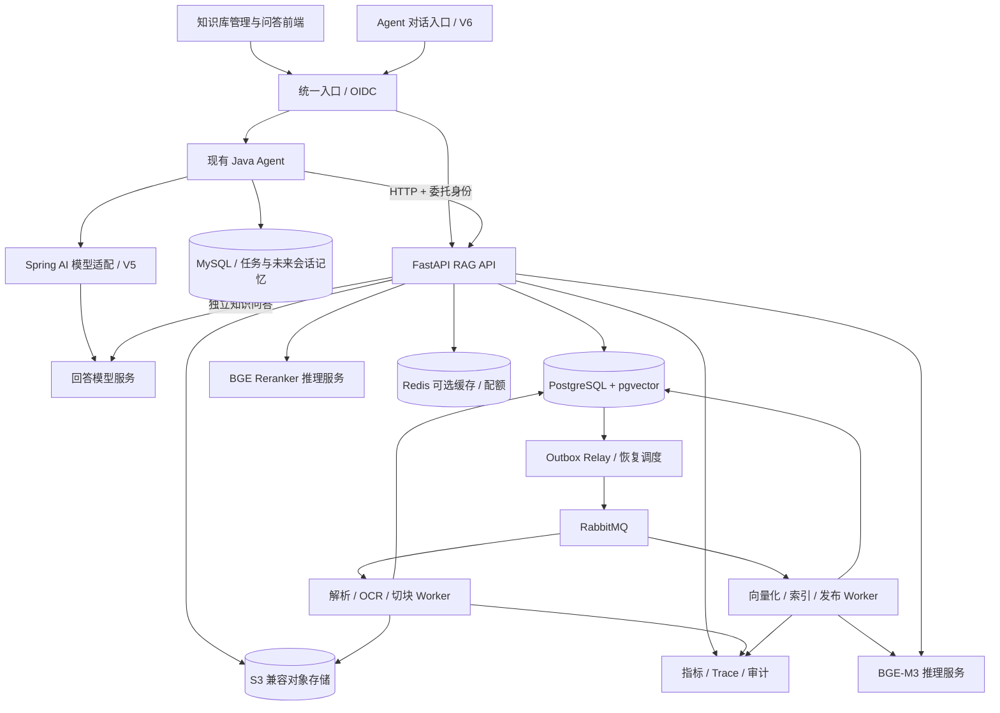

# AI Agent 面试导向版本路线与 RAG 生产化清单

更新时间：2026-11-03（V5 本地实现与有限验证完成；下一版 V6）。**后续版本以 AI Agent 面试为主要目标：补齐 Java AI 框架、短期/长期记忆、MCP、多模型与交互优化，形成可演示、可解释、有验证证据的售后 Agent。** V5 当前范围见 [交付说明](docs/agent/delivery-v5.md) 与 [验证记录](docs/agent/verification-v5-2026-11-03.md)；生产门槛仍保留。

当前代码覆盖异步入库、授权混合检索/重排、单文档版本治理，以及单轮有引用问答，尚未达到生产发布条件。V4 15 项小样本/核心测试通过；真实 DeepSeek 首次 402，用户充值后同一篇短政策/同一条问题复验通过。工作库未升级到 0004，V4 未部署。业务质量验收、rewrite、父块、整库重建、SSE/会话、企业委托与全链路生产验收仍待完成。

状态依据：[运行说明](docs/rag/implementation.md)、[V1 历史验收](docs/rag/verification-2026-11-02.md)、[V2 验收](docs/rag/verification-v2-2026-11-02.md)、[ADR-002](docs/rag/adr-002-hybrid-retrieval.md)。V2 增加隔离评测 runner、合成语料、检索与权限回归；具体实测边界以 V2 记录为准，不替代业务质量、压力、HA 和恢复验收。

V3 范围见 [开发交付文档](docs/rag/version-3.md)，实际执行范围见 [V3 测试记录](docs/rag/verification-v3-2026-11-03.md)。[测试交接清单](docs/rag/testing-v3-handoff.md) 保留完整候选场景，未全部执行。下文“待验证”指剩余迁移演练、端到端/页面或生产验证，不否定已通过的基础回归；不能引用 V1/V2 数字作为 V3 证据。

V4 范围见 [问答交付说明](docs/rag/version-4.md)、[小样本验证](docs/rag/verification-v4-2026-11-03.md)。不将 V3 的 53 项历史通过数字充当本轮全量回归，不把模拟回答测试当作真实 LLM 质量验收。[岗位差距分析](toAjob-distance.md) 的建议已转为本文第 11 节的后续开发顺序；V4 历史范围保持不变。V5 原目标见 [执行基线](docs/agent/version-5.md)，下一版本为 V6 短期记忆。

本文 `[x]` 表示该条明确范围已实现，验证边界以验收记录为准；`[ ]` 表示仍有工作未完成。涉及多项能力的总项标为“部分完成”，不因基础能力落地而把整个生产阶段勾选完成。容量、时延和质量指标仍是待实测的首发目标。

## 1. 结论与当前差距

**已采用同仓维护、独立部署的 Python/FastAPI RAG 应用，通过 HTTP 对接 Java。** RAG 负责文档接入、解析、向量索引、权限、检索、引用与 V4 单轮知识问答。Java 继续负责业务工具、任务编排和审批，V5 增加显式开关控制的任务/聊天知识集成，本地联合回答通过，企业后台凭据交换尚未实现。

FastAPI 是 API 框架，不会自动解决生产可靠性。已把解析、切块和向量化流程交给 MQ 驱动的独立 Worker，模型在独立服务运行；OCR 待补。在线查询与离线入库目前仍共用一个 embedding 实例，算力隔离/配额是后续任务。异步重计算的框架依据见 FastAPI [Background Tasks](https://fastapi.tiangolo.com/tutorial/background-tasks/#caveat)。

当前代码与差距如下；原 `KnowledgeBase` 的 3 条演示文档仅保留为 local 适配，不是远程 RAG 的故障回退：

| 实现位置 | 已实现 | 距离生产目标仍缺 |
| --- | --- | --- |
| [API 与权限](rag-service/app/main.py)、[身份校验](rag-service/app/auth.py) | KB 创建/列表、用户 ACL、文档读权限收窄、引用/原件鉴权、开发登录、OIDC 验签代码 | 实际企业 IdP 联调、组/服务账号、正式委托、策略管理 |
| [迁移](rag-service/migrations/versions/0003_document_lifecycle.py)、[生命周期](rag-service/app/lifecycle.py)、[GC](rag-service/app/version_gc.py) | 既有 PG/pgvector/RLS；V3 已开发版本编号、内容修订 CAS、发布/回滚、保留期回收和引用 tombstone | V3 独立验证；KB generation manifest、影子重建、孤立对象/S3 历史版本/备份清理 |
| [解析](rag-service/app/parsing.py)、[Worker](rag-service/app/worker.py)、[Relay](rag-service/app/dispatcher.py) | 四类基础格式、token 切块、Outbox/MQ、租约/心跳/fencing、有限重试、取消 | OCR/HTML/质量审核、解析沙箱、阶段产物检查点、DLQ 运维与实进程故障演练 |
| [Embedding](rag-inference/server.py)、[Reranker](rag-inference/reranker_server.py) | 两个固定 revision 的真实 CPU 模型、常驻/预热/就绪、reranker 文件大小/hash 校验 | 动态 batch、GPU 容量基准、线上与导入资源隔离、完整 profile 注册 |
| [检索管线](rag-service/app/retrieval/pipeline.py)、[问答](rag-service/app/answers.py) | hybrid/RRF/rerank、预算/重授权；V4 结构化问答、引用与版本门禁、调用预算和反馈，真实单条问答通过 | rewrite、父块、业务语义质量、规模容量验证 |
| [管理页面](rag-service/app/static/index.html)、[问答页面](rag-service/app/static/answers.js) | 上传/检索/授权、V3 版本治理；V4 非流式问答、引用、用量和反馈 | 页面交互验收；批量上传、复杂解析预览、回收站、SSE/会话、反馈审核与配额 |
| [Java HTTP 客户端](src/main/java/com/yu/agent/workflow/application/HttpRagKnowledgeSearchClient.java)、[查询入口](src/main/java/com/yu/agent/workflow/api/KnowledgeController.java) | local/http 适配、可信 JWT 检查、完整响应 deadline/大小限制、无状态桥接、禁止故障回 demo | 企业委托、工作库 V7 升级与生产验收、熔断与统一 trace；任务租户化/本地委托/引用约束已实现 |
| [Compose](compose.rag.yaml)、[测试](rag-service/tests/test_integration.py)、[真实验收](rag-service/scripts/acceptance.py) | 本地真实基础设施与模型运行，隔离测试库/bucket，权限和可靠性回归 | 独立 CI、经审核业务质量集、压力/恢复演练、HA/PITR、监控告警、生产发布报告 |

已有 Java JWT、工具白名单、审批、审计和 Outbox 的设计继续保留。V5 已贯通任务/聊天审计租户与回放边界；默认仍返回 `RAG_TASK_TENANCY_REQUIRED`，仅显式启用且授权条件齐备时开放。业务适配器固定单租户，企业委托未落地；RAG 达标不代表整个 Agent 已满足生产要求。

## 2. 产品范围与优先级

目标产品：供企业内部用户及业务 Agent 使用的多租户知识服务，支持“上传 → 处理进度 → 发布 → 授权搜索 → 有依据回答 → 更新/撤销 → 运营评估”的完整闭环。

近期交付目标是以 Java 售后 Agent 串起业务工具、知识证据和记忆。RAG 作为已有工程优势持续维护，开发优先级以第 11 节 V5–V10 为准；下表 P0/P1 仍表示生产发布要求，不表示必须做完全部 RAG 运维功能才能开始 Java 框架或记忆开发。面试演示通过与生产发布通过分别记录。

优先级定义：**P0 为首发阻断项；P1 为首发生产能力；P2 为上线后基于数据推进的增强项。** P0 和 P1 都要完成并通过验收才称为本文定义的生产首发；前几个阶段仅用于开发和受控试用。下表按完整功能记录状态，后文勾选仅覆盖对应子项的明确范围。

| ID | 优先级 | 功能与完成标准 | 当前状态与剩余工作 |
| --- | --- | --- | --- |
| R01 | P0 | 租户、KB、用户/组/服务账号授权；隔离测试通过 | 部分完成：租户/KB/文档用户权限与 RLS 已有；组、服务账号、正式 IdP 待补 |
| R02 | P0 | 五类格式上传、限额、校验、隔离处理、原件存储 | 部分完成：TXT/MD/文本 PDF/DOCX、10 MiB 代理上传、私有 S3；HTML、批量、扫描与沙箱待补 |
| R03 | P0 | 结构解析、token 切块、来源坐标、质量校验 | 部分完成：token 切块、PDF 页号、正文 hash、空内容拒绝；结构/质量报告与审核待补 |
| R04 | P0 | MQ、持久状态、Outbox、幂等、租约、重试、死信与恢复 | 部分完成：单 job 可靠入库链路已通；阶段检查点、DLQ、完整故障演练待补 |
| R05 | P0 | BGE-M3、pgvector、版本化索引与真实模型验收 | 部分完成：真实 dense/首版历史验收；V3 已开发单文档多版本及 profile 兼容检查，待验证；KB 代际/多 profile/重建待补 |
| R06 | P1 | rewrite、中文词法、dense、融合、rerank、上下文 | V2 已实现 hybrid/RRF/rerank、完整块去重与预算；rewrite、父块/相邻块和业务质量验收待补 |
| R07 | P0 | 无证据拒答、引用、生成前后权限；区分故障与无结果 | V4 已实现无证据/模型拒答、结论引用/摘录校验、生成前后权限/版本复核与故障区分；小样本边界和真实单条回答通过，业务语义质量待验收 |
| R08 | P0 | 内容更新、原子发布、删除/ACL 即时生效、迟到任务防护 | 部分完成：V3 已开发单文档更新、CAS 发布、回滚、历史引用与显式 GC，待验证；整库重建和完整删除/恢复传播待补 |
| R09 | P1 | OCR、表格结构、解析预览、复杂文档重跑 | 部分完成：基础 DOCX 表格转文本、失败重试已有；OCR/复杂结构与审核预览待补 |
| R10 | P1 | KB、上传、进度、版本、权限、检索调试、问答、反馈 | 部分完成：V4 增加问答/引用/用量与基本反馈页面；浏览器验收、回收站、复杂管理功能待补 |
| R11 | P1 | 问答、SSE、多轮、独立检索 API、Java Agent 与契约测试 | 部分完成：V4 非流式单轮问答 API 已开发；SSE/多轮/完整任务聊天接入待补 |
| R12 | P0 | 限流、配额、超时、隔离、审计、敏感处理与降级 | 部分完成：输入/响应上限、模型超时/并发锁、基础审计已有；V2 已有 PG 租户检索限流、12 秒预算和明确降级；上传/费用配额、算力隔离及完整脱敏策略待补 |
| R13 | P0 | 标注集、质量评测、权限回归、故障/负载演练 | 部分完成：确定性回归与真实端到端烟测通过；V2 已有 20 文档/44 题合成评测；经审核业务集、系统故障与负载验收待补 |
| R14 | P0 | 部署、监控、备份恢复、灰度回滚、runbook、配置门禁 | 部分完成：Compose、探针、基本配置门禁已有；生产运维与发布验收待补 |
| R15 | P2 | 企业连接器、增量同步、权限同步与对账 | 未开始 |
| R16 | P2 | BM25/sparse、多向量、问题拆解、多模态/GraphRAG | 未开始 |

首发不开放任意 URL 抓取，不把订单实时状态、余额等业务事实同步成 RAG 的权威来源；这类问题仍调用现有业务工具。知识内容可以解释政策，不能替代业务系统的权限、审批和交易规则。

## 3. 架构与技术决策

下图是完整生产目标。当前已运行 FastAPI、PG/pgvector、私有 MinIO、Outbox Dispatcher、RabbitMQ、单个 Celery ingestion Worker 和独立 CPU embedding 服务；V2 增加独立 CPU reranker；统一 OIDC 入口、独立阶段 Worker、LLM、Redis 与观测平台尚未部署。



RAG 是一套应用、多个运行角色。Java 保留业务执行控制，并逐版承担框架适配和会话/记忆；图中 V5/V6 节点为目标，尚未实现。同一请求选定一个主要回答生成方。

| 层 | 首版选择 | 取舍与边界 |
| --- | --- | --- |
| API | FastAPI、Pydantic、版本化 OpenAPI | API 进程只做认证、业务编排与 I/O；不加载 GPU 模型 |
| 持久化 | PostgreSQL + pgvector；psycopg 显式事务 + Alembic | 已落地；SQLAlchemy 供迁移使用，没有 ORM 实体层；保留 Java MySQL/Flyway |
| 原件与中间产物 | 私有 S3 兼容对象存储，本地 MinIO | 已存原件；解析 JSON、报告、预览产物待补 |
| 异步 | RabbitMQ + Celery；PG jobs 表为状态真相 | 不以 Celery result backend 代替任务业务状态；不承诺 exactly-once |
| 文档解析 | 已用 pypdf、python-docx 与 UTF-8 文本解析 | 复杂 PDF/DOCX 后续评估 Docling；OCR 与质量矩阵待实现 |
| Embedding | 已用 Transformers AutoModel/AutoTokenizer 独立服务化 | 固定 BGE-M3 revision，CLS pooling + L2 归一化，CPU dense；未使用 FlagEmbedding |
| Rerank | 已用固定 revision 的 `BAAI/bge-reranker-v2-m3` | 独立 CPU float32、单并发、10 候选/512 tokens（模型接口上限 20）、校验权重、超时降级 |
| 词法检索 | 已用版本化 Jieba + PostgreSQL `tsvector`/GIN | `ts_rank_cd`，不称为 BM25；编号完整匹配，旧数据幂等回填 |
| 融合 | 已用 RRF，四种固定 profile 与 fingerprint | 各路最多 50 条、按 chunk 去重；不相加原始分数 |
| 回答 | V4 已实现 DeepSeek / Chat Completions 适配，Python 直接调用 | 结构化非流式输出；充值后真实单条回答/引用/反馈通过，业务语义质量仍待验收；不通过 Java 再反调模型 |
| 前端 | 已用原生 HTML/CSS/JS，由 FastAPI 同源提供 | 当前没有 `rag-web`；复杂交互确有需要时再迁移 React/TypeScript |
| 运维 | Docker Compose 开发/集成；生产容器平台或已有平台 | 是否使用 Kubernetes 取决于现有运维能力；必须具备多副本与恢复能力 |

Python 服务和推理依赖已生成 `requirements.lock`，BGE-M3 已固定 revision。开发镜像仍有可变 tag，本地 MinIO 从固定源码 tag 构建；完整兼容矩阵、生产镜像 digest/依赖准入、模型校验流程仍需补齐。

为什么独立应用：Python 的解析和模型生态更直接；CPU、GPU、在线查询和离线入库需要不同资源；RAG 后续也能服务其他 Agent。代价是新增 Python、MQ、PG 和推理运维，需要正式的接口契约、跨服务 tracing 和故障预算。先同仓维护，未来有独立团队和发布需求再拆仓。

## 4. 文档接入、解析与异步入库

### 4.1 上传与管理

- [x] 创建/列出知识库，记录 owner，管理已有租户成员的 KB 读/上传/管理权限，见 [API](rag-service/app/main.py)。
- [ ] 增加 KB 说明、语言、保留策略、默认解析/检索配置及编辑能力。
- [x] 单文件 API 代理上传，当前上限 **10 MiB**；客户端 `Idempotency-Key` 支持重放与冲突检查，原件写入私有对象存储。
- [ ] 拖拽、多文件上传、稳定的前端重试键与重复提交提示；扩展到 50 MiB/单批 20 个前先完成资源与安全验收，租户总量可配置。
- [x] 服务端生成对象路径，完整 PUT 后在 PG 事务创建 document/version/job/outbox，返回 `202 + job_id`；Worker 读取原件后校验 SHA256。
- [ ] 增加上传会话、受限预签名凭证、隔离区和 complete API；多段上传校验所有权与完成状态，不把 ETag 无条件当作文件哈希。
- [x] 扩展名白名单、大小限制、PDF 文件头、DOCX 结构/展开总量/宏检查、文本 UTF-8/二进制检查，见 [解析器](rag-service/app/parsing.py)。
- [ ] MIME/扩展名白名单、恶意文件扫描、解压比与页数限制；解析进程无外网、非 root、有 CPU/内存/临时磁盘/时限限制。拒绝加密且无法解析的文件并显示明确原因。
- [x] 原件通过 API 鉴权代理下载，引用读取重新授权；下载原件后再次检查权限，不签发长效公开下载链接。
- [ ] 持久化规范化结果、解析报告与原文预览，分别授权并设置保留策略。
- [x] 当前上传按 tenant、actor、key 幂等，摘要包含 KB、文件名和内容哈希；同键不同摘要返回 409，无跨租户内容去重查询。
- [ ] 幂等能力扩展到其他写操作时增加 operation 范围、回放记录与到期策略。
- [ ] 过期上传、孤立对象有定时回收与审计；对象存储与 PG 不假装共享一个事务。

### 4.2 解析与切块

- [x] 实现 TXT/Markdown、文本 PDF、DOCX 基础解析；PDF 记录真实页号，DOCX 按正文顺序提取段落/表格文本；空内容不发布。复杂文档格式质量尚未完成专项验收。
- [x] 使用 BGE tokenizer offset 按 **480 tokens / 64 overlap** 切块，保留原文和内容 hash；最多 100 页、30 万字符、1000 块，见 [配置](rag-service/app/config.py) 和 [推理服务](rag-inference/server.py)。
- [ ] 定义统一 `ParsedDocument`：标题、章节、段落、列表、表格、页号、bbox（可得时）、字符偏移、语言、质量标记、parser revision。
- [ ] PDF 区分文本页、扫描页和混合页；低文本密度时路由 OCR；清理重复页眉页脚，保留阅读顺序。DOCX 保留标题层级和表格；HTML 清理脚本及外链，不执行内容。
- [ ] 表格保留表头与行关联，过长表格按行组切分并重复必要表头。没有可靠坐标时返回章节/偏移，不能编造页码。
- [ ] 在已有 token 切块上补充标题/章节/表格结构优先策略，通过评测调整长度与重叠；不能把基础段落/页分块算作复杂版面已验收。
- [ ] 保存 `parent_chunk_id`、章节路径、前后邻接关系；检索小块，按权限和 token 预算补充父段及相邻段。
- [ ] 标题路径可参与 embedding；保存实际 embedding 输入哈希和展示正文，确保可以复现和引用。
- [ ] 空文本、明显乱码、OCR 低置信度、表格失真进入 `NEEDS_REVIEW`；支持预览和重新解析，不静默发布。
- [ ] 元数据、解析器、切块器与 tokenizer 版本全部记录；只修改 ACL 不触发重新向量化。

Docling 提供多种格式转换能力，但“库支持格式”不等于本项目已经验收该格式；仍需准备实际中文 PDF、扫描件与表格样本。见 [Docling supported formats](https://docling-project.github.io/docling/usage/supported_formats/)。

### 4.3 任务状态与可靠性

当前状态机为 `QUEUED → PARSING → EMBEDDING → INDEXING → SUCCEEDED`，另有 `RETRY_WAIT / FAILED / CANCELLED`。校验在上传及解析阶段执行，分块并入 EMBEDDING，发布并入 INDEXING；尚无独立 `CHUNKING / READY_TO_PUBLISH / NEEDS_REVIEW` 状态。

- [x] [Relay](rag-service/app/dispatcher.py) 用 PG 行锁领取 Outbox，持久消息确认后标记发送；失败保留待投递记录。
- [x] [Worker](rag-service/app/worker.py) 使用租约/心跳/fencing，重复投递只允许一个有效处理者发布；删除、取消、失效租约或上传权限撤销均不能正常发布旧结果。
- [x] 当前默认租约 180 秒、心跳约 60 秒、队列恢复阈值 30 秒；每轮最多 3 次尝试，退避重试，失败可由有权限的管理者手动重试；状态保存在 PG。
- [x] [Celery 配置](rag-service/app/queue.py) 使用 quorum 队列、publisher confirm、late ACK、reject-on-worker-lost 和 prefetch=1；当前开发环境只有单 RabbitMQ 节点，不具备集群 HA。
- [ ] 阶段产物检查点、分阶段队列、DLQ 管理、抖动退避、细粒度恢复与真实 kill/乱序/依赖切换演练。当前重试会重新解析和计算整份文档。

下面保留完整生产状态机及可靠性目标，尚未全部实现：


以上是目标 ingestion job 的阶段，**不是文档可检索状态**。当前发布事务成功前没有可检索的半成品。V3 将 READY 索引与 active 发布指针分开，新版处理失败时保留旧版；该行为待独立验证。`NEEDS_REVIEW`、`resume_stage` 和阶段产物仍待实现。

1. API 在 PG 同一事务写 `document_version + ingestion_job + outbox_event`。原件上传已完成才进入这个事务；失败留下的孤立对象由回收器处理。
2. Relay 有租约地领取 Outbox，发布持久消息并等待 publisher confirm；确认后再标记已发送。发布成功后进程崩溃可能重复投递，所以消费者必须幂等。
3. 消息仅含 `schema_version/event_id/tenant_id/job_id/stage/traceparent` 等定位信息，不携带正文、密钥或客户端指定的可执行函数。消费者按固定任务白名单处理并回查 PG。
4. Worker 领取阶段租约和递增 fencing token。幂等键为 `(tenant_id, document_version_id, pipeline_revision, stage, batch_no)`；结果唯一约束防止重复 chunk/vector。
5. 阶段结果、状态变更、下一阶段 Outbox 在同一事务提交，再 ACK。外部模型调用不占长数据库事务；HTTP 调用必须有超时。重复推理最多增加计算，不能重复发布。
6. Worker 心跳续租；过期任务由恢复调度重新投递。旧 Worker 即使恢复，也因 fencing token 不匹配而不能提交、覆盖或发布。
7. 网络、429、可恢复 5xx 指数退避并加抖动；当前最多 3 次，生产次数和退避预算经演练确定。格式错误、授权失败、不可解析输入不盲目重试。DLQ 和失败任务列表都可人工重放，重放也检查当前版本/删除状态。
8. 使用 Celery late ACK 时，同时评估 `task_reject_on_worker_lost`、worker prefetch、RabbitMQ consumer timeout；不能仅设置 `acks_late` 就认为所有进程丢失都会恢复。PG 恢复器兜底卡住的任务，毒任务有尝试上限。
9. 分离 parse、OCR、embed、publish、cleanup 队列；在线 embedding 与批量导入分别限额或独立部署。长任务切批并记录检查点，避免单个大文件占住 Worker。
10. 取消为协作式：停止新阶段、批次之间检查取消/删除标记；已在执行的推理可能完成，但结果不能发布。UI 显示阶段、进度、失败原因和最后心跳。

RabbitMQ 的 publisher confirms 与 consumer ACK 是不同确认环节；Celery 的 late ACK 也有进程退出例外。实现与故障测试依据：[RabbitMQ confirms](https://www.rabbitmq.com/docs/confirms)、[Celery tasks](https://docs.celeryq.dev/en/stable/userguide/tasks.html)。

## 5. Embedding、PostgreSQL 与索引生命周期

### 5.1 BGE-M3 推理

- [x] 真实 `BAAI/bge-m3` **1024 维 dense** 写入 PG `vector(1024)`，已通过端到端烟测。模型支持最长 8192 tokens，当前服务主动限制为 **1024 tokens/条**；未实现 sparse/multi-vector。见 [模型卡](https://huggingface.co/BAAI/bge-m3) 和 [实现](rag-inference/server.py)。
- [x] 模型/tokenizer 固定 revision `5617a9f61b028005a4858fdac845db406aefb181`，CPU CLS + L2 归一化；查询和文档检查 `bge-m3-dense-v1` profile。下载脚本记录文件 SHA256 manifest。
- [ ] 把精度、预处理、tokenizer、最大长度等组成可注册的不可变 profile；补充权重可信校验和比对及启动完整性验证。已有 hash 记录不等同于这些强校验全部实现。
- [x] 启动预热/readiness、单推理锁、忙时 429、输入限制；请求最多 8 条，Worker 每批 4 块，HTTP 超时默认 120 秒，客户端校验维数/NaN/Inf/零向量。
- [ ] 有界排队/全链路 deadline、OOM 缩批与重试、面向在线请求的独立配额。
- [ ] 按 token 总量动态组 batch；单独记录 CPU/GPU、精度、批量、输入长度的吞吐和质量结果。CPU 模式用于开发及明确接受慢速的场景，不据此推算 GPU 生产容量。
- [x] 模型常驻独立 CPU 进程，API/Worker 通过 HTTP 调用；Compose 中 Worker 等 embedding 健康后启动，模型权重存在命名卷。
- [ ] embedding 缓存按 tenant、输入内容哈希、完整 profile 隔离；去重缓存不是访问权限来源。

### 5.2 主要数据模型

当前 [0001 迁移](rag-service/migrations/versions/0001_initial.py) 创建租户、KB/ACL、文档/版本、入库任务/Outbox、chunks 和审计表；0002 增加词法索引与检索限流。V3 的 [0003](rag-service/migrations/versions/0003_document_lifecycle.py) 增加版本生命周期字段、`publication_events`、`version_gc_tasks`、`citation_tombstones`，含租户复合约束和 FORCE RLS，尚未执行。向量仍在 `chunks.embedding`，`active_version_id` 指向当前发布版本；引用 ID 是 chunk ID，回收后保留 tombstone。

以下表格是后续完整模型目标，**不代表这些表或字段已存在**。V4 的 0004 已增加 `answer_runs` 元数据与 `answer_feedback`；不保存问题/回答正文。尚缺组、上传会话、chunk_sets、独立 embeddings、generation manifest、job_steps、processed_events、完整 profile/查询/会话模型。已有表继续使用增量迁移和租户复合约束。

| 表/实体 | 关键内容 |
| --- | --- |
| `tenants` / `tenant_memberships` / `group_memberships` | 租户、有效成员、组与 membership revision；身份来自已验证认证 |
| `knowledge_bases` | 名称、owner、策略、`active_generation_id`、`content_revision`、`acl_revision` |
| `documents` | 稳定 document_id、kb_id、source_key、生命周期、tombstone、acl_revision |
| `upload_sessions` / `idempotency_requests` | 受限对象定位、大小/哈希、过期时间、完成状态；请求摘要与响应回放 |
| `document_versions` | 不可变内容版本、对象定位、sha256、标题、语言、生效/失效时间、上传人 |
| `chunk_sets` | document_version、parser/chunker/embedding profile、产物状态、校验摘要 |
| `chunks` | chunk_set、文本、token 数、父子/邻接关系、页码/章节/偏移、`tsvector` |
| `chunk_embeddings` | chunk_id、embedding_profile、1024 维向量、输入哈希；唯一键防重复 |
| `index_generations` / `generation_documents` | KB 索引代际、base_generation、发布状态；manifest 映射 document 到 version/chunk_set |
| `acl_bindings` | tenant/KB/document、主体类型、主体 ID、read/upload/manage/publish 等动作 |
| `ingestion_jobs` / `job_steps` | 阶段、attempt、lease、fence、进度、错误、取消标记、产物定位 |
| `outbox_events` / `processed_events` | 投递租约、确认、消费去重、事件 schema 版本 |
| `retrieval_profiles` / `model_profiles` | rewrite/召回/rerank/上下文/模型参数及不可变版本 |
| `query_runs` / `answer_runs` / `feedback` | trace、版本、耗时、用量、引用 ID、反馈；敏感正文有单独保留策略 |
| `citations` | query/answer、tenant、document_version、chunk、定位与内容哈希；引用读取时重新授权 |
| 会话/记忆关联 | 会话、消息、摘要与长期记忆权威状态由 Java 管理（V6/V7）；RAG 仅保留必要关联 ID 和证据定位，历史证据再次使用时重新授权，不另建一套对话权威状态 |
| `audit_events` | 上传、发布、撤权、删除、下载、管理操作与前后 revision，限制访问 |

目标关系：KB 当前指针 → generation manifest → 文档版本 → chunk_set → chunk / embedding；ACL 和 tombstone 读取当前权威状态，不从旧 manifest 恢复授权。

manifest 引用不可变 chunk_set，未变化的文档复用旧产物，不重新计算全库 embedding。初版每次发布构建完整 manifest，成本随文档数增长；在目标规模压测复制与清理成本，必要时再引入增量 manifest，避免过早实现复杂的快照链。

### 5.3 检索索引与性能

- [x] 当前按 tenant、选定 KB、文档未删除、`active_version_id`、embedding profile 和文档 ACL 约束检索，使用 cosine 精确排序；HNSW 已建，但当前检索主动关闭 index scan，尚未启用 ANN。
- [x] 连接池最大 8，事务内 statement timeout 为 10 秒；后续仍需测量查询计划、扫描量与并发容量。
- [ ] dense 使用 cosine distance 与匹配的 HNSW opclass；租户、KB、版本映射、状态和 ACL join 键建立关系索引；词法字段建立 GIN 索引。
- [ ] 查询在 SQL 中包含 tenant、有效文档、当前 generation 和 ACL 约束，未授权内容不能交给 reranker/LLM。不能先取全库 top-k 到应用，再过滤出“有权限结果”。
- [ ] 注意：SQL 有权限条件不代表 HNSW 物理扫描先完成权限过滤。pgvector ANN 过滤可能减少候选，应评估 iterative scan、扩大扫描预算、按租户/KB 分区及小授权集上的精确检索回退。分别测试授权覆盖 1%、10%、100% 的召回和耗时。见 [pgvector filtering](https://github.com/pgvector/pgvector#filtering)。
- [ ] `EXPLAIN ANALYZE` 验证实际查询计划、ACL join 和 LIMIT；记录 ANN 相对精确搜索的 Recall@k；限制 statement timeout、连接池与最大扫描量。
- [ ] 优先共享逻辑模型；超大或高隔离租户可迁独立分区/实例。容量压测证明 PG 不满足成本或 SLO 后，再评估独立搜索引擎。
- [ ] 维护 vacuum、统计信息、索引膨胀、WAL、备份窗口和重建磁盘余量；清理旧 generation 前检查运行请求和保留策略。

### 5.4 更新、发布、删除与回滚

V3 已开发单文档生命周期，尚未验证：不可变新版上传，旧版持续服务；Worker 原子写齐 dense/词法索引后标记 READY，人工发布或显式自动发布以 `content_revision` 做 CAS；冲突保留候选版；管理员可回滚已发布且 profile 兼容的版本。ACL 的 `revision` 独立管理，删除、发布、回收共用文档锁。历史引用固定原版本并复核当前权限，回收后用 tombstone 返回 410。保留期/最近 N 版/hold 保护、显式 GC 队列、租约/fencing 与重试代码见 [V3 说明](docs/rag/version-3.md)。

**KB manifest、整库影子重建、跨文档原子发布、孤立对象和备份清理仍未实现。** 下面 1–8 是完整生产目标，不能把单文档 CAS 当成整库 generation CAS 已完成。

1. **内容更新**：新建 document_version 和 chunk_set；旧 generation 持续服务。索引完整性、解析质量、授权与发布权限通过后才创建候选 manifest。
2. **原子发布**：事务内以 `base_generation_id` 做 CAS 切换 KB 指针并增加 content_revision。并发发布冲突先基于最新 manifest 合并，确认同一文档没有更新冲突，不能静默覆盖另一份更新。
3. **检索快照**：一次查询固定 generation/profile；后续取正文、父块、引用都使用同一版本。最终输出前再校验当前权限、tombstone；关键政策若中途失效，丢弃证据并要求重试。
4. **重新建库**：换 parser/chunker/embedding profile 时创建影子 generation，用新 profile 做全量构建和评测。记录源版本水位，补齐期间更新/删除，短暂发布锁下核对水位再切换，防止全量重建覆盖增量更新。
5. **撤权/下架/删除**：同步事务设置 ACL revision 或 tombstone，提交后新查询立即不可见；不等待 MQ 清向量。队列异步清理原件、预览、向量与缓存，展示清理进度和失败重试。
6. **晚到任务**：每次提交及发布检查 tenant、tombstone、document revision、fence；删除后的旧任务只能结束，不能恢复文档。
7. **回滚**：允许授权管理员选择仍可使用的旧 generation，记录理由；实时 ACL/tombstone 仍生效，旧版本不得恢复已删除或已禁止的政策。
8. **清理与恢复**：物理清理先设置可审计的保留期，再执行幂等 GC。覆盖对象版本、缓存、复制与备份中的保留行为；从备份恢复后必须重放删除/撤权记录，检查完成才开放查询。删除/撤权账本需要独立可靠副本或从权威源重新对账；不能用允许丢失最近 15 分钟数据的业务备份证明权限仍是最新，无法确认时保持拒绝访问。

## 6. 在线检索与回答链路

V2 检索链路为“鉴权/PG 租户限流 → NFKC 规范化 → dense、中文词法与编号并行召回 → RRF → 权限复核 → 可选 rerank → 最终权限复核 → 完整块去重/预算 → 引用与诊断”。query 最多 2000 字符、5 个 KB、top_k 1–20。V4 已在此基础上增加单轮回答 LLM；rewrite、父块扩展与会话仍待实现。


### 6.1 Query 优化与路由

- [x] NFKC/casefold/首尾空白规范化，中文 query 与文档使用同一分词规则，保留否定词和数字，完整字母数字编号另行提取；查询长度有限制。尚无会话历史或 LLM rewrite。
- [x] 显式指定的 KB 逐个鉴权，向量化后重新确认成员与 KB 权限；未经授权的 KB 返回 404，查询不能扩大租户范围。
- [ ] 接入模型路由后，模型建议只能缩小服务端允许列表，不能扩大授权范围。
- [ ] 多 KB 的 active generation 若使用不同 embedding profile，按 profile 分组编码和检索，只在融合阶段合并排名；限制 KB 数、分组数和总候选预算，不比较不同模型的向量距离。
- [ ] V6 由 Java 读取本租户、本会话授权历史，把“那退款呢”改写成独立问题后提交 RAG；历史引用及派生摘要失权后不能继续进入 prompt，RAG 不自行加载聊天历史。
- [ ] rewrite 输出结构化字段，有 schema 校验、超时和 token 预算；默认保留原 query，再增加最多 1 条改写，避免改写丢失事实。
- [ ] 编号、短精确查询可跳过 rewrite；只对歧义问题启用澄清、术语扩展。初版不对每个问题自动做无限 multi-query/HyDE/多跳循环。
- [ ] 存储脱敏的 original/rewrite、策略版本和各通道耗时，能检查“改写让效果变差”的样本。

### 6.2 Hybrid search 与 rerank

V2 实际参数来自 [profiles.json](rag-service/app/retrieval/profiles.json)：dense/lexical/identifier 各 top-50，总候选最多 150 条，RRF k=60，融合后最多 10 条送 rerank，未重排尾部保持 RRF 顺序；最终最多 top_k（1–20）块、单文档最多 3 块、2400 BGE tokens（含每块 24 tokens 引用预留）。保留 dense-only、lexical-only、hybrid 与 hybrid-rerank 四种对照。

1. **Dense**：BGE-M3 编码原问题/改写后做授权范围内语义召回，能覆盖同义表达。
2. **词法**：中文用可替换、版本化的分词适配器和业务词典，V2 已固定 [Jieba](https://github.com/fxsjy/jieba) 0.42.1，HMM=false 与词典 hash 参与 profile；文档与 query 使用同一规则，构建 PostgreSQL `simple` 配置的 `tsvector` 并用 GIN 检索。增加 SKU、政策编号等独立精确字段。SQL 参数化、过滤字段允许列表、tsquery 安全构造，禁止把模型输出拼成 SQL 或未经校验的查询表达式。
3. **明确技术名称**：PostgreSQL `ts_rank/ts_rank_cd` 是全文相关性排序，不能写成 BM25；默认配置也不能替代已验证的中文分词方案。见 [PostgreSQL text search ranking](https://www.postgresql.org/docs/current/textsearch-controls.html#TEXTSEARCH-RANKING)。
4. **融合**：采用 RRF，初始 `sum(weight_i / (60 + rank_i))`；按检索通道控制权重，限制多条改写对单一通道的重复加权；保留每路 rank 和原始分数用于调试。
5. **Rerank**：用 `BAAI/bge-reranker-v2-m3` 对 query/passage 重排，限制每对输入长度和候选数。score 即使经过 sigmoid，也不当作“答案正确概率”；拒答阈值通过业务数据校准。见 [reranker 模型卡](https://huggingface.co/BAAI/bge-reranker-v2-m3)。
6. **上下文**：V2 已做内容 hash 精确去重、单文档上限、BGE token 预算，完整保留原块引用。相邻块合并、近重复/父块、多样性与回答模型 system/历史/输出预算仍待实现。

BGE-M3 sparse 与普通全文检索是不同通道。后续若引入 sparse/BM25/多向量，需要单独设计索引、版本、ACL、更新和压测，不能因为模型能输出就算系统已经支持。

### 6.3 生成、引用和多轮

- [x] `/search` 返回检索证据、版本、内容 hash 和引用，不调用回答 LLM。
- [x] V4 `/answers` 复用检索管线，已实现结构化回答与逐条引用；小样本边界与一条真实 DeepSeek 回答/引用/反馈通过，未宣称广泛回答质量达标。
- [x] V4 生成前后复核全部发送来源的当前权限、version/hash/content_revision；错误引用、撤权或换版不返回生成正文。引用可追溯不等于语义正确。
- [ ] 回答区分 `answered`、`insufficient_evidence`、`needs_clarification`、`degraded`；未经授权资源不通过回答泄露标题、存在性、计数或路径。
- [ ] prompt 明确资料只是证据，不能改变系统指令或调用工具。文档中的“忽略规则”“泄露密钥”等属于不可信内容；关键词黑名单只能辅助，不能充当完整防护。
- [x] 命中与引用提供 document/version/chunk ID、可得的页/章节、原文和内容 hash；URL 由服务端构造。V3 引用固定历史版本并标注是否当前生效，读取检查实时权限与保留状态（新增语义待验证）。章节信息可为空，不编造位置。
- [ ] 发布给用户前验证引用存在、来源属于本次授权检索、版本一致、关键陈述有支持；自动规则负责结构和可追溯性，语义支持需要评测与人工抽检，不声称检查引用 ID 就能证明回答正确。
- [ ] 证据冲突时标明版本与适用日期、请求澄清或转人工；无证据不能让 LLM 凭常识补写公司政策。退款等动作继续受 Java 工具与审批控制。
- [ ] 对敏感 KB 默认缓冲全文，完成校验后输出。普通 SSE 可按已校验段落发送；已发送文本无法撤回，权限变更时取消余下生成并记录，前端不把未完成流标为完成答案。
- [ ] V6 由 Java 管理多轮会话，具备 tenant/owner/参与者授权、保留期、删除、token 裁剪与摘要；历史证据及其派生摘要在使用/展示前重新授权。V7 增加可确认、纠错、过期和遗忘的长期记忆；两者不等同于任务审计或知识库。
- [ ] 反馈记录答案 ID、问题分类与纠正建议，经授权人工审核后进入评测/知识修订，不自动写入正式知识。

### 6.4 超时、降级与成本

V2 检索在身份认证后共享 12 秒 deadline，embedding 4 秒、rerank 6 秒子预算；正常查询返回 status=ok，允许的模型故障返回 status=degraded 与 degraded_components。dense-only 模型故障返回 503；hybrid 仅在当前授权范围词法索引完整时允许 embedding 故障回退；rerank 失败回退 RRF。总预算耗尽返回 504，PG/权限故障失败关闭。Java 的 KB 列表与检索仍共用默认 15 秒 deadline。下面包含尚未实现的 rewrite/LLM/Redis 目标行为。

| 故障 | 行为 |
| --- | --- |
| rewrite 超时/非法输出 | 用原 query 继续，记录降级 |
| embedding 不可用 | 允许配置的 KB 走授权词法检索，注明降级；未达到证据门槛则拒答 |
| 词法通道故障 | 可用 dense 通道继续，记录缺失通道；关键编号查询可选择直接失败 |
| rerank 超时 | 使用融合排序，保守证据门槛；高敏感 KB 可要求失败关闭 |
| LLM 超时/限流 | 返回可用引用与可重试错误，不伪造答案；已开始的流不透明重放 |
| PG/权限服务不可用 | 失败关闭，返回 503；不从可能过期的缓存读取敏感答案 |
| MQ 不可用 | 已持久化任务保持待投递；达到积压/配额上限拒绝新上传，查询已发布知识仍可用 |
| Redis 不可用 | 查询缓存旁路；配额无法可靠计量时采用保守限额或拒绝高成本请求 |

生产目标检索 deadline 3 秒、回答整体 30 秒，仍需硬件/压测验证；当前 CPU 开发配置检索为 12 秒。总预算向下游传播，允许的重试次数和时间都包含其中。按租户限制 QPS、上传量、索引 token、并发、每日 LLM token 与费用，接近限额告警；查询成功率与“完整管线成功率”分开统计，避免长期降级被当作健康。

## 7. 权限、身份与数据安全

### 7.1 权限模型

当前 tenant membership、KB `reader/contributor/manager` 与文档 `allowed_subjects` 收窄已实现；tenant admin 只能管理自己的租户，读取文档仍受文档读权限约束。当前可信上传在成功处理后自动发布，Worker 发布前重新检查上传者权限；尚未分离 Publisher、人工发布流程、组或 service account。以下角色表描述生产目标，Contributor“没有自动发布权”需后续动作权限拆分后落实。

先采用可解释的模型：tenant membership 为前提，KB RBAC 决定 read/upload/manage/publish 等动作；document ACL 默认继承 KB，也可显式缩小可读主体范围。文档级规则不能越过 KB 访问门槛，首版不设计任意互相覆盖的 deny/allow 层级。

| 主体 | 默认权限 |
| --- | --- |
| Reader | 搜索、问答、查看其授权原文 |
| Contributor | 在被授权 KB 上传、查看自己的处理任务；没有自动发布权 |
| KB Manager / Publisher | 管理对应 KB、版本发布/回滚、权限与删除；操作留审计 |
| Tenant Admin | 管理本租户 KB 和成员，不等于其他租户管理员 |
| Service Account | 明确绑定租户/KB/scope；调用时不能随意代入任意用户 |

V3 首次上传保留自动发布，新版默认人工发布，调用者可显式开启自动发布；自动发布要求当前写权限和文档读 ACL，并受内容修订 CAS 约束。人工发布/回滚要求 manager。**目前尚无 KB 级强制审批策略，contributor 可选择自动发布，不能把默认人工发布称为不可绕过的审核流程。** 后续补 KB 策略和审批职责分离。RAG 以 PG 成员角色/KB ACL 授权，Java JWT 的 `roles` 不自动成为 RAG 权限。

### 7.2 身份贯通与防越权

- [x] RAG 验证 JWT 签名、issuer、audience、exp/iat、tenant/sub，并查询当前有效成员；tenant/user 不取自任意请求体或 `X-Role`，KB 操作按当前数据库角色授权。
- [ ] 在已有 local HS256 / OIDC RS256-JWKS 验签代码基础上，完成真实 IdP 联调、action scope、组映射、密钥轮换与正式委托测试。
- [ ] 浏览器使用 OIDC 登录；Java 使用 IdP 支持的 token exchange/on-behalf-of 获取 RAG audience 的短期委托 token，或经正式配置的受信网关签发委托凭证。不能把只适用于 Java audience 的 token 直接当作 RAG 凭证。
- [ ] 无用户上下文的定时任务使用受限 service identity；需要代用户执行的持久任务保存主体/租户/委托授权引用，执行时重新验证授权，不将原始 Bearer token 写入数据库、工具参数或日志。
- [ ] Java 端将认证上下文贯通到 ToolContext、任务恢复和聊天入口；工具参数中的 query/KB ID 不允许覆盖服务端主体。缺少可信租户的旧任务不能默认使用任意租户。
- [x] 已有 KB/文档列表、任务状态与操作、检索、引用、原件接口均检查租户/资源权限；相关越权回归已通过。
- [ ] 后续增加预览、反馈、会话、统计接口时同步覆盖鉴权与泄露测试。
- [x] PG 租户表启用 FORCE RLS，事务级设置 tenant；API 启动拒绝 superuser/BYPASSRLS；连接池租户不残留测试通过。迁移与 API/Worker/Dispatcher 使用分离 DB 角色，见 [迁移](rag-service/migrations/versions/0001_initial.py)。
- [ ] 进一步收紧角色到各自最小 SQL 权限，剥离开发共用环境中的管理凭据并验收生产密钥注入；不能把本地账号分离等同于生产最小权限全部完成。RLS 机制参考 [PostgreSQL 文档](https://www.postgresql.org/docs/current/ddl-rowsecurity.html)。
- [x] API 缺失/无效身份拒绝访问；Worker 以消息中的 tenant/job 定位 PG 权威记录，发布前重新检查上传者权限。
- [ ] 完成 MQ 伪造/跨租户 job 组合、受限 service identity 和生产 Worker 最小权限回归，不能只凭 MQ 网络隔离推断消息可信。

### 7.3 撤权、缓存与审计

- [x] 当前 KB/文档 ACL 和成员状态从 PG 读取；搜索在重排前/输出前（包括 debug）、原件下载后重新确认权限；KB 撤权在途查询回归通过。文档 ACL 使用 expected_revision，成员/KB 尚无统一 revision 体系。
- [x] 当前无共享答案/检索结果缓存；审计记录上传、发布、权限变更、删除、下载和任务管理；页面用 textContent 展示正文并设置 CSP/no-store。
- [ ] ACL/成员关系以权威存储 revision 为准；不能只靠长效 JWT 中的旧角色实现立即撤权。外部 IdP 组同步需要确定时延，在同步完成前不能声称源站撤权已经即时生效。
- [ ] 如后续引入检索/答案缓存，key 至少含 tenant、主体权限指纹、membership/ACL revision、KB content revision、generation、query、检索 profile；取缓存后仍检查当前权限和 tombstone。
- [ ] 权限事务提交后新请求拒绝旧授权；对已在途生成，在调用外部模型前和输出前重新检查，SSE 每批输出检查撤销信号。已经传给已批准模型供应方或发给用户的数据无法追溯收回，需要明确记录这一边界。
- [ ] tenant 级配置是否允许资料发送外部 LLM；不允许时用私有推理或只返回检索结果。模型调用、日志和评测样本有脱敏与保留策略。
- [ ] 日志默认记录 ID、hash、耗时和用量，不记完整原文、token、secret；调试正文需授权、采样、到期删除。审计导出也受权限限制。
- [ ] 原文/Markdown/HTML 预览防 XSS；CORS 使用允许列表；若使用 Cookie 会话加入 CSRF 防护；连接器阶段必须防 SSRF 和源站权限漂移。

## 8. API、前端与 Java 对接

### 8.1 已实现 API 与后续接口

业务前缀 `/api/v1`；健康检查位于 `/health/*`。仓库 [openapi.json](docs/rag/openapi.json) 通过 `scripts/export_openapi.py` 从实际路由生成 0.4.0 契约。上传、发布和回滚要求 `Idempotency-Key`；ACL 修改使用 `expected_revision`，新版上传/发布/回滚/回收使用 `expected_content_revision`。V4 问答不支持幂等键/答案缓存，反馈按回答与主体 upsert。已返回 `X-Request-ID`，尚未贯通 `traceparent`。

| API（除 health 外省略 `/api/v1`） | 状态 | 当前行为 / 后续工作 |
| --- | --- | --- |
| `POST/GET /knowledge-bases` | 已实现 | 创建/列出可见 KB，列表最多 100 项；详情/编辑待补 |
| `GET/PATCH /knowledge-bases/{kb_id}` | 待实现 | KB 详情与策略修改 |
| `PUT /knowledge-bases/{kb_id}/acl`、`DELETE .../acl/{subject}` | 已实现 | 授予/撤销本租户已有用户的 KB 权限 |
| `POST /knowledge-bases/{kb_id}/documents` | 已实现 | multipart `file` + `Idempotency-Key`，返回 202/job_id；小文件代理上传 |
| `POST /knowledge-bases/{kb_id}/uploads`、`POST /uploads/{id}/complete` | 待实现 | 预签名上传会话和完成校验 |
| `GET /knowledge-bases/{kb_id}/documents` | 已实现 | 文档、处理状态、失败原因，最多 100 项；游标分页待补 |
| `DELETE /documents/{document_id}` | 已实现，V3 修改待验证 | 逻辑删除、解除 active 指针、递增内容/ACL 修订并取消未成功任务；物理清理另排队 |
| `GET /documents/{document_id}/original` | 已实现 | 已发布原件鉴权代理下载 |
| `GET /documents/{document_id}`、`GET/POST .../versions` | V3 已开发待验证 | 详情、分页历史、新版上传与内容修订检查 |
| `POST .../versions/{version_id}/publish`、`.../rollback` | V3 已开发待验证 | manager、CAS、幂等和发布审计；回滚要求曾发布、未回收且 profile 兼容 |
| `GET .../versions/compare`、`.../versions/{version_id}/original`、`.../publication-events` | V3 已开发待验证 | 有界正文比较、固定版本原件、分页发布记录；草稿限制可见性 |
| `PUT .../versions/{version_id}/retention-hold`、`POST .../retention/preview`、`.../retention/purge` | V3 已开发待验证 | 保留保护、回收预览、显式排队；GC 为独立可选进程 |
| `POST /documents/{document_id}/reindex` | 待实现 | 指定配置重建 |
| `PUT /documents/{document_id}/acl` | 已实现 | `subjects` 收窄/恢复继承，`expected_revision` 冲突返回 409 |
| `GET /jobs/{job_id}`、`POST .../retry`、`POST .../cancel` | 已实现 | 状态查询、失败重试、未发布任务取消 |
| `GET /jobs/{job_id}/events` | 待实现 | SSE 进度；当前 UI 每 4 秒轮询 |
| `POST /knowledge-bases/{kb_id}/publish`、`.../rollback` | 待实现 | generation 发布/回滚 |
| `POST /search` | 已实现 | 四种 profile 授权检索，返回证据/引用、分数类型、耗时与降级状态 |
| `POST /search/debug` | V2 已实现 | tenant admin/选中 KB manager 可查看已授权候选、通道排名、RRF/重排与预算 |
| `GET /citations/{chunk_id}` | 已实现，V3 修改待验证 | 固定版本引用和 current/historical 标记；实时权限检查，已回收返回 410，失权/已删除不泄露正文 |
| `POST /answers`、`POST /answers/{id}/feedback` | V4 已实现，小样本通过 | 单轮非流式、三种回答状态、来源/摘录门禁、当前授权、主体隔离反馈；SSE/会话待补 |
| Java 侧 `POST/GET /conversations`、`GET/DELETE /conversations/{id}` | V6 候选契约，未实现 | 会话与消息由 Java 管理；具体路径在 V6 定稿，不属于当前 RAG OpenAPI |
| `GET /me`、`GET /config`、`POST /auth/dev-token` | 已实现 | 当前身份、公开配置、本地开发登录；dev-token 有环境开关，生产禁止开启 |
| `GET /health/live`、`GET /health/ready` | 已实现 | 存活；PG/S3/embedding profile 就绪检查，尚非全栈业务健康证明 |
| 内部 `/metrics` | 待实现 | 指标端点与监控接入 |

当前可用搜索请求示意：KB ID 必须为 UUID，身份不由请求体提交；`conversation_id/filters` 尚不支持，额外字段会被拒绝。

```json
{
  "query": "已经发货还能退吗？",
  "knowledge_base_ids": ["f5972e06-79d8-4dcd-809d-3b4a9efce9da"],
  "top_k": 5,
  "profile": "hybrid-rerank-v2"
}
```

当前返回结构示意：ID/分数仅为示例；尚无 generation_ids/rewrite。distance 只对 dense 命中有值；score_type 为 rrf 或 reranker_logit，均不代表答案正确概率。实际响应含 profile_fingerprint、lexical_profile、reranker_profile、degraded_components、context_tokens、token_budget_basis 与 timings_ms，完整类型以 OpenAPI 为准。

```json
{
  "request_id": "8bf08691-243f-4567-a827-dff6ed1563b6",
  "status": "ok",
  "retrieval_profile_id": "hybrid-rerank-v2",
  "embedding_profile": "bge-m3-dense-v1",
  "degraded_components": [],
  "hits": [{
    "document_id": "bd19be4b-649e-4f01-8068-893d9362a5c7",
    "document_version_id": "420699b3-ef61-4e47-9b9f-e36489a8fb26",
    "chunk_id": "9fe0d1e8-9b0c-4e4f-b636-81b61037da43",
    "title": "售后政策",
    "text": "已发货订单的退款需要主管审批。",
    "page": null,
    "section": null,
    "content_hash": "示例：原文内容的SHA256",
    "distance": 0.25,
    "score": 3.09,
    "score_type": "reranker_logit",
    "citation": {
      "id": "9fe0d1e8-9b0c-4e4f-b636-81b61037da43",
      "url": "/api/v1/citations/9fe0d1e8-9b0c-4e4f-b636-81b61037da43",
      "page": null,
      "section": null
    }
  }],
  "degraded_components": []
}
```

当前语义：已授权 KB 没有可读命中时返回 `200 + empty hits`；KB 本身无权访问返回 404；身份无效 401；操作无权限 403；文档 ACL revision/幂等冲突 409；文件大小超限 413；字段/模型长度非法 422；embedding 故障返回可重试 503。标准业务错误体包含 `code/message/request_id/retryable`，边界中间件的 400/411/413 早退响应尚需统一。412/504、全链路预算与独立限流 429 仍需补齐；当前推理服务 429 会映射为上游 503。Java 不把远程故障解释成 `NO_EVIDENCE`。

后续 SSE 事件计划为 `metadata/progress/answer_delta/citations/completed/error`，带 event_id。进度事件可断线续订；答案流默认不承诺断点生成续传，重连查询已持久化终态或明确启动新请求。用户取消/断连时取消下游并记录已产生用量。

### 8.2 最小可用前端

- [x] [原生管理台](rag-service/app/static/index.html)：开发身份/访问令牌登录、KB 列表与创建、单文件上传、状态轮询、重试/取消/删除、KB 用户授权与撤销、搜索结果及引用弹窗。
- [x] 已浏览器联调登录、已发布文档展示、中文语义搜索及引用查看；当前页面随 API 同源发布。

剩余前端任务：

- [ ] 补齐 KB 编辑、组授权、配额使用展示。
- [ ] 增加拖拽/批量上传、上传重试回放、任务筛选/分页和最后心跳；已有单文件列表、阶段/错误展示、重试/取消继续复用。
- [ ] 原文/解析结果/chunk 对照预览；显示版本、索引配置、发布状态与引用定位。
- [ ] 新版本发布、历史比较、回滚、下架、文档 ACL 编辑与物理清理状态；已有逻辑删除继续复用，敏感操作显示对象和影响。
- [ ] 检索调试：原问题/改写、每路候选、融合/重排、最终上下文、耗时；只显示操作者有权限的数据。
- [ ] 问答：引用跳转、无证据状态、SSE、反馈、会话管理；不显示“模型分数 0.9 = 90% 正确”等误导信息。

### 8.3 接入现有 Java Agent

V5 本地交付与限制见 [说明](docs/agent/delivery-v5.md)。以下区分已实现的受控路径与仍待完成的生产项。

- [x] 已新增 `KnowledgeSearchClient`、local/http 适配与 `agent.knowledge.backend`；生产配置要求 http/HTTPS，远端故障不回退 3 条演示文档。
- [x] `knowledge.search` 已调用适配器，保留 `evidence/citation/hits` 并携带 documentVersionId/chunkId；无状态 `POST /api/v1/knowledge/search` 已与真实 RAG 联调。
- [x] HTTP 客户端要求已验证 JWT 与 RAG audience/tenant/subject 匹配，仅请求配置服务，不跟随重定向；KB 列表+检索共用 15 秒默认 deadline，响应上限 1 MiB，检查基础 schema，引用 URL 在本地构造。
- [x] V5 可信主体贯通任务/审计/幂等/回放，持久保存委托与证据，具备本地重新签名和撤销路径；远程任务 RAG 仍需显式开关。
- [ ] 企业 token exchange、工作库 V7 迁移部署与完整生产恢复验收；当前业务适配固定一个租户。
- [ ] 补服务间 trace、熔断、按总预算控制的重试、证据 token 上限、明确的 KB 范围选择。当前桥接自动选择可访问的最多 5 个 KB，超过上限明确失败。
- [x] V5 Java 调用 `/search` 联合业务工具回答；管理台继续调用 `/answers`。真实服务层合成样例通过，完整 HTTP 入口验收仍待补。
- [x] V5 Java 最终回答校验来源/连续原文及当前权限/修订，无证据拒答；不代表语义正确率或完整 prompt injection 攻防验收。
- [ ] 在现有客户端单测和真实桥接烟测上补全 429/超时/5xx、恶意内容、跨租户任务、任务恢复撤权和完整聊天契约测试。

## 9. 质量、容量与上线验收目标

### 9.1 基准假设

先按中文为主、中英混合、10 个租户、50 个 KB、5 万份文档、100 万 chunks 的规模设计；目标持续 10 QPS 搜索、2 QPS 问答，突发与并发另测。真实客户规模、GPU 型号、预算和外部 LLM 配额在 M0 形成容量配置；这些假设不是性能承诺。

100 万个 1024 维 float32 向量，仅元素载荷约 4.096 GB（约 3.81 GiB）；尚不含行、HNSW、正文、原件、WAL、备份和副本。影子重建可能同时保留两套索引，必须按实测膨胀与保留策略预算磁盘。GPU 显存、批大小和推理副本数由模型实测决定，不虚报一张卡能跑多少并发。

### 9.2 验收指标

| 类别 | 首发目标 | 测量说明 |
| --- | --- | --- |
| 可用性 | 核心检索月度 99.9% 目标 | 压测/演练验证能力；上线后观测月度数据，不能靠短时测试宣称达到月度 SLO |
| 时延 | `/search` p95 ≤ 2 s；普通问答首个正文 p95 ≤ 5 s、完整答案 p95 ≤ 15 s | 在声明硬件、模型、10/2 QPS、输出 ≤ 512 tokens 下测试；缓冲式敏感回答单独统计 |
| 入库 | ≤ 20 页纯文本 PDF、≤ 10 MiB，健康无积压时 p95 ≤ 120 s 可检索 | 扫描/OCR 独立测量，不与纯文本混报 |
| 新鲜度 | 发布提交后新查询使用新 generation；撤权/下架提交后新请求不再可见 | 旧请求输出前复核；监控在途取消与物理清理时延 |
| 隔离 | 越权、跨租户、撤权缓存、直接引用/下载泄露用例全部通过 | 不能用平均正确率掩盖任何已知权限失败 |
| 检索 | 标注集 Recall@20 ≥ 0.90，nDCG@10 ≥ 0.80 | 以授权、有效版本的相关 chunk 为 ground truth；按语言、题型、权限稀疏度分桶 |
| 回答 | 引用可解析率 100%；关键陈述有证据支持率 ≥ 95%；无答案题正确拒答率 ≥ 95% | 自动检查 + 双人抽检；定义分母，另报可回答问题误拒答率，不能全部拒答刷分 |
| 恢复 | Worker 中断/重复/乱序场景无重复发布、无丢失业务任务 | 对账 jobs/steps/outbox，不以“队列空了”作为完成证据 |
| 备份 | 初始 RPO ≤ 15 min、RTO ≤ 2 h | 真实恢复演练，覆盖 PG、对象存储、配置、删除撤权记录；不承诺只备份向量就能恢复 |

如果实测不能达到，应调整配置、容量或经记录修改目标后再验收，不能直接在文档打勾。

### 9.3 评测与测试体系

- [x] [核心测试](rag-service/tests/test_core.py) 与 [PG/S3 集成测试](rag-service/tests/test_integration.py) 共 37 项通过：隔离测试数据库/bucket，推理明确使用 stub，覆盖权限、幂等、发布、撤权、租约/fencing、Outbox 重放与故障区分。
- [x] [真实验收脚本](rag-service/scripts/acceptance.py) 不替换模型或 MQ，验证中文上传、异步发布、不同措辞检索、引用、租户隔离、KB 授权与撤销。
- [x] Java 全量 74 项测试通过；另有真实 HTTP 桥接和浏览器交互验收，见 [记录](docs/rag/verification-2026-11-02.md)。
- [ ] 为测试接入独立 CI，并扩展文本 PDF/DOCX/复杂表格样本的格式能力矩阵；单条 Markdown 真实烟测不等同于全格式或质量验收。
- [ ] 首批建立不少于 200 条经审核问题，逐步扩展到 500–1000 条；包含标准问法、口语、省略、多轮、错别字、编号、表格、跨段、多语言、无答案、版本冲突、恶意指令与权限变更。
- [ ] 训练/调参集与冻结验收集分开；保存语料快照、授权主体、期望证据、正确拒答条件、标注版本。评测样本不得把真实敏感资料泄露到外部服务。
- [x] V2 四路评测 runner：dense-only、lexical-only、hybrid、hybrid+rerank；按题型/数据划分报告 Recall@20、nDCG@10、MRR、延迟、错误、降级与泄露。内置合成集，不等于业务验收。
- [ ] 补齐经审核业务集、rewrite 对照、费用/并发/硬件基准。
- [ ] 组件测试覆盖切块/引用映射、RRF、预算、状态机和 ACL；真实 PG/RabbitMQ/对象存储集成测试覆盖事务和恢复；模型 stub 只用于确定性测试，真实 BGE/LLM 另有验收集。
- [ ] 故障演练覆盖：发 MQ 成功但未记账、提交结果前后 kill Worker、租约过期旧进程回来、重复/乱序事件、GPU OOM、模型 429、PG/MQ 切换、S3 不可用、Redis 故障。
- [ ] 生命周期测试覆盖：更新时继续查询旧版、两人同时发布、重建期间增量更新、删除时任务仍运行、回滚仍服从撤权、备份恢复后删除不复活。
- [ ] 压测同时运行在线检索与离线导入；含冷/热缓存、大小租户混合、1% 授权集、长 query、恶意大文件和连接池耗尽，报告 p50/p95/p99 与错误率。

## 10. 运维、部署与发布门禁

- [x] [Compose 开发栈](compose.rag.yaml) 已运行，PG/MQ/对象/模型使用命名卷，主机端口仅绑定回环；迁移/开发初始化为独立一次性任务，存储/模型有健康检查。
- [x] 基本生产配置门禁已实现：RAG 禁止 production + local auth/dev login/已识别开发凭据，要求对象存储 TLS；Java prod 要求远程 HTTPS RAG。门禁不能替代实际 IdP、秘密管理与全部依赖安全验证。
- [x] [运行说明](docs/rag/implementation.md) 记录本地启动/停止、网络受限安装、模型预下载、测试与 Java 接入方法。

剩余生产发布要求：

- [ ] 独立 dev/test/prod 配置；生产禁用演示文档、开发 token、公开存储和调试正文；缺少可信身份配置、默认密码或关键依赖时启动/就绪失败。
- [ ] API 至少双副本；PG 主备/PITR；对象存储冗余与生命周期；RabbitMQ 使用托管 HA 或经过演练的 quorum 队列集群。单机 Compose 只作为开发与集成环境。RabbitMQ 复制队列的机制见 [Quorum queues](https://www.rabbitmq.com/docs/quorum-queues)。
- [ ] 在线 embedding/rerank 有可用性与故障策略，导入与在线算力分离或预留配额；OCR 单独扩容。单 GPU 故障域要明确，不靠 API 双副本假装模型层高可用。
- [ ] OTel trace 串联 Java → API → 检索/模型，以及 Outbox → MQ → Worker；日志 request_id/job_id/correlation_id 一致。
- [ ] 指标包括：队列最老任务年龄、各阶段耗时/失败、DLQ、Outbox 积压、索引延迟、检索空命中、各路候选、拒答、降级、引用失败、LLM token/费用、GPU 显存/队列、PG 慢查询/连接/WAL、撤权与删除传播。
- [ ] 告警有负责人、阈值、持续时间与 runbook；指标标签不用 document_id/user_id 等高基数标识。无证据率上升与服务故障分别处理。
- [ ] 发布流程：依赖/镜像/模型检查 → 迁移验证 → 集成/权限/质量回归 → 影子流量 → 小范围灰度 → 放量；代码、prompt、retrieval profile、模型与 generation 均能定位版本。
- [ ] 数据库变更采用 expand/contract，滚动升级期间事件与 API 向后兼容；回滚应用前确认旧代码能读新 schema，不把 destructive downgrade 当作常规回滚。
- [ ] 首发归档硬件/版本配置、评测报告、压测报告、故障演练、恢复演练、已知限制、值班人和回滚步骤。

## 11. 分阶段实施计划

### 11.1 版本主线：优先补齐 AI Agent 面试能力

版本顺序调整为 **V5 Java AI 框架与安全集成 → V6 短期记忆 → V7 长期记忆 → V8 MCP → V9 流式与多模型成本控制 → V10 受控重规划与部署演练**。V1–V4 保留历史编号；V5 起是整个 Java Agent + RAG 项目的版本，不再只是 Python RAG 功能编号。下表 V5 已完成本地实现与小样本验证（企业委托/生产验收除外），V6–V10 为待实施计划；J01–J06 来自 [toAjob](toAjob.md)。

| 版本 | 主要交付与依赖 | 面试可展示的验收结果 | 岗位对应 / 范围控制 |
| --- | --- | --- | --- |
| V1–V4：现有基础 | 异步入库、混合检索/重排、版本治理、单轮可信问答；Java 受控业务执行 | 能解释检索、引用、审批、幂等、Outbox 与恢复；沿用已有报告的真实验证范围 | J01/J02/J05；不重做已交付能力，不称为生产上线 |
| **V5：Java AI 框架与安全 RAG 集成** | Spring AI 实现既有模型网关；tenant 贯通任务/审计/幂等/恢复与工具授权；持久委托；Java 用 `/search` 证据结合业务工具生成受校验回答 | 从 Java 入口查订单并引用政策；越权、失权回放/恢复、无证据和模型失败正确处理；框架不绕过审批 | J01/J04/J05/J06；较大，拆 V5A/B/C；不含会话记忆，详见 [V5 计划](docs/agent/version-5.md) |
| **V6：短期记忆与上下文管理** | 依赖 V5 隔离；Java conversations/messages、owner/参与者 ACL、token 窗口、摘要版本/水位、工具消息配对、历史证据重授权；增加简洁对话入口 | 下一轮“那运费呢”能沿用订单指代；新会话/其他主体不串话；并发消息不覆盖，预算不足可解释裁剪 | J03/J05；先做跨请求对话，不自动保存跨会话长期事实 |
| **V7：长期记忆与遗忘** | 依赖 V6 来源/身份；首批只做确认过的回答偏好、已完成任务摘要；来源/确认/有效期/修订/删除；结构化偏好查表，任务摘要按需独立向量索引 | 新会话可使用确认的偏好；用户能查看、纠错、删除；过期/撤权/旧向量不再注入，实时订单状态仍查工具 | J03/J04；不把聊天全量写入 KB，不新增一种数据库作为前提 |
| **V8：一个真实只读 MCP 工具** | 复用 V5 主体与工具治理；独立 MCP server 暴露一个受控查询，Java client 发现/调用；服务和工具允许列表、命名空间、schema/权限校验、超时审计 | 展示发现→授权→调用→审计；未允许工具不可执行、服务故障不触发副作用；可解释 MCP 与 Function Calling 的分工 | J04/J06；不扩为插件市场，不要求现有 HTTP 工具全迁移 |
| **V9：流式交互、多模型与成本控制** | 基于 V5 用量记录和 V6 会话；先 SSE 进度/取消，再允许范围内的模型正文流；默认/备用两种回答模型及显式路由；调用账本和全请求预算 | 可区分首个进度/首个有效文本/总时延；断连取消可追踪；能说明路由原因、实际/未知 usage、重试成本；备用模型不扩大数据出域范围 | J04/J05；拆交互、路由两个交付；严格证据问答默认校验后输出，不称任务进度为 token 流式 |
| **V10：受控重规划与面试交付** | 复用既有状态机；缺参澄清、只读观察后重规划上限、计划修订记录、共享 deadline/预算；固定合成场景的部署/故障/恢复演练 | “询问政策→追问→记住偏好→申请退款→另一主体审批→确认外部结果”完整演示；失败能补信息/有限换工具/停止；可按 trace 复盘 | J01/J05/J06；重规划不能重放已受理写操作；交付架构图、ADR、评测、运行手册和面试讲解，不自动等于生产发布 |

V5–V7 优先补当前最大缺口，完成后即可组织第一轮完整项目讲解；V8–V10 是继续扩展面试覆盖的路线，不把“做完全部版本”设成开始面试的条件。各版本保留可运行样例、关键边界证据和一页设计取舍；基础耗时/usage 从 V5 开始记录，小规模部署说明随版本更新，不到 V10 才开始观测。

每版先验证少量代表场景：正常、越权、失效/删除、超时/预算和该版关键并发边界；实际模型、测试替身、历史报告分别记录。面试样例不冒充业务准确率评测；第 9 节较大样本、容量和生产门槛保留到相应验收，不要求每次开发重复整个矩阵。exact/ANN、rewrite、父块等优化先有失败样本与开关对照，不为关键词换库或重写 Python RAG。

### 11.2 V5 交付基线与下一版 V6

当前交付见 [V5 说明](docs/agent/delivery-v5.md)，下述保留目标基线；下一版实现 V6 会话与短期记忆。

1. **V5A 框架适配**：优先评估 Spring AI，以当前 Java 17 / Spring Boot 3.5.16 为兼容基线，锁定正式版本并记录选型。实现现有 `ToolCallingGateway` 的适配，保留 `ToolRegistry`、最多 4 轮的应用侧循环与审批状态机；先用业务只读工具验收。框架内置自动工具执行不得绕开现有控制。只做完本项不能宣布完整 V5 已交付。
2. **V5B 主体、租户和委托**：统一可信身份上下文，完成任务、事件/聊天审计、幂等回放、审批、恢复和工具目标的隔离；迁移历史数据有显式归属，不能把 NULL tenant 当成公共数据。后台按持久授权引用重获最小权限，失败/撤权时停止。未通过的路径继续关闭。
3. **V5C Java 联合回答**：Java 用 Spring AI 选择只读业务工具和 `/search`，在最终回答验证引用/原文/全部送模来源的当前权限及版本，落实无证据拒答与故障区分；同步 trace、模型/Prompt 版本、调用耗时和供应商 usage。Python `/answers` 继续服务独立知识问答，同一请求只有一个主要回答生成流程。

V5 完成标准：上述三项与 [V5 验收清单](docs/agent/version-5.md) 均有证据；一条真实 Java→模型→业务工具/RAG→引用回答链路可复现，跨主体/跨租户及恢复失权不会泄露。租户范围未贯通的旧业务适配器不能进入多租户演示。V5 不增加长期记忆、MCP、整库重建、OCR 或工作流框架重写。

### 11.3 原 M0–M8：保留为生产验收工作域

M 编号继续供旧文档引用，**不再表示下一版本的串行开发顺序**。M5 拆入 V5/V6/V9；其余缺口按发布条件和实际问题安排，安全前置条件随功能完成。生产发布仍须第 9 节及全部 P0/P1 通过；面试演示不降低开放生产访问的门槛。

| 阶段 | 当前状态与已交付 | 剩余工作 / 完成门槛 |
| --- | --- | --- |
| M0：约束与契约 | 部分完成：ADR、实际 OpenAPI JSON、依赖锁、固定模型 revision、真实 CPU 烟测 | 正式 IdP/委托、容量/硬件/预算配置、兼容矩阵、冻结评测集、BGE/reranker 基准 |
| M1：服务骨架与隔离 | 基础已实现：FastAPI/PG/迁移/RLS、KB/ACL、探针、Compose、空库测试与配置门禁 | 实际 OIDC 联调、完整生产凭据隔离、最小权限、trace/结构化日志与 CI；不能据此认定生产认证已完成 |
| M2：真实入库闭环 | 第一条本地链路已验收：上传→MQ→解析/切块→真实 BGE→PG→授权检索/引用 | 阶段产物恢复、DLQ、真实进程故障/乱序/重启演练、完整格式样本验收；预签名/批量上传另补 |
| M3：检索质量 | V2 已实现合成评测/runner、中文词法/编号、RRF、rerank、完整块预算与检索诊断 | 经审核业务集、按需 rewrite、父块/相邻块、质量与容量验收 |
| M4：更新与治理 | V3 已开发单文档版本/CAS 发布/回滚、历史引用、保留期 GC、版本页面；基础回归已通过 | 工作库迁移/完整并发恢复/页面验收；整库 manifest/CAS、影子重建、孤立对象/备份清理、恢复对账 |
| M5：问答与 Agent | V4 已交付单轮 `/answers`、结构化引用门禁、生成前后授权、基础反馈；真实单条问答通过，Java 无状态桥接保留 | 业务回答质量验收、SSE/会话/反馈审核闭环；企业委托与生产恢复验收；Java V7 租户迁移和本地委托代码已有有限验证 |
| M6：文档与运行控制 | 部分基础：DOCX 表格文本、输入上限、单独 CPU 推理、基础审计/页面 | OCR/HTML/复杂版面/审核、解析沙箱、配额/费用/限流、在线与导入隔离、看板/告警、管理台补齐 |
| M7：生产发布 | 未验收；现有 Compose 仅用于开发/集成 | HA、PITR/恢复、安全/故障/压力演练、灰度回滚/runbook、生产配置；第 9 节及全部 P0/P1 通过 |
| M8：增强 | 未开始 | 连接器、BM25/sparse、多向量、拆解/多模态/GraphRAG；每项先有业务样本、权限方案和收益对照 |

### 11.4 第一批 T01–T07 的实际完成情况

| 任务 | 状态 | 已交付证据 | 未完成部分 |
| --- | --- | --- | --- |
| T01：边界与契约 | 部分完成 | [ADR](docs/rag/adr-001-service-boundary.md)、[当前 OpenAPI](docs/rag/openapi.json)、V3/V4 接口说明与导出脚本 | 完整契约集成验证、正式身份委托联调、统一边界错误体、trace 契约 |
| T02：Python 服务基础 | 部分完成 | [pyproject](rag-service/pyproject.toml)、[lock](rag-service/requirements.lock)、配置/入口/健康检查、request_id 日志 | JSON 结构化日志、端到端 tracing 与独立 CI |
| T03：Docker 开发环境 | 基础已完成 | [Compose](compose.rag.yaml)：PG、MQ、MinIO、迁移/seed、API/Dispatcher/Worker/embedding；模型健康门禁 | 可选部署 profile、`.env.example`、正式 secrets 注入和镜像 digest/供应链准入 |
| T04：初始迁移与租户约束 | 已完成本条范围 | [0001](rag-service/migrations/versions/0001_initial.py)、[运行角色初始化](rag-service/docker/init-roles.sql)，空库/隔离测试通过 | 后续新增表/字段用新迁移；生产最小权限收紧归 M1 |
| T05：身份与权限 | 部分完成 | JWT/principal、OIDC-JWKS 验签代码、租户 RLS、KB/文档 ACL、越权回归 | 实际 IdP/组/service identity/委托联调；不能把开发 JWT 测试当成 OIDC 验收 |
| T06：基准与评测 | 部分完成 | 固定模型/依赖、下载脚本、[真实中文烟测](rag-service/scripts/acceptance.py) 与验收记录 | 已交付 JSONL、合成集与四路 runner；仍需经审核冻结业务集、CPU/GPU 吞吐/并发基准 |
| T07：第一条真实链路 | 已完成本地闭环验收 | 真实 MQ/BGE/PG/S3 上传检索、引用/权限、Java 桥接及页面检查 | 完整 M2 可靠性与生产指标仍未验收，不能视为整阶段生产完成 |

### 11.5 原 N01–N07：剩余工作与新版路线的映射

V2 已交付 N01 的评测工程和 N02/N03 基础能力；V3 单文档生命周期已有基础回归；V4 已完成 N07 的单轮回答。下一开发主线是 V6 短期记忆，在 V5 本地闭环上推进，不重复开发 V4 或先做完 N05/N06。下表保留 RAG 待办；正式 IdP、密钥隔离、解析沙箱、配额和运维门禁仍是开放生产访问前的要求。

| 任务 | 现状与新版安排 | 可验收交付 |
| --- | --- | --- |
| N01：评测基线（承接 T06） | 已实现 JSONL/快照 hash/四路 runner、20 文档 44 题合成集；V5 起增量加入 Agent 代表场景；经审核至少 200 题业务集保留为生产质量验收任务 | 检索质量、任务成功/工具选择、引用支持与拒答按范围记录；真实模型与替身分开，版本与重跑命令齐全 |
| N02：中文 hybrid | 已实现 0002/GIN/编号、版本化分词、三路授权召回、RRF/去重与旧数据回填 | dense-only/lexical-only/hybrid 对照；编号和中文样本收益、越权零泄露、字段/配置可追溯 |
| N03：rerank 与上下文 | 已实现独立真实 reranker、候选/长度/deadline、回退、完整块去重/token 预算；父块元数据与扩展待补 | 相对 hybrid 的质量/延迟/成本报告，超时和模型故障回归，不把分数当正确概率 |
| N04：按需 query rewrite | 单轮改写按失败样本触发；多轮指代改写归 V6：保留原 query、受控摘要和授权范围，非法输出降级，不覆盖原始问题 | 开关对照和改写退化样本；不能由改写扩大 KB、主体或租户范围 |
| N05：入库可靠性补强 | 生产发布工作域 M2；阶段检查点、DLQ、抖动重试与真实 kill/重复/乱序演练，按实际故障或发布需求推进 | 对账 job/outbox/产物，证明无重复可见发布、无任务丢失、旧租约不能提交 |
| N06：内容更新与回收 | V3 基础回归已通过；完整迁移/页面/恢复验证仍待完成。整库 manifest、影子重建、孤立对象/备份策略保留 M4，不占 V5–V7 主线 | 对照 [V3 已执行记录](docs/rag/verification-v3-2026-11-03.md) 与 [剩余候选场景](docs/rag/testing-v3-handoff.md) 补验证；不把历史基础通过改写成完整验收 |
| N07：回答与完整 Agent | V4 单轮回答已交付；V5 框架/租户/委托/Java 证据回答，V6 会话，V9 流式；反馈审核按生产需求补齐 | 各版单独提供证据；V5 安全前置条件完成并验收后才开放对应 Java RAG 路径 |

## 12. 当前目录、后续演进与维护规则

以下路径以当前 Maven 项目目录（`pom.xml` 所在目录）为根。当前已经存在：

```text
rag-service/
  pyproject.toml / requirements.in / requirements.lock / Dockerfile
  app/
    main.py / config.py / auth.py / db.py / storage.py
    parsing.py / embedding.py / queue.py / worker.py / dispatcher.py
    bootstrap.py / errors.py
    lifecycle.py / version_api.py / retention.py / version_gc.py
    answers.py / answer_provider.py / answer_contracts.py
    static/              # 当前原生 HTML/CSS/JS 管理台
  app/retrieval/         # 词法、模型客户端、异步 SQL、限流、RRF/预算、响应契约
  app/backfill.py        # 不重算向量的词法回填
  evals/                # 合成 JSONL、manifest、四路评测 runner
  migrations/versions/0001_initial.py / 0002_hybrid_retrieval.py
  migrations/versions/0003_document_lifecycle.py
  migrations/versions/0004_answers.py
  docker/init-roles.sql
  docker/minio/Dockerfile
  tests/test_core.py / test_integration.py
  scripts/run_tests.py / acceptance.py / export_openapi.py
rag-inference/
  server.py / download_model.py
  reranker_server.py / reranker_config.py / download_reranker.py
  requirements.in / requirements.lock / Dockerfile
compose.rag.yaml
docs/rag/
  openapi.json            # 已从实际路由生成 V3 契约
  adr-001-service-boundary.md
  adr-002-hybrid-retrieval.md / adr-003-document-lifecycle.md
  implementation.md
  verification-2026-11-02.md
  verification-v2-2026-11-02.md
  verification-v3-2026-11-03.md
  version-4.md / verification-v4-2026-11-03.md
  version-3.md / testing-v3-handoff.md
```

后续随模块复杂度拆分，避免仅为目录完整而空建模块；下面为目标结构，非已实现清单：

```text
rag-service/
  pyproject.toml
  app/
    main.py
    api/                 # KB、上传、任务、检索、回答、引用
    auth/                # principal、tenant、ACL、委托
    ingestion/           # 上传、解析适配器、切块、质量报告
    workers/             # 阶段任务、租约、恢复、Outbox
    retrieval/           # rewrite、dense、lexical、fusion、rerank
    generation/          # prompt、证据门禁、引用、SSE
    storage/             # PG repository、对象存储
    models/              # embedding/rerank/LLM 客户端
    observability/
  migrations/
  tests/
    integration/
    security/
    reliability/
  evals/                 # 数据集规范、runner、指标、报告
rag-inference/           # 独立推理进程入口，分别部署 embedding/rerank
rag-web/                 # 可选 React/TS 迁移；当前页面仍在 app/static
compose.rag.yaml
docs/rag/
  openapi.json           # 继续由实际路由生成
  adr-001-service-boundary.md
  capacity-profile.md
  deployment.md
  runbook.md
  evaluation-report.md
  release-checklist.md
```

每项完成后在本文件更新状态，链接代码、迁移、报告或提交；混合条目应拆出已完成范围，不能把“部分完成”勾成全完成。变更架构选择时同步修改 ADR 和实际 OpenAPI。沿用当前 Java 构建/测试，新 RAG 独立 CI 尚待接入；持续补 Java/RAG 契约测试。不得用“HTTP 200”“容器启动”“测试用了 mock”替代模型质量、授权隔离和故障恢复证据。

## 13. 上线后增强的触发条件

| 增强 | 何时值得做 | 必须一起补齐 |
| --- | --- | --- |
| 企业文档连接器 | 人工上传开始造成明显维护负担 | 来源唯一键、etag/水位、增量同步、删除对账、ACL 传播、凭证管理、配额和 SSRF 防护 |
| 真正 BM25/独立搜索引擎 | 编号/长文词法效果或 PG 吞吐经评测不足 | 中文 analyzer、索引一致性、版本发布、过滤语义和恢复；不能失去当前权限边界 |
| BGE-M3 sparse/multi-vector | dense + 词法 + rerank 仍有明确召回缺口 | 稀疏/多向量存储、索引与容量评估、profile 切换、离线收益证明 |
| Agentic RAG/问题拆解 | 需要跨文档多跳证据的样本占比足够高 | 最大步骤/费用、共享 deadline、每步权限、停止条件、对照评测 |
| 多模态/GraphRAG | 文档核心信息在图片、关系或跨文档聚合中 | 图片/关系来源引用、增量更新/删除、节点/边 ACL、资源与质量成本 |
| 模型微调 | 已有持续高质量标注、通用模型出现稳定领域缺口 | 数据授权、训练/测试隔离、离线及灰度收益、模型版本与回滚 |

生产首发的完成依据是：用户能管理真实知识，Agent 能找到有权访问的有效证据并给出可核验回答，系统能更新、撤权、恢复和观测。后续复杂能力在这个基础上逐项增加。
