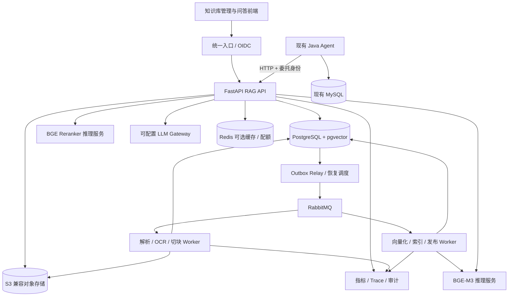

# RAG 生产化功能清单与实施计划

更新时间：2026-11-02。**当前已完成可在本地运行的“文档上传 → 异步入库 → 授权检索 → 引用查看”链路，尚未达到生产发布条件。** M0/M1 已有基础实现，M2 第一条链路通过真实 BGE-M3/MQ/PG/S3 验收，M4/M5 的部分权限和接入能力提前落地。

状态依据：[实现与运行说明](docs/rag/implementation.md)、[验收记录](docs/rag/verification-2026-11-02.md)、[ADR-001](docs/rag/adr-001-service-boundary.md)。本地验收包含 73 项 Java 测试、14 项 Python 测试、真实模型端到端烟测及页面/Java HTTP 联调；这些结果不替代检索质量、压力、HA 和恢复演练。

本文 `[x]` 表示该条明确范围已实现，验证边界以验收记录为准；`[ ]` 表示仍有工作未完成。涉及多项能力的总项标为“部分完成”，不因基础能力落地而把整个生产阶段勾选完成。容量、时延和质量指标仍是待实测的首发目标。

## 1. 结论与当前差距

**已采用同仓维护、独立部署的 Python/FastAPI RAG 应用，通过 HTTP 对接 Java。** RAG 已负责文档接入、解析、向量索引、权限、检索和引用；知识问答待实现。Java 继续负责业务工具、任务编排和审批，当前仅开放无状态知识查询桥接，完整 Agent 任务/聊天接入尚未开放。

FastAPI 是 API 框架，不会自动解决生产可靠性。已把解析、切块和向量化流程交给 MQ 驱动的独立 Worker，模型在独立服务运行；OCR 待补。在线查询与离线入库目前仍共用一个 embedding 实例，算力隔离/配额是后续任务。异步重计算的框架依据见 FastAPI [Background Tasks](https://fastapi.tiangolo.com/tutorial/background-tasks/#caveat)。

当前代码与差距如下；原 `KnowledgeBase` 的 3 条演示文档仅保留为 local 适配，不是远程 RAG 的故障回退：

| 实现位置 | 已实现 | 距离生产目标仍缺 |
| --- | --- | --- |
| [API 与权限](rag-service/app/main.py)、[身份校验](rag-service/app/auth.py) | KB 创建/列表、用户 ACL、文档读权限收窄、引用/原件鉴权、开发登录、OIDC 验签代码 | 实际企业 IdP 联调、组/服务账号、正式委托、策略管理 |
| [数据库迁移](rag-service/migrations/versions/0001_initial.py) | PG/pgvector、租户复合约束与 FORCE RLS、分离运行角色、首版文档原子发布 | 内容更新、KB generation manifest、CAS、影子重建、回滚与 GC |
| [解析](rag-service/app/parsing.py)、[Worker](rag-service/app/worker.py)、[Relay](rag-service/app/dispatcher.py) | 四类基础格式、token 切块、Outbox/MQ、租约/心跳/fencing、有限重试、取消 | OCR/HTML/质量审核、解析沙箱、阶段产物检查点、DLQ 运维与实进程故障演练 |
| [推理服务](rag-inference/server.py) | 固定 revision 的 BGE-M3，真实 1024 维 dense，CPU 常驻推理、预热、就绪检查 | 动态 batch、GPU 容量基准、线上与导入资源隔离、完整 profile 注册 |
| [检索 API](rag-service/app/main.py) | 当前有效版本与权限过滤后的精确向量检索、可鉴权引用 | 中文词法、hybrid/RRF、rerank、rewrite、上下文组装、LLM 回答 |
| [管理页面](rag-service/app/static/index.html) | 原生 HTML/CSS/JS，单文件上传、状态轮询、搜索、引用、用户授权/撤销 | 批量上传、解析预览、版本管理、问答/SSE、反馈与配额 |
| [Java HTTP 客户端](src/main/java/com/yu/agent/workflow/application/HttpRagKnowledgeSearchClient.java)、[查询入口](src/main/java/com/yu/agent/workflow/api/KnowledgeController.java) | local/http 适配、可信 JWT 检查、完整响应 deadline/大小限制、无状态桥接、禁止故障回 demo | 任务/审计/幂等表的租户迁移、持久授权委托、聊天引用约束、熔断与 trace |
| [Compose](compose.rag.yaml)、[测试](rag-service/tests/test_integration.py)、[真实验收](rag-service/scripts/acceptance.py) | 本地真实基础设施与模型运行，隔离测试库/bucket，权限和可靠性回归 | 独立 CI、质量评测集、压力/恢复演练、HA/PITR、监控告警、生产发布报告 |

已有 Java JWT、工具白名单、审批、审计和 Outbox 的设计继续保留。Java 任务/聊天审计目前没有完整租户边界，远程 RAG 对这些入口返回 `RAG_TASK_TENANCY_REQUIRED`，避免证据进入未隔离的任务存储；RAG 达标也不代表整个 Agent 已满足生产要求。

## 2. 产品范围与优先级

目标产品：供企业内部用户及业务 Agent 使用的多租户知识服务，支持“上传 → 处理进度 → 发布 → 授权搜索 → 有依据回答 → 更新/撤销 → 运营评估”的完整闭环。

优先级定义：**P0 为首发阻断项；P1 为首发生产能力；P2 为上线后基于数据推进的增强项。** P0 和 P1 都要完成并通过验收才称为本文定义的生产首发；前几个阶段仅用于开发和受控试用。下表按完整功能记录状态，后文勾选仅覆盖对应子项的明确范围。

| ID | 优先级 | 功能与完成标准 | 当前状态与剩余工作 |
| --- | --- | --- | --- |
| R01 | P0 | 租户、KB、用户/组/服务账号授权；隔离测试通过 | 部分完成：租户/KB/文档用户权限与 RLS 已有；组、服务账号、正式 IdP 待补 |
| R02 | P0 | 五类格式上传、限额、校验、隔离处理、原件存储 | 部分完成：TXT/MD/文本 PDF/DOCX、10 MiB 代理上传、私有 S3；HTML、批量、扫描与沙箱待补 |
| R03 | P0 | 结构解析、token 切块、来源坐标、质量校验 | 部分完成：token 切块、PDF 页号、正文 hash、空内容拒绝；结构/质量报告与审核待补 |
| R04 | P0 | MQ、持久状态、Outbox、幂等、租约、重试、死信与恢复 | 部分完成：单 job 可靠入库链路已通；阶段检查点、DLQ、完整故障演练待补 |
| R05 | P0 | BGE-M3、pgvector、版本化索引与真实模型验收 | 部分完成：真实 dense 与文档首版原子发布已验收；KB 代际/多 profile/重建待补 |
| R06 | P1 | rewrite、中文词法、dense、融合、rerank、上下文 | 部分完成：仅 dense-exact；其余检索质量能力待实现 |
| R07 | P0 | 无证据拒答、引用、生成前后权限；区分故障与无结果 | 部分完成：检索引用、重授权、空命中/故障区分已有；回答与生成权限复核待补 |
| R08 | P0 | 内容更新、原子发布、删除/ACL 即时生效、迟到任务防护 | 部分完成：首版发布、逻辑删除、撤权、迟到发布防护已有；更新/回滚/物理 GC 待补 |
| R09 | P1 | OCR、表格结构、解析预览、复杂文档重跑 | 部分完成：基础 DOCX 表格转文本、失败重试已有；OCR/复杂结构与审核预览待补 |
| R10 | P1 | KB、上传、进度、版本、权限、检索调试、问答、反馈 | 部分完成：基础管理页面已联调；版本、完整调试、问答/反馈待补 |
| R11 | P1 | 问答、SSE、多轮、独立检索 API、Java Agent 与契约测试 | 部分完成：检索 API 与 Java 无状态桥接已通；完整任务/聊天接入和问答待补 |
| R12 | P0 | 限流、配额、超时、隔离、审计、敏感处理与降级 | 部分完成：输入/响应上限、模型超时/并发锁、基础审计已有；配额、隔离、脱敏策略与降级待补 |
| R13 | P0 | 标注集、质量评测、权限回归、故障/负载演练 | 部分完成：确定性回归与真实端到端烟测通过；质量数据集、系统故障与负载验收待补 |
| R14 | P0 | 部署、监控、备份恢复、灰度回滚、runbook、配置门禁 | 部分完成：Compose、探针、基本配置门禁已有；生产运维与发布验收待补 |
| R15 | P2 | 企业连接器、增量同步、权限同步与对账 | 未开始 |
| R16 | P2 | BM25/sparse、多向量、问题拆解、多模态/GraphRAG | 未开始 |

首发不开放任意 URL 抓取，不把订单实时状态、余额等业务事实同步成 RAG 的权威来源；这类问题仍调用现有业务工具。知识内容可以解释政策，不能替代业务系统的权限、审批和交易规则。

## 3. 架构与技术决策

下图是完整生产目标。当前已运行 FastAPI、PG/pgvector、私有 MinIO、Outbox Dispatcher、RabbitMQ、单个 Celery ingestion Worker 和独立 CPU embedding 服务；统一 OIDC 入口、独立阶段 Worker、reranker、LLM、Redis 与观测平台尚未部署。



这是一套应用、多个运行角色，不在第一版拆成大量业务微服务。

| 层 | 首版选择 | 取舍与边界 |
| --- | --- | --- |
| API | FastAPI、Pydantic、版本化 OpenAPI | API 进程只做认证、业务编排与 I/O；不加载 GPU 模型 |
| 持久化 | PostgreSQL + pgvector；psycopg 显式事务 + Alembic | 已落地；SQLAlchemy 供迁移使用，没有 ORM 实体层；保留 Java MySQL/Flyway |
| 原件与中间产物 | 私有 S3 兼容对象存储，本地 MinIO | 已存原件；解析 JSON、报告、预览产物待补 |
| 异步 | RabbitMQ + Celery；PG jobs 表为状态真相 | 不以 Celery result backend 代替任务业务状态；不承诺 exactly-once |
| 文档解析 | 已用 pypdf、python-docx 与 UTF-8 文本解析 | 复杂 PDF/DOCX 后续评估 Docling；OCR 与质量矩阵待实现 |
| Embedding | 已用 Transformers AutoModel/AutoTokenizer 独立服务化 | 固定 BGE-M3 revision，CLS pooling + L2 归一化，CPU dense；未使用 FlagEmbedding |
| Rerank | 计划 `BAAI/bge-reranker-v2-m3` | 尚未实现；与 embedding 分别配置、限流和观测 |
| 词法检索 | 计划中文预分词 + PostgreSQL `tsvector`/GIN | 尚未实现；该方案不称为 BM25，编号走精确匹配通道 |
| 融合 | 计划 RRF，参数版本化 | 尚未实现；避免直接相加不同通道不可比的原始分数 |
| 回答 | 计划可配置 LLM Provider，初期可对接现有 DeepSeek 供应方 | 尚未实现；Python 自己实现适配层，不通过 Java 再反调一次模型 |
| 前端 | 已用原生 HTML/CSS/JS，由 FastAPI 同源提供 | 当前没有 `rag-web`；复杂交互确有需要时再迁移 React/TypeScript |
| 运维 | Docker Compose 开发/集成；生产容器平台或已有平台 | 是否使用 Kubernetes 取决于现有运维能力；必须具备多副本与恢复能力 |

Python 服务和推理依赖已生成 `requirements.lock`，BGE-M3 已固定 revision。开发镜像仍有可变 tag，本地 MinIO 从固定源码 tag 构建；完整兼容矩阵、生产镜像 digest/依赖准入、模型校验流程仍需补齐。

为什么独立应用：Python 的解析和模型生态更直接；CPU、GPU、在线查询和离线入库需要不同资源；RAG 后续也能服务其他 Agent。代价是新增 Python、MQ、PG 和推理运维，需要正式的接口契约、跨服务 tracing 和故障预算。先同仓维护，未来有独立团队和发布需求再拆仓。

## 4. 文档接入、解析与异步入库

### 4.1 上传与管理

- [x] 创建/列出知识库，记录 owner，管理已有租户成员的 KB 读/上传/管理权限，见 [API](rag-service/app/main.py)。
- [ ] 增加 KB 说明、语言、保留策略、默认解析/检索配置及编辑能力。
- [x] 单文件 API 代理上传，当前上限 **10 MiB**；客户端 `Idempotency-Key` 支持重放与冲突检查，原件写入私有对象存储。
- [ ] 拖拽、多文件上传、稳定的前端重试键与重复提交提示；扩展到 50 MiB/单批 20 个前先完成资源与安全验收，租户总量可配置。
- [x] 服务端生成对象路径，完整 PUT 后在 PG 事务创建 document/version/job/outbox，返回 `202 + job_id`；Worker 读取原件后校验 SHA256。
- [ ] 增加上传会话、受限预签名凭证、隔离区和 complete API；多段上传校验所有权与完成状态，不把 ETag 无条件当作文件哈希。
- [x] 扩展名白名单、大小限制、PDF 文件头、DOCX 结构/展开总量/宏检查、文本 UTF-8/二进制检查，见 [解析器](rag-service/app/parsing.py)。
- [ ] MIME/扩展名白名单、恶意文件扫描、解压比与页数限制；解析进程无外网、非 root、有 CPU/内存/临时磁盘/时限限制。拒绝加密且无法解析的文件并显示明确原因。
- [x] 原件通过 API 鉴权代理下载，引用读取重新授权；下载原件后再次检查权限，不签发长效公开下载链接。
- [ ] 持久化规范化结果、解析报告与原文预览，分别授权并设置保留策略。
- [x] 当前上传按 tenant、actor、key 幂等，摘要包含 KB、文件名和内容哈希；同键不同摘要返回 409，无跨租户内容去重查询。
- [ ] 幂等能力扩展到其他写操作时增加 operation 范围、回放记录与到期策略。
- [ ] 过期上传、孤立对象有定时回收与审计；对象存储与 PG 不假装共享一个事务。

### 4.2 解析与切块

- [x] 实现 TXT/Markdown、文本 PDF、DOCX 基础解析；PDF 记录真实页号，DOCX 按正文顺序提取段落/表格文本；空内容不发布。复杂文档格式质量尚未完成专项验收。
- [x] 使用 BGE tokenizer offset 按 **480 tokens / 64 overlap** 切块，保留原文和内容 hash；最多 100 页、30 万字符、1000 块，见 [配置](rag-service/app/config.py) 和 [推理服务](rag-inference/server.py)。
- [ ] 定义统一 `ParsedDocument`：标题、章节、段落、列表、表格、页号、bbox（可得时）、字符偏移、语言、质量标记、parser revision。
- [ ] PDF 区分文本页、扫描页和混合页；低文本密度时路由 OCR；清理重复页眉页脚，保留阅读顺序。DOCX 保留标题层级和表格；HTML 清理脚本及外链，不执行内容。
- [ ] 表格保留表头与行关联，过长表格按行组切分并重复必要表头。没有可靠坐标时返回章节/偏移，不能编造页码。
- [ ] 在已有 token 切块上补充标题/章节/表格结构优先策略，通过评测调整长度与重叠；不能把基础段落/页分块算作复杂版面已验收。
- [ ] 保存 `parent_chunk_id`、章节路径、前后邻接关系；检索小块，按权限和 token 预算补充父段及相邻段。
- [ ] 标题路径可参与 embedding；保存实际 embedding 输入哈希和展示正文，确保可以复现和引用。
- [ ] 空文本、明显乱码、OCR 低置信度、表格失真进入 `NEEDS_REVIEW`；支持预览和重新解析，不静默发布。
- [ ] 元数据、解析器、切块器与 tokenizer 版本全部记录；只修改 ACL 不触发重新向量化。

Docling 提供多种格式转换能力，但“库支持格式”不等于本项目已经验收该格式；仍需准备实际中文 PDF、扫描件与表格样本。见 [Docling supported formats](https://docling-project.github.io/docling/usage/supported_formats/)。

### 4.3 任务状态与可靠性

当前状态机为 `QUEUED → PARSING → EMBEDDING → INDEXING → SUCCEEDED`，另有 `RETRY_WAIT / FAILED / CANCELLED`。校验在上传及解析阶段执行，分块并入 EMBEDDING，发布并入 INDEXING；尚无独立 `CHUNKING / READY_TO_PUBLISH / NEEDS_REVIEW` 状态。

- [x] [Relay](rag-service/app/dispatcher.py) 用 PG 行锁领取 Outbox，持久消息确认后标记发送；失败保留待投递记录。
- [x] [Worker](rag-service/app/worker.py) 使用租约/心跳/fencing，重复投递只允许一个有效处理者发布；删除、取消、失效租约或上传权限撤销均不能正常发布旧结果。
- [x] 当前默认租约 180 秒、心跳约 60 秒、队列恢复阈值 30 秒；每轮最多 3 次尝试，退避重试，失败可由有权限的管理者手动重试；状态保存在 PG。
- [x] [Celery 配置](rag-service/app/queue.py) 使用 quorum 队列、publisher confirm、late ACK、reject-on-worker-lost 和 prefetch=1；当前开发环境只有单 RabbitMQ 节点，不具备集群 HA。
- [ ] 阶段产物检查点、分阶段队列、DLQ 管理、抖动退避、细粒度恢复与真实 kill/乱序/依赖切换演练。当前重试会重新解析和计算整份文档。

下面保留完整生产状态机及可靠性目标，尚未全部实现：


以上是目标 ingestion job 的阶段，**不是文档可检索状态**。当前已经保证发布事务成功前没有可检索的半成品；目标还需支持 `NEEDS_REVIEW`、`resume_stage` 和阶段产物，以及更新失败时继续服务旧版本。

1. API 在 PG 同一事务写 `document_version + ingestion_job + outbox_event`。原件上传已完成才进入这个事务；失败留下的孤立对象由回收器处理。
2. Relay 有租约地领取 Outbox，发布持久消息并等待 publisher confirm；确认后再标记已发送。发布成功后进程崩溃可能重复投递，所以消费者必须幂等。
3. 消息仅含 `schema_version/event_id/tenant_id/job_id/stage/traceparent` 等定位信息，不携带正文、密钥或客户端指定的可执行函数。消费者按固定任务白名单处理并回查 PG。
4. Worker 领取阶段租约和递增 fencing token。幂等键为 `(tenant_id, document_version_id, pipeline_revision, stage, batch_no)`；结果唯一约束防止重复 chunk/vector。
5. 阶段结果、状态变更、下一阶段 Outbox 在同一事务提交，再 ACK。外部模型调用不占长数据库事务；HTTP 调用必须有超时。重复推理最多增加计算，不能重复发布。
6. Worker 心跳续租；过期任务由恢复调度重新投递。旧 Worker 即使恢复，也因 fencing token 不匹配而不能提交、覆盖或发布。
7. 网络、429、可恢复 5xx 指数退避并加抖动；当前最多 3 次，生产次数和退避预算经演练确定。格式错误、授权失败、不可解析输入不盲目重试。DLQ 和失败任务列表都可人工重放，重放也检查当前版本/删除状态。
8. 使用 Celery late ACK 时，同时评估 `task_reject_on_worker_lost`、worker prefetch、RabbitMQ consumer timeout；不能仅设置 `acks_late` 就认为所有进程丢失都会恢复。PG 恢复器兜底卡住的任务，毒任务有尝试上限。
9. 分离 parse、OCR、embed、publish、cleanup 队列；在线 embedding 与批量导入分别限额或独立部署。长任务切批并记录检查点，避免单个大文件占住 Worker。
10. 取消为协作式：停止新阶段、批次之间检查取消/删除标记；已在执行的推理可能完成，但结果不能发布。UI 显示阶段、进度、失败原因和最后心跳。

RabbitMQ 的 publisher confirms 与 consumer ACK 是不同确认环节；Celery 的 late ACK 也有进程退出例外。实现与故障测试依据：[RabbitMQ confirms](https://www.rabbitmq.com/docs/confirms)、[Celery tasks](https://docs.celeryq.dev/en/stable/userguide/tasks.html)。

## 5. Embedding、PostgreSQL 与索引生命周期

### 5.1 BGE-M3 推理

- [x] 真实 `BAAI/bge-m3` **1024 维 dense** 写入 PG `vector(1024)`，已通过端到端烟测。模型支持最长 8192 tokens，当前服务主动限制为 **1024 tokens/条**；未实现 sparse/multi-vector。见 [模型卡](https://huggingface.co/BAAI/bge-m3) 和 [实现](rag-inference/server.py)。
- [x] 模型/tokenizer 固定 revision `5617a9f61b028005a4858fdac845db406aefb181`，CPU CLS + L2 归一化；查询和文档检查 `bge-m3-dense-v1` profile。下载脚本记录文件 SHA256 manifest。
- [ ] 把精度、预处理、tokenizer、最大长度等组成可注册的不可变 profile；补充权重可信校验和比对及启动完整性验证。已有 hash 记录不等同于这些强校验全部实现。
- [x] 启动预热/readiness、单推理锁、忙时 429、输入限制；请求最多 8 条，Worker 每批 4 块，HTTP 超时默认 120 秒，客户端校验维数/NaN/Inf/零向量。
- [ ] 有界排队/全链路 deadline、OOM 缩批与重试、面向在线请求的独立配额。
- [ ] 按 token 总量动态组 batch；单独记录 CPU/GPU、精度、批量、输入长度的吞吐和质量结果。CPU 模式用于开发及明确接受慢速的场景，不据此推算 GPU 生产容量。
- [x] 模型常驻独立 CPU 进程，API/Worker 通过 HTTP 调用；Compose 中 Worker 等 embedding 健康后启动，模型权重存在命名卷。
- [ ] embedding 缓存按 tenant、输入内容哈希、完整 profile 隔离；去重缓存不是访问权限来源。

### 5.2 主要数据模型

当前 [0001 迁移](rag-service/migrations/versions/0001_initial.py) 已创建 `tenants`、`tenant_memberships`、`knowledge_bases`、`kb_acl`、`documents`、`document_versions`、`ingestion_jobs`、`outbox_events`、`chunks`、`audit_events`，含租户复合约束、FORCE RLS 和运行角色授权。向量直接存 `chunks.embedding`，文档通过 `active_version_id` 指向首个完整版本；引用 ID 目前就是 chunk ID，没有独立 citations 表。

以下表格是后续完整模型目标，**不代表这些表或字段已存在**。尚缺 `group_memberships`、上传会话、chunk_sets、独立 embeddings、generation manifest、job_steps、processed_events、profile 注册、查询/回答/反馈/会话表。已有表也需后续 Alembic 增量迁移，不能修改已应用的初始迁移来升级环境。所有租户数据使用租户键，引用关系继续使用包含 tenant 的复合约束。

| 表/实体 | 关键内容 |
| --- | --- |
| `tenants` / `tenant_memberships` / `group_memberships` | 租户、有效成员、组与 membership revision；身份来自已验证认证 |
| `knowledge_bases` | 名称、owner、策略、`active_generation_id`、`content_revision`、`acl_revision` |
| `documents` | 稳定 document_id、kb_id、source_key、生命周期、tombstone、acl_revision |
| `upload_sessions` / `idempotency_requests` | 受限对象定位、大小/哈希、过期时间、完成状态；请求摘要与响应回放 |
| `document_versions` | 不可变内容版本、对象定位、sha256、标题、语言、生效/失效时间、上传人 |
| `chunk_sets` | document_version、parser/chunker/embedding profile、产物状态、校验摘要 |
| `chunks` | chunk_set、文本、token 数、父子/邻接关系、页码/章节/偏移、`tsvector` |
| `chunk_embeddings` | chunk_id、embedding_profile、1024 维向量、输入哈希；唯一键防重复 |
| `index_generations` / `generation_documents` | KB 索引代际、base_generation、发布状态；manifest 映射 document 到 version/chunk_set |
| `acl_bindings` | tenant/KB/document、主体类型、主体 ID、read/upload/manage/publish 等动作 |
| `ingestion_jobs` / `job_steps` | 阶段、attempt、lease、fence、进度、错误、取消标记、产物定位 |
| `outbox_events` / `processed_events` | 投递租约、确认、消费去重、事件 schema 版本 |
| `retrieval_profiles` / `model_profiles` | rewrite/召回/rerank/上下文/模型参数及不可变版本 |
| `query_runs` / `answer_runs` / `feedback` | trace、版本、耗时、用量、引用 ID、反馈；敏感正文有单独保留策略 |
| `citations` | query/answer、tenant、document_version、chunk、定位与内容哈希；引用读取时重新授权 |
| `conversations` / `messages` | tenant、owner、参与者、消息、引用及到期策略；历史证据再次使用时重新授权 |
| `audit_events` | 上传、发布、撤权、删除、下载、管理操作与前后 revision，限制访问 |

目标关系：KB 当前指针 → generation manifest → 文档版本 → chunk_set → chunk / embedding；ACL 和 tombstone 读取当前权威状态，不从旧 manifest 恢复授权。

manifest 引用不可变 chunk_set，未变化的文档复用旧产物，不重新计算全库 embedding。初版每次发布构建完整 manifest，成本随文档数增长；在目标规模压测复制与清理成本，必要时再引入增量 manifest，避免过早实现复杂的快照链。

### 5.3 检索索引与性能

- [x] 当前按 tenant、选定 KB、文档未删除、`active_version_id`、embedding profile 和文档 ACL 约束检索，使用 cosine 精确排序；HNSW 已建，但当前检索主动关闭 index scan，尚未启用 ANN。
- [x] 连接池最大 8，事务内 statement timeout 为 10 秒；后续仍需测量查询计划、扫描量与并发容量。
- [ ] dense 使用 cosine distance 与匹配的 HNSW opclass；租户、KB、版本映射、状态和 ACL join 键建立关系索引；词法字段建立 GIN 索引。
- [ ] 查询在 SQL 中包含 tenant、有效文档、当前 generation 和 ACL 约束，未授权内容不能交给 reranker/LLM。不能先取全库 top-k 到应用，再过滤出“有权限结果”。
- [ ] 注意：SQL 有权限条件不代表 HNSW 物理扫描先完成权限过滤。pgvector ANN 过滤可能减少候选，应评估 iterative scan、扩大扫描预算、按租户/KB 分区及小授权集上的精确检索回退。分别测试授权覆盖 1%、10%、100% 的召回和耗时。见 [pgvector filtering](https://github.com/pgvector/pgvector#filtering)。
- [ ] `EXPLAIN ANALYZE` 验证实际查询计划、ACL join 和 LIMIT；记录 ANN 相对精确搜索的 Recall@k；限制 statement timeout、连接池与最大扫描量。
- [ ] 优先共享逻辑模型；超大或高隔离租户可迁独立分区/实例。容量压测证明 PG 不满足成本或 SLO 后，再评估独立搜索引擎。
- [ ] 维护 vacuum、统计信息、索引膨胀、WAL、备份窗口和重建磁盘余量；清理旧 generation 前检查运行请求和保留策略。

### 5.4 更新、发布、删除与回滚

当前已完成：首版 chunks 与文档 active version 在同一事务发布；逻辑删除同步屏蔽读取并使未完成 job 失效；文档 ACL 用 `expected_revision` 防止覆盖；引用/原件检查实时权限；迟到 Worker 通过 fence/租约/删除检查被拒绝。**尚无内容更新、KB manifest、影子重建、回滚或物理清理**。下面 1–8 是完整生命周期目标，需在现有首版发布基础上继续实现。

1. **内容更新**：新建 document_version 和 chunk_set；旧 generation 持续服务。索引完整性、解析质量、授权与发布权限通过后才创建候选 manifest。
2. **原子发布**：事务内以 `base_generation_id` 做 CAS 切换 KB 指针并增加 content_revision。并发发布冲突先基于最新 manifest 合并，确认同一文档没有更新冲突，不能静默覆盖另一份更新。
3. **检索快照**：一次查询固定 generation/profile；后续取正文、父块、引用都使用同一版本。最终输出前再校验当前权限、tombstone；关键政策若中途失效，丢弃证据并要求重试。
4. **重新建库**：换 parser/chunker/embedding profile 时创建影子 generation，用新 profile 做全量构建和评测。记录源版本水位，补齐期间更新/删除，短暂发布锁下核对水位再切换，防止全量重建覆盖增量更新。
5. **撤权/下架/删除**：同步事务设置 ACL revision 或 tombstone，提交后新查询立即不可见；不等待 MQ 清向量。队列异步清理原件、预览、向量与缓存，展示清理进度和失败重试。
6. **晚到任务**：每次提交及发布检查 tenant、tombstone、document revision、fence；删除后的旧任务只能结束，不能恢复文档。
7. **回滚**：允许授权管理员选择仍可使用的旧 generation，记录理由；实时 ACL/tombstone 仍生效，旧版本不得恢复已删除或已禁止的政策。
8. **清理与恢复**：物理清理先设置可审计的保留期，再执行幂等 GC。覆盖对象版本、缓存、复制与备份中的保留行为；从备份恢复后必须重放删除/撤权记录，检查完成才开放查询。删除/撤权账本需要独立可靠副本或从权威源重新对账；不能用允许丢失最近 15 分钟数据的业务备份证明权限仍是最新，无法确认时保持拒绝访问。

## 6. 在线检索与回答链路

当前只有“JWT/成员与 KB 鉴权 → BGE query embedding → 再次鉴权 → 当前有效版本的 dense-exact SQL 检索 → 原文/版本/引用返回”。query 最多 2000 字符、单次最多 5 个 KB、top_k 为 1–20；token 超限明确返回 422。以下完整流水线中的 rewrite、词法/RRF、rerank、父块扩展、LLM 与会话均待实现。


### 6.1 Query 优化与路由

- [ ] Unicode、空白等规范化；保留原问题、时间、数字、否定词、产品型号和专有名词。查询长度、历史轮数有上限。
- [x] 显式指定的 KB 逐个鉴权，向量化后重新确认成员与 KB 权限；未经授权的 KB 返回 404，查询不能扩大租户范围。
- [ ] 接入模型路由后，模型建议只能缩小服务端允许列表，不能扩大授权范围。
- [ ] 多 KB 的 active generation 若使用不同 embedding profile，按 profile 分组编码和检索，只在融合阶段合并排名；限制 KB 数、分组数和总候选预算，不比较不同模型的向量距离。
- [ ] 多轮追问只读取本租户、本会话授权历史，把“那退款呢”改写成独立问题；历史引用失权后不能继续进入 prompt。
- [ ] rewrite 输出结构化字段，有 schema 校验、超时和 token 预算；默认保留原 query，再增加最多 1 条改写，避免改写丢失事实。
- [ ] 编号、短精确查询可跳过 rewrite；只对歧义问题启用澄清、术语扩展。初版不对每个问题自动做无限 multi-query/HyDE/多跳循环。
- [ ] 存储脱敏的 original/rewrite、策略版本和各通道耗时，能检查“改写让效果变差”的样本。

### 6.2 Hybrid search 与 rerank

后续 hybrid 建议初始参数：每条 query dense top-50、lexical top-50；合并去重后最多 100 条候选，融合后最多 30 条送 rerank，最后 6–10 块进入上下文。它们是评测起点，尚非当前参数；当前 `/search` 直接返回最多 20 个 dense 命中。

1. **Dense**：BGE-M3 编码原问题/改写后做授权范围内语义召回，能覆盖同义表达。
2. **词法**：中文用可替换、版本化的分词适配器和业务词典，候选实现先以 [Jieba](https://github.com/fxsjy/jieba) 离线验证；文档与 query 使用同一规则，构建 PostgreSQL `simple` 配置的 `tsvector` 并用 GIN 检索。增加 SKU、政策编号等独立精确字段。SQL 参数化、过滤字段允许列表、tsquery 安全构造，禁止把模型输出拼成 SQL 或未经校验的查询表达式。
3. **明确技术名称**：PostgreSQL `ts_rank/ts_rank_cd` 是全文相关性排序，不能写成 BM25；默认配置也不能替代已验证的中文分词方案。见 [PostgreSQL text search ranking](https://www.postgresql.org/docs/current/textsearch-controls.html#TEXTSEARCH-RANKING)。
4. **融合**：采用 RRF，初始 `sum(weight_i / (60 + rank_i))`；按检索通道控制权重，限制多条改写对单一通道的重复加权；保留每路 rank 和原始分数用于调试。
5. **Rerank**：用 `BAAI/bge-reranker-v2-m3` 对 query/passage 重排，限制每对输入长度和候选数。score 即使经过 sigmoid，也不当作“答案正确概率”；拒答阈值通过业务数据校准。见 [reranker 模型卡](https://huggingface.co/BAAI/bge-reranker-v2-m3)。
6. **上下文**：同文档相邻块合并、近重复去重、限制单文档占比，必要时做多样性选择。父块扩展也执行权限过滤。上下文按模型 tokenizer 计数，先预留 system、历史和输出预算。

BGE-M3 sparse 与普通全文检索是不同通道。后续若引入 sparse/BM25/多向量，需要单独设计索引、版本、ACL、更新和压测，不能因为模型能输出就算系统已经支持。

### 6.3 生成、引用和多轮

- [x] `/search` 返回检索证据、版本、内容 hash 和引用，不调用回答 LLM。
- [ ] `/answers` 复用检索管线，生成有依据的知识回答。
- [ ] 回答区分 `answered`、`insufficient_evidence`、`needs_clarification`、`degraded`；未经授权资源不通过回答泄露标题、存在性、计数或路径。
- [ ] prompt 明确资料只是证据，不能改变系统指令或调用工具。文档中的“忽略规则”“泄露密钥”等属于不可信内容；关键词黑名单只能辅助，不能充当完整防护。
- [x] 命中与引用提供 document/version/chunk ID、可得的页/章节、原文和内容 hash；URL 由服务端构造，打开时验证当前版本与权限。当前章节信息可为空，不编造位置。
- [ ] 发布给用户前验证引用存在、来源属于本次授权检索、版本一致、关键陈述有支持；自动规则负责结构和可追溯性，语义支持需要评测与人工抽检，不声称检查引用 ID 就能证明回答正确。
- [ ] 证据冲突时标明版本与适用日期、请求澄清或转人工；无证据不能让 LLM 凭常识补写公司政策。退款等动作继续受 Java 工具与审批控制。
- [ ] 对敏感 KB 默认缓冲全文，完成校验后输出。普通 SSE 可按已校验段落发送；已发送文本无法撤回，权限变更时取消余下生成并记录，前端不把未完成流标为完成答案。
- [ ] 多轮会话有 owner/参与者授权、保留期、删除、token 裁剪；禁止客户端任意指定另一会话 ID 后读取其历史。
- [ ] 反馈记录答案 ID、问题分类与纠正建议，经授权人工审核后进入评测/知识修订，不自动写入正式知识。

### 6.4 超时、降级与成本

当前 embedding 故障返回可重试 503，非法/超长输入返回 422，无证据返回空 hits；没有词法/缓存/LLM 降级通道。Java 的 KB 列表与检索共用默认 15 秒完整响应 deadline，不回退演示数据。下表和检索 3 秒/回答 30 秒是后续目标，不是当前 Python API 的全链路预算。

| 故障 | 行为 |
| --- | --- |
| rewrite 超时/非法输出 | 用原 query 继续，记录降级 |
| embedding 不可用 | 允许配置的 KB 走授权词法检索，注明降级；未达到证据门槛则拒答 |
| 词法通道故障 | 可用 dense 通道继续，记录缺失通道；关键编号查询可选择直接失败 |
| rerank 超时 | 使用融合排序，保守证据门槛；高敏感 KB 可要求失败关闭 |
| LLM 超时/限流 | 返回可用引用与可重试错误，不伪造答案；已开始的流不透明重放 |
| PG/权限服务不可用 | 失败关闭，返回 503；不从可能过期的缓存读取敏感答案 |
| MQ 不可用 | 已持久化任务保持待投递；达到积压/配额上限拒绝新上传，查询已发布知识仍可用 |
| Redis 不可用 | 查询缓存旁路；配额无法可靠计量时采用保守限额或拒绝高成本请求 |

初始检索 deadline 3 秒，rewrite/embedding/rerank 各有子预算；回答整体 deadline 30 秒。总预算向下游传播，允许的重试次数和时间都包含其中。按租户限制 QPS、上传量、索引 token、并发、每日 LLM token 与费用，接近限额告警；查询成功率与“完整管线成功率”分开统计，避免长期降级被当作健康。

## 7. 权限、身份与数据安全

### 7.1 权限模型

当前 tenant membership、KB `reader/contributor/manager` 与文档 `allowed_subjects` 收窄已实现；tenant admin 只能管理自己的租户，读取文档仍受文档读权限约束。当前可信上传在成功处理后自动发布，Worker 发布前重新检查上传者权限；尚未分离 Publisher、人工发布流程、组或 service account。以下角色表描述生产目标，Contributor“没有自动发布权”需后续动作权限拆分后落实。

先采用可解释的模型：tenant membership 为前提，KB RBAC 决定 read/upload/manage/publish 等动作；document ACL 默认继承 KB，也可显式缩小可读主体范围。文档级规则不能越过 KB 访问门槛，首版不设计任意互相覆盖的 deny/allow 层级。

| 主体 | 默认权限 |
| --- | --- |
| Reader | 搜索、问答、查看其授权原文 |
| Contributor | 在被授权 KB 上传、查看自己的处理任务；没有自动发布权 |
| KB Manager / Publisher | 管理对应 KB、版本发布/回滚、权限与删除；操作留审计 |
| Tenant Admin | 管理本租户 KB 和成员，不等于其他租户管理员 |
| Service Account | 明确绑定租户/KB/scope；调用时不能随意代入任意用户 |

后续 KB 将可配置“可信上传自动发布”或“人工发布”；新版本准备完成不自动等同于可搜索。当前 RAG 以 PG 中的成员角色和 KB ACL 授权，Java JWT 的 `roles` 不会自动成为 RAG 权限；正式角色映射/授权流程仍需设计，不能把 Java `ADMIN` 继承成全平台超管。

### 7.2 身份贯通与防越权

- [x] RAG 验证 JWT 签名、issuer、audience、exp/iat、tenant/sub，并查询当前有效成员；tenant/user 不取自任意请求体或 `X-Role`，KB 操作按当前数据库角色授权。
- [ ] 在已有 local HS256 / OIDC RS256-JWKS 验签代码基础上，完成真实 IdP 联调、action scope、组映射、密钥轮换与正式委托测试。
- [ ] 浏览器使用 OIDC 登录；Java 使用 IdP 支持的 token exchange/on-behalf-of 获取 RAG audience 的短期委托 token，或经正式配置的受信网关签发委托凭证。不能把只适用于 Java audience 的 token 直接当作 RAG 凭证。
- [ ] 无用户上下文的定时任务使用受限 service identity；需要代用户执行的持久任务保存主体/租户/委托授权引用，执行时重新验证授权，不将原始 Bearer token 写入数据库、工具参数或日志。
- [ ] Java 端将认证上下文贯通到 ToolContext、任务恢复和聊天入口；工具参数中的 query/KB ID 不允许覆盖服务端主体。缺少可信租户的旧任务不能默认使用任意租户。
- [x] 已有 KB/文档列表、任务状态与操作、检索、引用、原件接口均检查租户/资源权限；相关越权回归已通过。
- [ ] 后续增加预览、反馈、会话、统计接口时同步覆盖鉴权与泄露测试。
- [x] PG 租户表启用 FORCE RLS，事务级设置 tenant；API 启动拒绝 superuser/BYPASSRLS；连接池租户不残留测试通过。迁移与 API/Worker/Dispatcher 使用分离 DB 角色，见 [迁移](rag-service/migrations/versions/0001_initial.py)。
- [ ] 进一步收紧角色到各自最小 SQL 权限，剥离开发共用环境中的管理凭据并验收生产密钥注入；不能把本地账号分离等同于生产最小权限全部完成。RLS 机制参考 [PostgreSQL 文档](https://www.postgresql.org/docs/current/ddl-rowsecurity.html)。
- [x] API 缺失/无效身份拒绝访问；Worker 以消息中的 tenant/job 定位 PG 权威记录，发布前重新检查上传者权限。
- [ ] 完成 MQ 伪造/跨租户 job 组合、受限 service identity 和生产 Worker 最小权限回归，不能只凭 MQ 网络隔离推断消息可信。

### 7.3 撤权、缓存与审计

- [x] 当前 KB/文档 ACL 和成员状态从 PG 读取；搜索向量化后、原件下载后重新确认权限；KB 撤权在途查询回归通过。文档 ACL 使用 expected_revision，成员/KB 尚无统一 revision 体系。
- [x] 当前无共享答案/检索结果缓存；审计记录上传、发布、权限变更、删除、下载和任务管理；页面用 textContent 展示正文并设置 CSP/no-store。
- [ ] ACL/成员关系以权威存储 revision 为准；不能只靠长效 JWT 中的旧角色实现立即撤权。外部 IdP 组同步需要确定时延，在同步完成前不能声称源站撤权已经即时生效。
- [ ] 如后续引入检索/答案缓存，key 至少含 tenant、主体权限指纹、membership/ACL revision、KB content revision、generation、query、检索 profile；取缓存后仍检查当前权限和 tombstone。
- [ ] 权限事务提交后新请求拒绝旧授权；对已在途生成，在调用外部模型前和输出前重新检查，SSE 每批输出检查撤销信号。已经传给已批准模型供应方或发给用户的数据无法追溯收回，需要明确记录这一边界。
- [ ] tenant 级配置是否允许资料发送外部 LLM；不允许时用私有推理或只返回检索结果。模型调用、日志和评测样本有脱敏与保留策略。
- [ ] 日志默认记录 ID、hash、耗时和用量，不记完整原文、token、secret；调试正文需授权、采样、到期删除。审计导出也受权限限制。
- [ ] 原文/Markdown/HTML 预览防 XSS；CORS 使用允许列表；若使用 Cookie 会话加入 CSRF 防护；连接器阶段必须防 SSRF 和源站权限漂移。

## 8. API、前端与 Java 对接

### 8.1 已实现 API 与后续接口

业务前缀 `/api/v1`；健康检查位于根路径 `/health/*`。当前路由契约见 [openapi.json](docs/rag/openapi.json)，由 FastAPI 生成；没有 `openapi.yaml`。已返回服务端生成的 `X-Request-ID`，尚未贯通 `traceparent`；当前仅上传要求 `Idempotency-Key`，仅文档 ACL 修改要求 `expected_revision`，不能泛化为所有写操作已支持。

| API（除 health 外省略 `/api/v1`） | 状态 | 当前行为 / 后续工作 |
| --- | --- | --- |
| `POST/GET /knowledge-bases` | 已实现 | 创建/列出可见 KB，列表最多 100 项；详情/编辑待补 |
| `GET/PATCH /knowledge-bases/{kb_id}` | 待实现 | KB 详情与策略修改 |
| `PUT /knowledge-bases/{kb_id}/acl`、`DELETE .../acl/{subject}` | 已实现 | 授予/撤销本租户已有用户的 KB 权限 |
| `POST /knowledge-bases/{kb_id}/documents` | 已实现 | multipart `file` + `Idempotency-Key`，返回 202/job_id；小文件代理上传 |
| `POST /knowledge-bases/{kb_id}/uploads`、`POST /uploads/{id}/complete` | 待实现 | 预签名上传会话和完成校验 |
| `GET /knowledge-bases/{kb_id}/documents` | 已实现 | 文档、处理状态、失败原因，最多 100 项；游标分页待补 |
| `DELETE /documents/{document_id}` | 已实现 | 逻辑删除并阻止迟到发布；物理清理待补 |
| `GET /documents/{document_id}/original` | 已实现 | 已发布原件鉴权代理下载 |
| `GET /documents/{document_id}`、`GET/POST .../versions` | 待实现 | 文档详情、历史版本、内容更新 |
| `POST /documents/{document_id}/reindex` | 待实现 | 指定配置重建 |
| `PUT /documents/{document_id}/acl` | 已实现 | `subjects` 收窄/恢复继承，`expected_revision` 冲突返回 409 |
| `GET /jobs/{job_id}`、`POST .../retry`、`POST .../cancel` | 已实现 | 状态查询、失败重试、未发布任务取消 |
| `GET /jobs/{job_id}/events` | 待实现 | SSE 进度；当前 UI 每 4 秒轮询 |
| `POST /knowledge-bases/{kb_id}/publish`、`.../rollback` | 待实现 | generation 发布/回滚 |
| `POST /search` | 已实现 | dense-exact 授权检索，返回证据与引用 |
| `GET /citations/{chunk_id}` | 已实现 | 引用 ID 为 chunk ID，验证当前版本与实时权限 |
| `POST /answers`、`POST /answers/{id}/feedback` | 待实现 | 回答/SSE/反馈 |
| `POST/GET /conversations`、`GET/DELETE /conversations/{id}` | 待实现 | 会话与消息管理 |
| `GET /me`、`GET /config`、`POST /auth/dev-token` | 已实现 | 当前身份、公开配置、本地开发登录；dev-token 有环境开关，生产禁止开启 |
| `GET /health/live`、`GET /health/ready` | 已实现 | 存活；PG/S3/embedding profile 就绪检查，尚非全栈业务健康证明 |
| 内部 `/metrics` | 待实现 | 指标端点与监控接入 |

当前可用搜索请求示意：KB ID 必须为 UUID，身份不由请求体提交；`conversation_id/filters` 尚不支持，额外字段会被拒绝。

```json
{
  "query": "已经发货还能退吗？",
  "knowledge_base_ids": ["f5972e06-79d8-4dcd-809d-3b4a9efce9da"],
  "top_k": 5
}
```

当前返回结构示意：ID 和 distance 仅为示例；尚无 generation_ids、rewrite 或多路 timing 字段。distance 是 cosine 距离，不是答案正确概率。

```json
{
  "request_id": "8bf08691-243f-4567-a827-dff6ed1563b6",
  "status": "ok",
  "retrieval_profile_id": "dense-exact-v1",
  "embedding_profile": "bge-m3-dense-v1",
  "hits": [{
    "document_id": "bd19be4b-649e-4f01-8068-893d9362a5c7",
    "document_version_id": "420699b3-ef61-4e47-9b9f-e36489a8fb26",
    "chunk_id": "9fe0d1e8-9b0c-4e4f-b636-81b61037da43",
    "title": "售后政策",
    "text": "已发货订单的退款需要主管审批。",
    "page": null,
    "section": null,
    "content_hash": "示例：原文内容的SHA256",
    "distance": 0.25,
    "citation": {
      "id": "9fe0d1e8-9b0c-4e4f-b636-81b61037da43",
      "url": "/api/v1/citations/9fe0d1e8-9b0c-4e4f-b636-81b61037da43",
      "page": null,
      "section": null
    }
  }],
  "degraded_components": []
}
```

当前语义：已授权 KB 没有可读命中时返回 `200 + empty hits`；KB 本身无权访问返回 404；身份无效 401；操作无权限 403；文档 ACL revision/幂等冲突 409；文件大小超限 413；字段/模型长度非法 422；embedding 故障返回可重试 503。标准业务错误体包含 `code/message/request_id/retryable`，边界中间件的 400/411/413 早退响应尚需统一。412/504、全链路预算与独立限流 429 仍需补齐；当前推理服务 429 会映射为上游 503。Java 不把远程故障解释成 `NO_EVIDENCE`。

后续 SSE 事件计划为 `metadata/progress/answer_delta/citations/completed/error`，带 event_id。进度事件可断线续订；答案流默认不承诺断点生成续传，重连查询已持久化终态或明确启动新请求。用户取消/断连时取消下游并记录已产生用量。

### 8.2 最小可用前端

- [x] [原生管理台](rag-service/app/static/index.html)：开发身份/访问令牌登录、KB 列表与创建、单文件上传、状态轮询、重试/取消/删除、KB 用户授权与撤销、搜索结果及引用弹窗。
- [x] 已浏览器联调登录、已发布文档展示、中文语义搜索及引用查看；当前页面随 API 同源发布。

剩余前端任务：

- [ ] 补齐 KB 编辑、组授权、配额使用展示。
- [ ] 增加拖拽/批量上传、上传重试回放、任务筛选/分页和最后心跳；已有单文件列表、阶段/错误展示、重试/取消继续复用。
- [ ] 原文/解析结果/chunk 对照预览；显示版本、索引配置、发布状态与引用定位。
- [ ] 新版本发布、历史比较、回滚、下架、文档 ACL 编辑与物理清理状态；已有逻辑删除继续复用，敏感操作显示对象和影响。
- [ ] 检索调试：原问题/改写、每路候选、融合/重排、最终上下文、耗时；只显示操作者有权限的数据。
- [ ] 问答：引用跳转、无证据状态、SSE、反馈、会话管理；不显示“模型分数 0.9 = 90% 正确”等误导信息。

### 8.3 接入现有 Java Agent

- [x] 已新增 `KnowledgeSearchClient`、local/http 适配与 `agent.knowledge.backend`；生产配置要求 http/HTTPS，远端故障不回退 3 条演示文档。
- [x] `knowledge.search` 已调用适配器，保留 `evidence/citation/hits` 并携带 documentVersionId/chunkId；无状态 `POST /api/v1/knowledge/search` 已与真实 RAG 联调。
- [x] HTTP 客户端要求已验证 JWT 与 RAG audience/tenant/subject 匹配，仅请求配置服务，不跟随重定向；KB 列表+检索共用 15 秒默认 deadline，响应上限 1 MiB，检查基础 schema，引用 URL 在本地构造。
- [ ] 扩展可信主体到 `AuthenticatedUser/ToolContext` 和持久任务，完成任务、审计、幂等键、聊天/恢复路径的 tenant 隔离；保存委托授权引用并在恢复时重授权，再解除 `RAG_TASK_TENANCY_REQUIRED` 门禁。
- [ ] 补服务间 trace、熔断、按总预算控制的重试、证据 token 上限、明确的 KB 范围选择。当前桥接自动选择可访问的最多 5 个 KB，超过上限明确失败。
- [ ] 完整 Agent 路径调用 `/search` 取证据，再由聊天模型结合业务工具回答；管理台调用 `/answers`，共用引用契约和权限约束。
- [ ] Java 最终回答增加引用校验、无证据门禁、prompt injection 回归；不能因 HTTP 成功就把无证据变成肯定答案。
- [ ] 在现有客户端单测和真实桥接烟测上补全 429/超时/5xx、恶意内容、跨租户任务、任务恢复撤权和完整聊天契约测试。

## 9. 质量、容量与上线验收目标

### 9.1 基准假设

先按中文为主、中英混合、10 个租户、50 个 KB、5 万份文档、100 万 chunks 的规模设计；目标持续 10 QPS 搜索、2 QPS 问答，突发与并发另测。真实客户规模、GPU 型号、预算和外部 LLM 配额在 M0 形成容量配置；这些假设不是性能承诺。

100 万个 1024 维 float32 向量，仅元素载荷约 4.096 GB（约 3.81 GiB）；尚不含行、HNSW、正文、原件、WAL、备份和副本。影子重建可能同时保留两套索引，必须按实测膨胀与保留策略预算磁盘。GPU 显存、批大小和推理副本数由模型实测决定，不虚报一张卡能跑多少并发。

### 9.2 验收指标

| 类别 | 首发目标 | 测量说明 |
| --- | --- | --- |
| 可用性 | 核心检索月度 99.9% 目标 | 压测/演练验证能力；上线后观测月度数据，不能靠短时测试宣称达到月度 SLO |
| 时延 | `/search` p95 ≤ 2 s；普通问答首个正文 p95 ≤ 5 s、完整答案 p95 ≤ 15 s | 在声明硬件、模型、10/2 QPS、输出 ≤ 512 tokens 下测试；缓冲式敏感回答单独统计 |
| 入库 | ≤ 20 页纯文本 PDF、≤ 10 MiB，健康无积压时 p95 ≤ 120 s 可检索 | 扫描/OCR 独立测量，不与纯文本混报 |
| 新鲜度 | 发布提交后新查询使用新 generation；撤权/下架提交后新请求不再可见 | 旧请求输出前复核；监控在途取消与物理清理时延 |
| 隔离 | 越权、跨租户、撤权缓存、直接引用/下载泄露用例全部通过 | 不能用平均正确率掩盖任何已知权限失败 |
| 检索 | 标注集 Recall@20 ≥ 0.90，nDCG@10 ≥ 0.80 | 以授权、有效版本的相关 chunk 为 ground truth；按语言、题型、权限稀疏度分桶 |
| 回答 | 引用可解析率 100%；关键陈述有证据支持率 ≥ 95%；无答案题正确拒答率 ≥ 95% | 自动检查 + 双人抽检；定义分母，另报可回答问题误拒答率，不能全部拒答刷分 |
| 恢复 | Worker 中断/重复/乱序场景无重复发布、无丢失业务任务 | 对账 jobs/steps/outbox，不以“队列空了”作为完成证据 |
| 备份 | 初始 RPO ≤ 15 min、RTO ≤ 2 h | 真实恢复演练，覆盖 PG、对象存储、配置、删除撤权记录；不承诺只备份向量就能恢复 |

如果实测不能达到，应调整配置、容量或经记录修改目标后再验收，不能直接在文档打勾。

### 9.3 评测与测试体系

- [x] [核心测试](rag-service/tests/test_core.py) 与 [PG/S3 集成测试](rag-service/tests/test_integration.py) 共 14 项通过：隔离测试数据库/bucket，推理明确使用 stub，覆盖权限、幂等、发布、撤权、租约/fencing、Outbox 重放与故障区分。
- [x] [真实验收脚本](rag-service/scripts/acceptance.py) 不替换模型或 MQ，验证中文上传、异步发布、不同措辞检索、引用、租户隔离、KB 授权与撤销。
- [x] Java 全量 73 项测试通过；另有真实 HTTP 桥接和浏览器交互验收，见 [记录](docs/rag/verification-2026-11-02.md)。
- [ ] 为测试接入独立 CI，并扩展文本 PDF/DOCX/复杂表格样本的格式能力矩阵；单条 Markdown 真实烟测不等同于全格式或质量验收。
- [ ] 首批建立不少于 200 条经审核问题，逐步扩展到 500–1000 条；包含标准问法、口语、省略、多轮、错别字、编号、表格、跨段、多语言、无答案、版本冲突、恶意指令与权限变更。
- [ ] 训练/调参集与冻结验收集分开；保存语料快照、授权主体、期望证据、正确拒答条件、标注版本。评测样本不得把真实敏感资料泄露到外部服务。
- [ ] 比较 dense-only、lexical-only、hybrid、hybrid+rerank、加 rewrite 各版本；对每种题型报告质量、时延和费用，保留更简单的对照组。
- [ ] 组件测试覆盖切块/引用映射、RRF、预算、状态机和 ACL；真实 PG/RabbitMQ/对象存储集成测试覆盖事务和恢复；模型 stub 只用于确定性测试，真实 BGE/LLM 另有验收集。
- [ ] 故障演练覆盖：发 MQ 成功但未记账、提交结果前后 kill Worker、租约过期旧进程回来、重复/乱序事件、GPU OOM、模型 429、PG/MQ 切换、S3 不可用、Redis 故障。
- [ ] 生命周期测试覆盖：更新时继续查询旧版、两人同时发布、重建期间增量更新、删除时任务仍运行、回滚仍服从撤权、备份恢复后删除不复活。
- [ ] 压测同时运行在线检索与离线导入；含冷/热缓存、大小租户混合、1% 授权集、长 query、恶意大文件和连接池耗尽，报告 p50/p95/p99 与错误率。

## 10. 运维、部署与发布门禁

- [x] [Compose 开发栈](compose.rag.yaml) 已运行，PG/MQ/对象/模型使用命名卷，主机端口仅绑定回环；迁移/开发初始化为独立一次性任务，存储/模型有健康检查。
- [x] 基本生产配置门禁已实现：RAG 禁止 production + local auth/dev login/已识别开发凭据，要求对象存储 TLS；Java prod 要求远程 HTTPS RAG。门禁不能替代实际 IdP、秘密管理与全部依赖安全验证。
- [x] [运行说明](docs/rag/implementation.md) 记录本地启动/停止、网络受限安装、模型预下载、测试与 Java 接入方法。

剩余生产发布要求：

- [ ] 独立 dev/test/prod 配置；生产禁用演示文档、开发 token、公开存储和调试正文；缺少可信身份配置、默认密码或关键依赖时启动/就绪失败。
- [ ] API 至少双副本；PG 主备/PITR；对象存储冗余与生命周期；RabbitMQ 使用托管 HA 或经过演练的 quorum 队列集群。单机 Compose 只作为开发与集成环境。RabbitMQ 复制队列的机制见 [Quorum queues](https://www.rabbitmq.com/docs/quorum-queues)。
- [ ] 在线 embedding/rerank 有可用性与故障策略，导入与在线算力分离或预留配额；OCR 单独扩容。单 GPU 故障域要明确，不靠 API 双副本假装模型层高可用。
- [ ] OTel trace 串联 Java → API → 检索/模型，以及 Outbox → MQ → Worker；日志 request_id/job_id/correlation_id 一致。
- [ ] 指标包括：队列最老任务年龄、各阶段耗时/失败、DLQ、Outbox 积压、索引延迟、检索空命中、各路候选、拒答、降级、引用失败、LLM token/费用、GPU 显存/队列、PG 慢查询/连接/WAL、撤权与删除传播。
- [ ] 告警有负责人、阈值、持续时间与 runbook；指标标签不用 document_id/user_id 等高基数标识。无证据率上升与服务故障分别处理。
- [ ] 发布流程：依赖/镜像/模型检查 → 迁移验证 → 集成/权限/质量回归 → 影子流量 → 小范围灰度 → 放量；代码、prompt、retrieval profile、模型与 generation 均能定位版本。
- [ ] 数据库变更采用 expand/contract，滚动升级期间事件与 API 向后兼容；回滚应用前确认旧代码能读新 schema，不把 destructive downgrade 当作常规回滚。
- [ ] 首发归档硬件/版本配置、评测报告、压测报告、故障演练、恢复演练、已知限制、值班人和回滚步骤。

## 11. 分阶段实施计划

主线仍按 `M0/M1 基础 → M2 闭环 → M3 质量 → M4 生命周期 → M5 问答/完整 Agent → M6 运行控制 → M7 发布` 推进。M0/M1 的正式身份与配置缺口、M2 的可靠性补强持续补齐；M4 的删除/ACL 和 M5 的 Java 客户端已提前交付。阶段不是简单串行“做过即全部完成”，上线前所有 P0/P1 门禁必须一起验收。

| 阶段 | 当前状态与已交付 | 剩余工作 / 完成门槛 |
| --- | --- | --- |
| M0：约束与契约 | 部分完成：ADR、实际 OpenAPI JSON、依赖锁、固定模型 revision、真实 CPU 烟测 | 正式 IdP/委托、容量/硬件/预算配置、兼容矩阵、冻结评测集、BGE/reranker 基准 |
| M1：服务骨架与隔离 | 基础已实现：FastAPI/PG/迁移/RLS、KB/ACL、探针、Compose、空库测试与配置门禁 | 实际 OIDC 联调、完整生产凭据隔离、最小权限、trace/结构化日志与 CI；不能据此认定生产认证已完成 |
| M2：真实入库闭环 | 第一条本地链路已验收：上传→MQ→解析/切块→真实 BGE→PG→授权检索/引用 | 阶段产物恢复、DLQ、真实进程故障/乱序/重启演练、完整格式样本验收；预签名/批量上传另补 |
| M3：检索质量 | 下一主线：当前仅 dense-exact 基线 | 评测集/runner、中文词法/编号、RRF、rerank、按需 rewrite、父块/预算、检索调试；以对照评测验收收益 |
| M4：更新与治理 | 部分提前完成：首版原子发布、ACL 收窄/撤销、逻辑删除与迟到任务防护 | 新版本更新、manifest/CAS、并发合并、影子重建、回滚、GC/孤立对象回收、版本页面与恢复对账 |
| M5：问答与 Agent | 部分提前完成：引用与 Java local/http 客户端、无状态真实查询桥接 | `/answers`、证据门禁、SSE/会话/反馈；Java 主体/任务/审计/幂等租户迁移、委托与恢复重授权，再开放完整聊天/任务 |
| M6：文档与运行控制 | 部分基础：DOCX 表格文本、输入上限、单独 CPU 推理、基础审计/页面 | OCR/HTML/复杂版面/审核、解析沙箱、配额/费用/限流、在线与导入隔离、看板/告警、管理台补齐 |
| M7：生产发布 | 未验收；现有 Compose 仅用于开发/集成 | HA、PITR/恢复、安全/故障/压力演练、灰度回滚/runbook、生产配置；第 9 节及全部 P0/P1 通过 |
| M8：增强 | 未开始 | 连接器、BM25/sparse、多向量、拆解/多模态/GraphRAG；每项先有业务样本、权限方案和收益对照 |

### 11.1 第一批 T01–T07 的实际完成情况

| 任务 | 状态 | 已交付证据 | 未完成部分 |
| --- | --- | --- | --- |
| T01：边界与契约 | 部分完成 | [ADR](docs/rag/adr-001-service-boundary.md)、[实际 OpenAPI JSON](docs/rag/openapi.json)、本文当前 API/错误语义 | 正式身份委托联调、统一边界错误体、trace 契约；产物采用 JSON，不再要求重复维护 YAML |
| T02：Python 服务基础 | 部分完成 | [pyproject](rag-service/pyproject.toml)、[lock](rag-service/requirements.lock)、配置/入口/健康检查、request_id 日志 | JSON 结构化日志、端到端 tracing 与独立 CI |
| T03：Docker 开发环境 | 基础已完成 | [Compose](compose.rag.yaml)：PG、MQ、MinIO、迁移/seed、API/Dispatcher/Worker/embedding；模型健康门禁 | 可选部署 profile、`.env.example`、正式 secrets 注入和镜像 digest/供应链准入 |
| T04：初始迁移与租户约束 | 已完成本条范围 | [0001](rag-service/migrations/versions/0001_initial.py)、[运行角色初始化](rag-service/docker/init-roles.sql)，空库/隔离测试通过 | 后续新增表/字段用新迁移；生产最小权限收紧归 M1 |
| T05：身份与权限 | 部分完成 | JWT/principal、OIDC-JWKS 验签代码、租户 RLS、KB/文档 ACL、越权回归 | 实际 IdP/组/service identity/委托联调；不能把开发 JWT 测试当成 OIDC 验收 |
| T06：基准与评测 | 部分完成 | 固定模型/依赖、下载脚本、[真实中文烟测](rag-service/scripts/acceptance.py) 与验收记录 | JSONL 规范、冻结标注集、质量 runner、CPU/GPU 吞吐和 reranker 基准 |
| T07：第一条真实链路 | 已完成本地闭环验收 | 真实 MQ/BGE/PG/S3 上传检索、引用/权限、Java 桥接及页面检查 | 完整 M2 可靠性与生产指标仍未验收，不能视为整阶段生产完成 |

### 11.2 下一批执行顺序

先完成 N01，再推进检索质量主线 N02–N04；N05 补强现有入库可靠性，随后完成 N06 生命周期与 N07 问答/完整 Agent。正式 IdP、密钥隔离、解析沙箱、配额和运维门禁贯穿后续迭代，在开放非可信文件或生产访问前必须完成。

| 任务 | 实现计划 | 可验收交付 |
| --- | --- | --- |
| N01：评测基线（承接 T06） | 定义 JSONL：query、tenant/subject、KB、期望证据/拒答、语料版本；建立 runner，从经审核样本逐步达到至少 200 题，冻结验收集 | dense-exact 的 Recall@20/nDCG@10/延迟报告，按题型和权限分桶；版本与重跑命令齐全 |
| N02：中文 hybrid | 新迁移增加词法/编号索引；实现版本化中文分词、授权过滤 lexical 与 dense 双路召回、RRF/去重、候选上限 | dense-only/lexical-only/hybrid 对照；编号和中文样本收益、越权零泄露、字段/配置可追溯 |
| N03：rerank 与上下文 | 独立 reranker 推理、候选/长度/deadline 限制、故障回退、上下文去重/token 预算；逐步补父块元数据与授权扩展 | 相对 hybrid 的质量/延迟/成本报告，超时和模型故障回归，不把分数当正确概率 |
| N04：按需 query rewrite | 增加有预算/超时的 LLM Provider 适配；保留原 query，歧义查询结构化改写、编号跳过、非法输出降级；记录脱敏调试信息 | 开关对照和改写退化样本；授权范围不可扩大。多轮改写待 M5 会话授权完成后接入 |
| N05：入库可靠性补强 | 阶段产物/检查点、DLQ/失败列表、抖动重试、可观察恢复；增加真实 kill Worker、MQ 发布临界点、重复/乱序演练 | 对账 job/outbox/产物，证明无重复可见发布、无任务丢失、旧租约不能提交 |
| N06：内容更新与回收 | 新版本 API、chunk_set/profile、manifest/CAS、影子重建/回滚、GC/孤立对象保留策略、版本 UI | 更新不中断旧版查询，并发不覆盖，删除/撤权不被迟到任务/回滚/恢复复活 |
| N07：回答与完整 Agent | `/answers` 证据/引用门禁、SSE/反馈/会话；同步改造 Java 主体、任务/审计/幂等租户边界与委托 | 无证据不编政策，历史引用失权不可再用；通过任务/聊天/恢复隔离后解除远程 RAG 门禁 |

## 12. 当前目录、后续演进与维护规则

以下路径以当前 Maven 项目目录（`pom.xml` 所在目录）为根。当前已经存在：

```text
rag-service/
  pyproject.toml / requirements.in / requirements.lock / Dockerfile
  app/
    main.py / config.py / auth.py / db.py / storage.py
    parsing.py / embedding.py / queue.py / worker.py / dispatcher.py
    bootstrap.py / errors.py
    static/              # 当前原生 HTML/CSS/JS 管理台
  migrations/versions/0001_initial.py
  docker/init-roles.sql
  docker/minio/Dockerfile
  tests/test_core.py / test_integration.py
  scripts/run_tests.py / acceptance.py
rag-inference/
  server.py / download_model.py
  requirements.in / requirements.lock / Dockerfile
compose.rag.yaml
docs/rag/
  openapi.json
  adr-001-service-boundary.md
  implementation.md
  verification-2026-11-02.md
```

后续随模块复杂度拆分，避免仅为目录完整而空建模块；下面为目标结构，非已实现清单：

```text
rag-service/
  pyproject.toml
  app/
    main.py
    api/                 # KB、上传、任务、检索、回答、引用
    auth/                # principal、tenant、ACL、委托
    ingestion/           # 上传、解析适配器、切块、质量报告
    workers/             # 阶段任务、租约、恢复、Outbox
    retrieval/           # rewrite、dense、lexical、fusion、rerank
    generation/          # prompt、证据门禁、引用、SSE
    storage/             # PG repository、对象存储
    models/              # embedding/rerank/LLM 客户端
    observability/
  migrations/
  tests/
    integration/
    security/
    reliability/
  evals/                 # 数据集规范、runner、指标、报告
rag-inference/           # 独立推理进程入口，分别部署 embedding/rerank
rag-web/                 # 可选 React/TS 迁移；当前页面仍在 app/static
compose.rag.yaml
docs/rag/
  openapi.json           # 继续由实际路由生成
  adr-001-service-boundary.md
  capacity-profile.md
  deployment.md
  runbook.md
  evaluation-report.md
  release-checklist.md
```

每项完成后在本文件更新状态，链接代码、迁移、报告或提交；混合条目应拆出已完成范围，不能把“部分完成”勾成全完成。变更架构选择时同步修改 ADR 和实际 OpenAPI。沿用当前 Java 构建/测试，新 RAG 独立 CI 尚待接入；持续补 Java/RAG 契约测试。不得用“HTTP 200”“容器启动”“测试用了 mock”替代模型质量、授权隔离和故障恢复证据。

## 13. 上线后增强的触发条件

| 增强 | 何时值得做 | 必须一起补齐 |
| --- | --- | --- |
| 企业文档连接器 | 人工上传开始造成明显维护负担 | 来源唯一键、etag/水位、增量同步、删除对账、ACL 传播、凭证管理、配额和 SSRF 防护 |
| 真正 BM25/独立搜索引擎 | 编号/长文词法效果或 PG 吞吐经评测不足 | 中文 analyzer、索引一致性、版本发布、过滤语义和恢复；不能失去当前权限边界 |
| BGE-M3 sparse/multi-vector | dense + 词法 + rerank 仍有明确召回缺口 | 稀疏/多向量存储、索引与容量评估、profile 切换、离线收益证明 |
| Agentic RAG/问题拆解 | 需要跨文档多跳证据的样本占比足够高 | 最大步骤/费用、共享 deadline、每步权限、停止条件、对照评测 |
| 多模态/GraphRAG | 文档核心信息在图片、关系或跨文档聚合中 | 图片/关系来源引用、增量更新/删除、节点/边 ACL、资源与质量成本 |
| 模型微调 | 已有持续高质量标注、通用模型出现稳定领域缺口 | 数据授权、训练/测试隔离、离线及灰度收益、模型版本与回滚 |

生产首发的完成依据是：用户能管理真实知识，Agent 能找到有权访问的有效证据并给出可核验回答，系统能更新、撤权、恢复和观测。后续复杂能力在这个基础上逐项增加。
